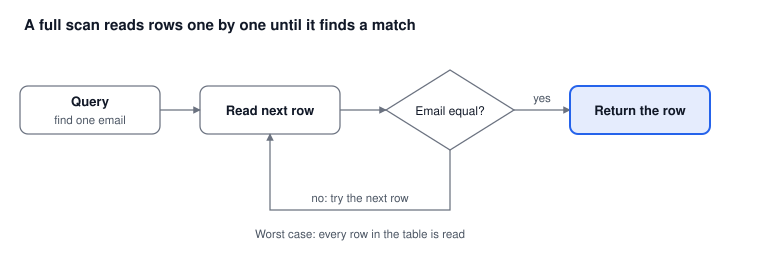
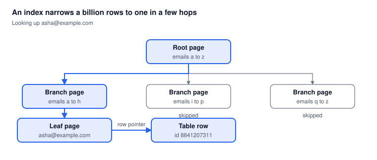

# Part 1: Why Searching Billions of Rows by Email Is Hard

*Oct 15, 2026 · Part 1 of 8 · [Series outline](series-outline.md)*

Without an index, finding one email means reading every row, so the time grows with the table; with an index, a billion rows needs only about 30 steps.

## The scenario

We have a `customers` table with billions of rows, and one question to answer fast: which customer owns this email?

| Column | Type | Example |
| --- | --- | --- |
| id | bigint | 8841207311 |
| name | text | Rajneesh Gupta |
| email | text | rajneesh@example.com |
| phone | text | +91 98xxxxxx10 |
| city | text | Delhi |

The query we want to be fast:

```sql
SELECT * FROM customers WHERE email = 'asha@example.com';
```

This is an **exact-match lookup**: we know the full email and want one row (or none). It is the simplest and most common search, and it is the focus of this series. Partial search such as "all emails ending in `@gmail.com`" is a different problem, covered in Part 5.

## How a full scan works

With no index, the database has no shortcut: it opens the table and compares each row's email to the one you asked for.



Three things make this painful at scale: the work grows with every row added, the disk must read the whole table (even rows you do not need), and many users running the same query at once multiply the load.

## How an index changes it

An index keeps emails in sorted order in a tree, so each step rules out a large share of the table and the database reaches the right row in a few hops.

Think of the index at the back of a book: you do not read every page to find a word, you look it up alphabetically and jump to the page number. In a database, that page number is the *row pointer*.



The database starts at the root, follows the branch whose range contains the email, reaches the leaf that stores it, and follows the row pointer to the table row. Only the highlighted pages are read; the other branches are never touched.

## The numbers

Growing the table 10,000 times makes a full scan 10,000 times slower, but adds only about 14 steps to an index lookup.

| Table size | Full scan: rows read (worst case) | Index lookup: steps (about log2 of rows) | Scan time at an assumed 1 million rows/second |
| --- | --- | --- | --- |
| 1 million | 1,000,000 | \~20 | \~1 second |
| 1 billion | 1,000,000,000 | \~30 | \~17 minutes |
| 10 billion | 10,000,000,000 | \~34 | \~2.8 hours |

The time column is an illustration, not a benchmark: real speed depends on hardware, caching and row size. The pattern is what matters.

**Why "about log2"?** Each step of a sorted search throws away half of the remaining rows. Real B-Tree indexes are wider than a binary tree, so they need even fewer levels (usually 4 to 5 for billions of rows), but each level can mean a disk read.

**The catch.** An index is extra data that must be stored and updated on every insert. It trades disk space and write speed for read speed, which is why the later parts of this series compare *where* to keep that structure.

## Try it yourself

You can see the difference on a laptop with PostgreSQL in about five minutes, using a few million rows instead of billions.

1. Create a table and fill it with test data:

```sql
CREATE TABLE customers (id bigserial PRIMARY KEY, name text, email text);

INSERT INTO customers (name, email)
SELECT 'User ' || g, 'user' || g || '@example.com'
FROM generate_series(1, 5000000) AS g;
```

2. Run the query with no index and look at the plan:

```sql
EXPLAIN ANALYZE SELECT * FROM customers WHERE email = 'user4999999@example.com';
```

You should see `Seq Scan` (a full scan) and a run time that is noticeable.

3. Add an index and repeat:

```sql
CREATE INDEX idx_customers_email ON customers (email);
EXPLAIN ANALYZE SELECT * FROM customers WHERE email = 'user4999999@example.com';
```

Now you should see `Index Scan` and a run time of a fraction of a millisecond to a few milliseconds.

The exact timings depend on your machine; what to compare is the plan type and the before-and-after difference.

## Common mistakes and what comes next

Most slow email lookups come from four avoidable mistakes:

1. **No index on `email` at all**, so every query is a full scan.
2. **Mismatched case or spaces**: `Asha@Example.com` and `asha@example.com` are different strings unless you normalise (trim and lower-case) on write and on search.
3. **Wrapping the column in a function**, such as `WHERE lower(email) = ...` with an index only on `email`. The index is skipped unless it was built on `lower(email)`.
4. **Using `SELECT *`** when you only need one or two columns, which forces extra reads.

**What comes next in the series:**

| Part | Topic | Question it answers |
| --- | --- | --- |
| 2 | B-Tree index in SQL | Is one well-indexed server enough? |
| 3 | Partitioning and sharding | What if one server is too small? |
| 4 | Key-value / NoSQL stores | Can the database route the lookup for me? |
| 5 | Search engines | What about partial and fuzzy search? |
| 6 | Cache and Bloom filter | How do I skip the database for repeats and misses? |
| 7 | Protecting email data | How do I search without storing plain emails? |
| 8 | Comparison and decision guide | Which option should I choose? |
