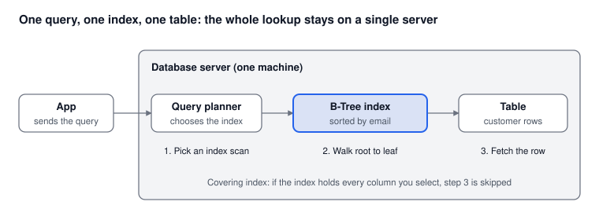

# Part 2: B-Tree Index in a Relational Database

*Oct 15, 2026 · Part 2 of 8 · [Series outline](series-outline.md) · [Previous: Part 1](part-1-why-searching-billions-of-rows-is-hard.md) · [Next: Part 3](part-3-partitioning-and-sharding.md)*

A B-Tree index on `email` is the simplest fix: one SQL statement, no new system, and each lookup touches only a handful of pages even at a billion rows.

## What a B-Tree index is

A B-Tree index is a sorted, tree-shaped copy of one column (here `email`) that points back to the table rows. Each page of the tree holds hundreds of keys, so the tree stays shallow: typically 4 to 5 levels is enough for billions of rows. The database reads one page per level, so a lookup costs a handful of page reads instead of a scan of the whole table.



## Step by step (PostgreSQL)

**1. Decide your case rule.** `Asha@Example.com` and `asha@example.com` are different strings. The cleanest fix is to lower-case and trim the email before you store it and before you search. If you cannot change the stored data, index `lower(email)` instead (step 2b).

**2a. Create the index without blocking writes.** On a large table, always use `CONCURRENTLY`, so inserts and updates keep working while the index builds:

```sql
CREATE UNIQUE INDEX CONCURRENTLY idx_customers_email
    ON customers (email);
```

A few things to know before you run it on a big table:

- It cannot run inside a transaction block.
- It takes much longer than a normal build, and it needs extra disk space while it runs.
- If it fails, it leaves an `INVALID` index behind. Drop it and try again.
- `UNIQUE` fails if duplicates already exist, so check for them first (`SELECT email, count(*) FROM customers GROUP BY email HAVING count(*) > 1;`).

**2b. Or index the lower-cased value** if you cannot normalise the stored data:

```sql
CREATE UNIQUE INDEX CONCURRENTLY idx_customers_email_lower
    ON customers (lower(email));

SELECT id, name FROM customers WHERE lower(email) = lower('Asha@Example.com');
```

The query must use the same expression as the index, otherwise the index is ignored.

**3. Check that the index is used:**

```sql
EXPLAIN (ANALYZE, BUFFERS)
SELECT id, name FROM customers WHERE email = 'asha@example.com';
```

You want to see `Index Scan` or `Index Only Scan`, a run time in milliseconds, and a small number of `Buffers`. `Seq Scan` means the index is not being used.

**4. Add a covering index for hot queries.** If a query only needs a few columns, store them inside the index so the database never visits the table:

```sql
CREATE INDEX CONCURRENTLY idx_customers_email_cover
    ON customers (email) INCLUDE (name, city);
```

This is the "step 3 is skipped" case in the diagram. The index gets bigger, so use it only for queries that run often.

**5. Keep it healthy.** Make sure autovacuum keeps up on a write-heavy table, rebuild bloated indexes with `REINDEX INDEX CONCURRENTLY`, and track the size of the index:

```sql
SELECT pg_size_pretty(pg_relation_size('idx_customers_email'));
```

## The MySQL (InnoDB) version

```sql
ALTER TABLE customers
    ADD UNIQUE INDEX idx_customers_email (email),
    ALGORITHM=INPLACE, LOCK=NONE;
```

Points specific to MySQL:

- Use `VARCHAR(254)` (or similar) for `email`, not `TEXT`, so the whole value can be indexed.
- The default collations in MySQL 8 (such as `utf8mb4_0900_ai_ci`) compare case-insensitively, so `Asha@x.com` and `asha@x.com` already match. Check the collation of your column.
- Every InnoDB secondary index also stores the primary key, so keep the primary key small (a `BIGINT`, not a long string).

## How big will the index get?

Often tens of GB per billion rows, depending on the length of the emails and how full the pages are. Measure your own with `pg_relation_size` (or `information_schema.TABLES` in MySQL) on a sample before you plan hardware. What matters most is whether the frequently used part of the index fits in RAM: once it does not, lookups turn into disk reads and slow down.

## Pros and cons

| Pros | Cons |
| --- | --- |
| Easiest option: one statement, no new system | One server holds the whole index, so you hit a single-machine ceiling |
| Works with the SQL and tools you already use | Index builds, vacuum and rebuilds get slow on very large tables |
| Also supports prefix and range queries (`email LIKE 'asha%'`) | Every insert and update also writes to the index, so heavy write loads slow down |
| Strong consistency and full transactions | Does not help with partial search (`LIKE '%asha%'`) |

## When to use it, and when to move on

**Use it when** the data fits on one well-sized server, you need exact (or prefix) email lookups, and you want the least change to your system.

**Move on to [Part 3](part-3-partitioning-and-sharding.md) when** the hot part of the index no longer fits in memory, index builds and maintenance take too long, or one server cannot handle the write volume.

## Common mistakes

1. **Wrapping the column in a function** without a matching index (`WHERE lower(email) = ...` with an index only on `email`).
2. **Leading wildcards**: `LIKE '%@gmail.com'` cannot use a B-Tree index (see Part 5).
3. **Stale statistics**: run `ANALYZE` after bulk loads so the planner picks the index.
4. **Too many indexes**: each one costs disk space and slows writes. Index what you query.
5. **Type mismatch**: comparing the column to a value of another type can silently disable the index. Check with `EXPLAIN`.

---

**Next:** [Part 3: Partitioning and sharding](part-3-partitioning-and-sharding.md), for when one server is not enough.
