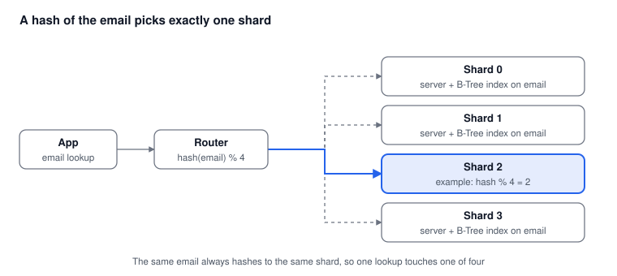

# Part 3: Partitioning and Sharding

*Oct 15, 2026 · Part 3 of 8 · [Series outline](series-outline.md) · [Previous: Part 2](part-2-btree-index.md) · [Next: Part 4](part-4-key-value-nosql.md)*

When one index is too big for one server, split the table into smaller pieces by a rule on the email, so each lookup touches only one small piece.

## Two flavours that are easy to confuse

| | Partitioning | Sharding |
| --- | --- | --- |
| Where the pieces live | On one database server | On many database servers |
| What it fixes | Index size and maintenance time | Index size, storage and throughput |
| Complexity | Low: built into PostgreSQL and MySQL | Higher: routing, rebalancing, per-shard backups |

You can combine them: shard across servers, and partition inside each shard.

## The routing rule

Take a hash of the email and use the remainder to pick a piece:

```text
piece = hash(email) % N
```

The same email always gives the same answer, so a lookup goes to exactly one piece, and that piece has its own small B-Tree index (Part 2).



Do not split by the first letter of the email. Some letters are far more common than others, so one piece becomes much bigger and busier than the rest (a *hotspot*). A hash spreads emails evenly.

## Step 1: Partitioning in PostgreSQL

Hash partitioning splits one logical table into several physical ones:

```sql
CREATE TABLE customers (
    id    bigint NOT NULL,
    email text   NOT NULL,
    name  text,
    PRIMARY KEY (email, id)
) PARTITION BY HASH (email);

CREATE TABLE customers_p0 PARTITION OF customers FOR VALUES WITH (MODULUS 4, REMAINDER 0);
CREATE TABLE customers_p1 PARTITION OF customers FOR VALUES WITH (MODULUS 4, REMAINDER 1);
CREATE TABLE customers_p2 PARTITION OF customers FOR VALUES WITH (MODULUS 4, REMAINDER 2);
CREATE TABLE customers_p3 PARTITION OF customers FOR VALUES WITH (MODULUS 4, REMAINDER 3);
```

Three things to notice:

- A primary key or unique constraint on a partitioned table must include the partition key, which is why the key is `(email, id)`.
- The primary key index is created inside every partition automatically.
- Choose more partitions than you need today (for example 32 or 64), because changing the number later is a data migration.

Check that the planner only reads one partition (*partition pruning*):

```sql
EXPLAIN SELECT * FROM customers WHERE email = 'asha@example.com';
```

The plan should mention only one `customers_pN` table.

## Step 2: Sharding across servers

You have two common routes.

**Route A: use a sharding layer.** For PostgreSQL, the Citus extension distributes a table across worker nodes:

```sql
CREATE EXTENSION citus;
SELECT create_distributed_table('customers', 'email');
```

For MySQL, Vitess plays a similar role. These tools do the routing, and can rebalance data when you add servers.

**Route B: route in your application.** Keep a stable hash function and a list of database connections:

```python
import hashlib

NUM_SHARDS = 4

def shard_for(email: str) -> int:
    key = email.strip().lower().encode()
    digest = hashlib.md5(key).digest()          # stable across processes and languages
    return int.from_bytes(digest[:8], "big") % NUM_SHARDS

def find_customer(email: str):
    conn = connections[shard_for(email)]        # one connection per shard
    return conn.query_one("SELECT * FROM customers WHERE email = %s", (email,))
```

Use a stable hash such as MD5 or xxHash here, not your language's built-in `hash()`: some languages (Python, for example) randomise it for every process, which would send the same email to different shards.

## Planning for growth

With `hash % N`, changing `N` changes the answer for most emails, so adding a server would move most of your data. Two common fixes:

1. **Many logical shards.** Start with, say, 1,024 logical shards and map them to physical servers in a small table. To add a server, move whole logical shards to it. No email changes its logical shard.
2. **Consistent hashing.** Servers sit on a ring, and adding one moves only a fraction of the keys. Many distributed databases do this for you (Part 4).

## Pros and cons

| Pros | Cons |
| --- | --- |
| Storage and traffic scale by adding servers | More moving parts: routing, rebalancing, backups per shard |
| Smaller indexes give faster lookups and maintenance | Queries by anything other than the shard key hit every shard |
| Keeps SQL and most of your tools | Cross-shard joins and transactions are hard or slow |
| A failure affects one shard, not everything | Changing the shard key later is a major migration |

## The "other field" problem

Your data is sharded by email, so a lookup by phone number has no idea which shard to ask. You have two options:

- **Fan out:** ask every shard and merge the answers. Simple, but slow and costly as shards grow.
- **Lookup table:** keep a small separate table `phone -> email` (itself sharded by phone), then do a second lookup by email. More work to keep in sync, but each lookup touches one shard.

Decide this before you choose the shard key.

## When to use it

**Use it when** you want to stay on SQL but one machine can no longer hold the index in memory or keep up with writes.

**Look at [Part 4](part-4-key-value-nosql.md) when** your lookups are almost all "by one key", and you would rather have the database handle the routing, replication and rebalancing for you.

## Common mistakes

1. Sharding by a value that is not used in most queries.
2. Using a hash that changes between processes or versions.
3. Too few partitions or logical shards at the start.
4. Forgetting that unique constraints (such as "one account per email") only work inside a shard unless the shard key is part of them. Using the email as the shard key makes this check easy.
5. Ignoring hotspots: watch the size and load of each shard, not only the average.

---

**Next:** [Part 4: Key-value and NoSQL stores](part-4-key-value-nosql.md), where the database does the sharding for you.
