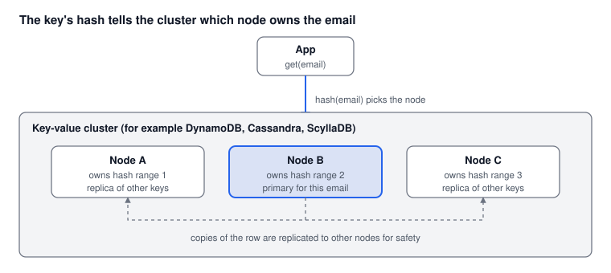

# Part 4: Key-Value and NoSQL Stores

*Oct 15, 2026 · Part 4 of 8 · [Series outline](series-outline.md) · [Previous: Part 3](part-3-partitioning-and-sharding.md) · [Next: Part 5](part-5-search-engines.md)*

In a distributed key-value store such as DynamoDB, Cassandra or ScyllaDB, the email is the partition key, so every lookup goes straight to the node that owns it, with no index search at all.

## How it works

A key-value store hashes the key you give it (the email), looks up which node owns that hash range, and reads the row from there. Sharding, replication and rebalancing are built in, so you do not write the routing code from Part 3 yourself. That is also the trade-off: the database is fast for the key it was designed around, and much weaker at everything else.



## Step by step

### 1. Design the table around the query

Start from the question "which row belongs to this email?". The answer is the key:

| Part | Choice |
| --- | --- |
| Partition key | normalised email (trimmed, lower-case) |
| Attributes | name, phone, city, and anything else on the record |

Emails have very high cardinality (nearly every row has a different one), which spreads data evenly across nodes. That is what you want from a partition key.

### 2. Create the table

**DynamoDB** (managed by AWS):

```bash
aws dynamodb create-table \
  --table-name customers \
  --attribute-definitions AttributeName=email,AttributeType=S \
  --key-schema AttributeName=email,KeyType=HASH \
  --billing-mode PAY_PER_REQUEST
```

**Cassandra / ScyllaDB** (open source, self-hosted or managed):

```sql
CREATE TABLE customers (
    email text PRIMARY KEY,
    name  text,
    phone text,
    city  text
);
```

### 3. Write and read by key

DynamoDB with Python (`boto3`):

```python
import boto3

table = boto3.resource("dynamodb").Table("customers")

table.put_item(Item={"email": "asha@example.com", "name": "Asha", "city": "Delhi"})

resp = table.get_item(Key={"email": "asha@example.com"})
customer = resp.get("Item")          # None if the email does not exist
```

Cassandra / ScyllaDB:

```sql
SELECT * FROM customers WHERE email = 'asha@example.com';
```

### 4. Pick a consistency level

Copies of each row live on several nodes, and you choose how many must agree:

- **DynamoDB:** reads are eventually consistent by default (cheaper and faster). Pass `ConsistentRead=True` on `get_item` when you must see the latest write, which costs more read capacity.
- **Cassandra / ScyllaDB:** choose a level per query, for example `LOCAL_QUORUM` (a majority of the replicas in the local data centre) as a common balance of safety and speed.

### 5. Add other lookups deliberately

You cannot filter efficiently on a field that is not part of the key. For each other lookup you need:

- **DynamoDB:** a Global Secondary Index (GSI), for example keyed by `phone`.
- **Cassandra / ScyllaDB:** a second table keyed by that field (usually preferred over a secondary index at large scale).

Each extra copy costs storage and write work, so add only the lookups you really need.

### 6. Migrate safely

Moving billions of rows from SQL is a project, so do it in stages:

1. Dual-write new changes to both stores.
2. Backfill the old data in batches.
3. Compare samples of reads from both until they match.
4. Switch reads to the new store, then stop writing to the old one.

## Pros and cons

| Pros | Cons |
| --- | --- |
| Typically single-digit-millisecond lookups by key at very large scale | Fast only for the key you designed for; ad-hoc queries are weak |
| Scaling out and replication are largely automatic | Limited joins and transactions compared with SQL |
| Managed services remove most of the operations work | A different way of modelling data, plus a migration |
| Handles very high read and write rates | Cost can grow quickly on managed services at high throughput |

## DynamoDB or Cassandra?

| | DynamoDB | Cassandra / ScyllaDB |
| --- | --- | --- |
| Who runs it | AWS (fully managed) | You, or a managed provider |
| Pricing model | Pay per request or provisioned capacity | Pay for the servers you run |
| Best fit | Teams already on AWS who want the least operations work | Teams that want control, multi-cloud or on-premises, and predictable server cost |

## When to use it

**Use it when** your hot path is "give me the record for this key", the data is very large, traffic is high, and your team is ready to leave a relational model for this data.

**Do not use it when** you need flexible queries, joins across many fields, or strict multi-row transactions. [Part 5](part-5-search-engines.md) covers flexible search.

## Common mistakes

1. Not normalising the email before using it as a key (`Asha@x.com` and `asha@x.com` become two items).
2. Reading with a scan or a filter instead of by key: that is a full table scan again, only slower and more expensive.
3. Adding many secondary indexes "just in case".
4. Choosing a partition key with few distinct values, which creates hot partitions.
5. Forgetting the item size limit (DynamoDB items can be at most 400 KB): store large documents elsewhere and keep a reference.

---

**Next:** [Part 5: Search engines](part-5-search-engines.md), for partial, domain and fuzzy email search.
