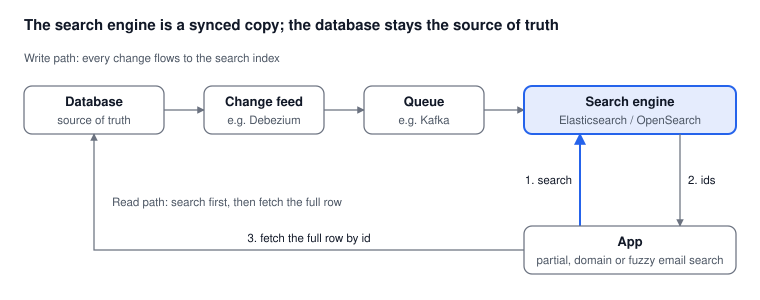

# Part 5: Search Engines (Elasticsearch / OpenSearch)

*Oct 15, 2026 · Part 5 of 8 · [Series outline](series-outline.md) · [Previous: Part 4](part-4-key-value-nosql.md) · [Next: Part 6](part-6-cache-and-bloom-filter.md)*

Choose a search engine when people need more than an exact match: part of an email, everything at a domain such as `@gmail.com`, typos, or email combined with other filters like city and date.

## How it works

A B-Tree answers "is this exact value here?". A search engine builds an **inverted index**: for each term (a word or a piece of text) it stores the list of documents that contain it. The index is split into shards spread over several nodes, and a query is run on all shards in parallel.

The most important design rule: **keep your main database as the source of truth, and treat the search engine as a read-optimised copy.** The copy can be rebuilt from the database at any time. Never make the search engine the only place where data lives.



## Step by step

### 1. Design the index (mapping)

Store the email once as an exact-match `keyword`, and add a `wildcard` sub-field for partial matches such as `*@gmail.com`:

```json
PUT /customers
{
  "mappings": {
    "properties": {
      "email": {
        "type": "keyword",
        "fields": { "partial": { "type": "wildcard" } }
      },
      "name": { "type": "text" },
      "city": { "type": "keyword" }
    }
  }
}
```

Keep the emails lower-cased in your database and index, so exact matches are simple and fast.

### 2. Load the data and keep it in sync

Load existing rows in batches with the bulk API:

```json
POST /_bulk
{ "index": { "_index": "customers", "_id": "8841207311" } }
{ "email": "asha@example.com", "name": "Asha", "city": "Delhi" }
```

After the first load, keep the index updated from the database's change log with a change-data-capture (CDC) tool such as Debezium and a queue such as Kafka, as in the diagram. Avoid writing to both the database and the search engine from application code: if one write fails, the two drift apart. Another safe pattern is the transactional outbox, where the app writes an event to the database in the same transaction as the data and a relay publishes it.

### 3. Query

**Exact match.** Use a `filter`, which skips relevance scoring and is the fastest form:

```json
GET /customers/_search
{
  "query": { "bool": { "filter": [ { "term": { "email": "asha@example.com" } } ] } }
}
```

**Domain or partial match** (using the `wildcard` sub-field):

```json
GET /customers/_search
{
  "query": { "wildcard": { "email.partial": { "value": "*@gmail.com" } } }
}
```

**Typo-tolerant match** (use sparingly on very large indexes, because it is the most expensive form):

```json
GET /customers/_search
{
  "query": { "fuzzy": { "email": { "value": "asha@exmple.com", "fuzziness": 2 } } }
}
```

### 4. Size it sensibly

Aim for shards of tens of GB, add replicas for availability and read capacity, and test with realistic data volume before you commit. Too many tiny shards waste memory, and a few huge shards slow recovery.

### 5. Fetch the full record from the database

The search returns ids. If you do not store everything in the index, fetch the full rows from the database by id (step 3 in the diagram). That keeps the index small and the database authoritative.

## Things to know

- **Near real time, not instant.** New documents become searchable after a refresh (every second by default), so a record you just saved may not show up for a moment. Do not use search for flows that must see the latest write.
- **It is a second system.** You need to run, monitor, upgrade and pay for another cluster.
- **Reindexing takes time.** If you change the mapping, you usually need to reindex. Plan for it with index aliases.
- **Personal data.** A search index holds copies of personal data and needs the same access control, encryption and retention rules as the database. Partial search also conflicts with hashing the email (Part 7), so decide early which you need.

## Pros and cons

| Pros | Cons |
| --- | --- |
| Exact, prefix, partial and fuzzy search in one place | A second system to run, monitor and pay for |
| Scales out across nodes; fast filtering and aggregations | Data is eventually consistent with the main database |
| Handles combined filters (email + city + date) | Partial-match fields use a lot of extra storage |
| Large ecosystem and managed offerings | Not a primary database; reindexing large data takes time |

## When to use it

**Use it when** the product needs search-box behaviour: partial input, domain lookups, typo tolerance, or filters across several fields.

**Skip it when** you only need exact match on email. A B-Tree index ([Part 2](part-2-btree-index.md)) or a key-value store ([Part 4](part-4-key-value-nosql.md)) is simpler, cheaper and strongly consistent.

## Common mistakes

1. Treating the search engine as the source of truth.
2. Writing to the database and the search engine separately from application code.
3. Using `wildcard` or `fuzzy` queries for plain exact lookups: use `term` in a filter.
4. Leaving dynamic mapping on, so the email field is analysed as free text and exact matches stop working.
5. Not planning for reindexing.

---

**Next:** [Part 6: Cache and Bloom filter](part-6-cache-and-bloom-filter.md), two cheap layers that take load off whichever store you chose.
