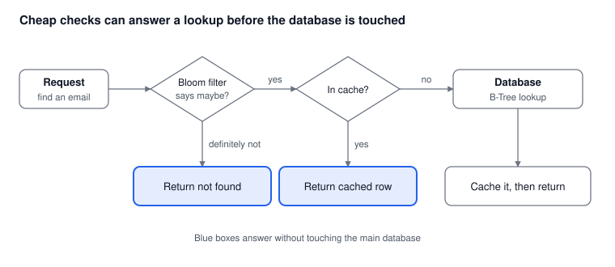

# Part 6: Speed Boosters: Cache and Bloom Filter

*Oct 15, 2026 · Part 6 of 8 · [Series outline](series-outline.md) · [Previous: Part 5](part-5-search-engines.md) · [Next: Part 7](part-7-protecting-email-pii.md)*

A cache and a Bloom filter do not replace the options in Parts 2 to 5; placed in front of them, they answer repeat lookups and "not found" lookups without touching the big database.



## Booster 1: a cache (Redis, Memcached)

A cache keeps recently used results in memory, so a repeated lookup never reaches the database.

**The pattern (cache-aside):**

1. Check the cache for the email.
2. On a **hit**, return it.
3. On a **miss**, read the database, store the result in the cache with a time to live (TTL), and return it.

**What to watch:**

- **Stale data.** When a record changes, update or delete its cache entry, and keep the TTL short enough that an occasional miss in invalidation is acceptable.
- **Key design.** Use a normalised key (`customer:` plus the trimmed, lower-cased email), or the same person will be cached twice.
- **Stampede.** If a popular entry expires, many requests may hit the database at once. Add a little random jitter to TTLs, and let only one request refill a key at a time.
- **Memory.** A cache holds only the hot part of the data. Set a memory limit and an eviction policy (for example least-recently-used).

## Booster 2: a Bloom filter

A Bloom filter is a tiny in-memory structure that answers one question: *is this email definitely not in the database?*

- If it says **no**, the answer is always right: the email does not exist, and you can return "not found" immediately.
- If it says **maybe**, the email might exist, or it might be a *false positive*. Go on to the cache and the database as usual.

It never gives a false "no", so it never hides a real record. It can only give a few unnecessary "maybe" answers, and you choose how few.

**Why it helps.** Lookups for emails that do not exist (typos, bots guessing addresses, "is this email taken?" sign-up checks) would otherwise each cost a full trip to the database, and a cache cannot help, because there is nothing to cache.

**Sizing.** At a 1% false-positive rate a Bloom filter needs about 10 bits per email, so roughly 1.2 GB per billion emails. A lower false-positive rate needs more memory. Size it up front for the number of emails you expect, because a plain Bloom filter cannot be shrunk, and a filter that is too full gives more false positives.

**With Redis**, Bloom filters are available through the RedisBloom module (included in Redis Stack):

```text
BF.RESERVE emails_bf 0.01 1000000000     # 1% false positives, room for 1 billion emails
BF.ADD     emails_bf asha@example.com    # run on every new sign-up
BF.EXISTS  emails_bf asha@example.com    # 0 = definitely not present, 1 = maybe present
```

**Limits to know:**

- You must **load every existing email** into the filter once, and add each new email as it is created.
- A Bloom filter **cannot delete** an entry. If deletions matter, use a cuckoo filter (also in RedisBloom), or rebuild the filter on a schedule.
- If almost every lookup is for an email that exists, a Bloom filter saves little. It pays off when many lookups are misses.

## Putting both in front of the database

```python
import json
import redis

r = redis.Redis()
TTL_SECONDS = 3600

def find_customer(email: str):
    email = email.strip().lower()
    key = f"customer:{email}"

    # 1. Bloom filter: is the email definitely not in the database?
    if not r.execute_command("BF.EXISTS", "emails_bf", email):
        return None

    # 2. Cache: have we looked this email up recently?
    cached = r.get(key)
    if cached is not None:
        return json.loads(cached)

    # 3. Database: the B-Tree lookup from Part 2 (or any option from Parts 3 to 5)
    row = db.query_one("SELECT id, name, city FROM customers WHERE email = %s", (email,))
    if row is not None:
        r.set(key, json.dumps(row), ex=TTL_SECONDS)
    return row
```

`db.query_one` stands for whichever database client you use.

## Cache vs Bloom filter

| | Cache | Bloom filter |
| --- | --- | --- |
| What it answers | The actual record | "Definitely not here" or "maybe here" |
| Helps most with | Repeated lookups of the same email | Lookups for emails that do not exist |
| Main risk | Stale data | False positives; cannot delete entries |
| Memory use | Grows with the number of cached records | Small and fixed by design |

## What to measure

Add them only when measurements show the main store is the bottleneck, and then track whether they pay off:

- **Cache hit ratio.** A low ratio means the cache is not helping, so check your keys, TTL and memory.
- **Share of lookups answered by the Bloom filter**, and its real false-positive rate.
- **Database load and p95/p99 latency** before and after.

## Common mistakes

1. Caching without a TTL or an invalidation plan.
2. Different key formats for the same email (case or whitespace).
3. Forgetting to add new emails to the Bloom filter, which turns real accounts into "not found". This is the one mistake that causes wrong answers, so test it.
4. Sizing the Bloom filter for today's data, then outgrowing it.
5. Treating the cache as the source of truth.

---

**Next:** [Part 7: Protecting email data](part-7-protecting-email-pii.md), for searching without keeping plain emails in the index.
