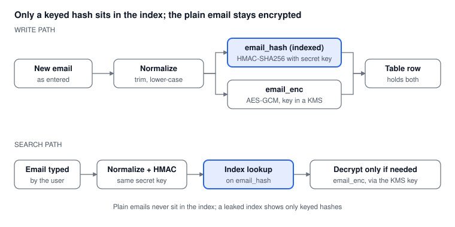

# Part 7: Protecting Email Data (Blind Index)

*Oct 15, 2026 · Part 7 of 8 · [Series outline](series-outline.md) · [Previous: Part 6](part-6-cache-and-bloom-filter.md) · [Next: Part 8](part-8-comparison-and-decision-guide.md)*

Email is personal data, so store it encrypted and search it through a keyed hash (a *blind index*), which gives you fast exact lookups without keeping plain emails in the index.

## The problem

Good encryption produces a different output every time you encrypt the same value, so you cannot index it or search it directly. And a plain hash such as SHA-256 is not safe on its own: there are only so many likely email addresses, so an attacker who steals the hashes can guess addresses and compare.

## The idea: a blind index

Keep two columns for each email:

| Column | Holds | Used for |
| --- | --- | --- |
| `email_enc` | the email, encrypted (for example AES-GCM) | showing or using the email when needed |
| `email_hash` | a keyed hash of the normalised email (HMAC-SHA256 with a secret key) | searching: this column carries the index |

The hash is "keyed": without the secret key, nobody can recompute it, so guessing common addresses does not work.



## Step by step

### 1. Create the columns and the index

```sql
CREATE TABLE customers (
    id          bigserial PRIMARY KEY,
    name        text,
    email_enc   bytea NOT NULL,
    email_hash  bytea NOT NULL
);

CREATE UNIQUE INDEX idx_customers_email_hash ON customers (email_hash);
```

The index is a normal B-Tree (Part 2). The same `email_hash` column can instead be the partition or shard key (Part 3) or the key in a key-value store (Part 4).

### 2. Compute the hash in your application

```python
import hashlib
import hmac

def blind_index(email: str, hmac_key: bytes) -> bytes:
    normalised = email.strip().lower()
    return hmac.new(hmac_key, normalised.encode("utf-8"), hashlib.sha256).digest()
```

Normalise exactly the same way on write and on search, or the hashes will not match.

### 3. Write: store the hash and the encrypted email

```python
email_hash = blind_index(email, hmac_key)
email_enc  = encrypt(email, data_key)       # AES-GCM, key from your KMS

db.execute(
    "INSERT INTO customers (name, email_enc, email_hash) VALUES (%s, %s, %s)",
    (name, email_enc, email_hash),
)
```

### 4. Search: hash the input, look it up, decrypt only if needed

```python
email_hash = blind_index(user_input, hmac_key)
row = db.query_one(
    "SELECT id, name, email_enc FROM customers WHERE email_hash = %s", (email_hash,)
)
# Decrypt row.email_enc only if the screen or API really needs the plain email.
```

### 5. Manage the keys properly

- Keep the HMAC key and the encryption key **separate**, and keep both in a key-management service (a cloud KMS or HashiCorp Vault), not in code or config files.
- Give only the services that need the keys access to them, and log that access.
- Plan for **rotation** from day one: store a key version next to each hash (for example `hash_key_version`). Changing the HMAC key means recomputing every hash, which needs the plain email, so it is a background job that decrypts, rehashes and rewrites each row.

## What you give up

- **Only exact match works.** A hash of `asha@example.com` tells you nothing about `asha@`. Partial, prefix and fuzzy search (Part 5) do not work on the hash column. If you need domain-level search, you can store a second keyed hash of just the domain part, but remember it groups many people under one value.
- **Equal emails have equal hashes.** Someone with access to the table can see which rows share an email and how often each value appears, even without the key. Unique-constraint checks work because of this property, but treat the column as sensitive anyway.
- **More moving parts.** Key management and rotation are real work.

## Pros and cons

| Pros | Cons |
| --- | --- |
| Fast exact lookups with no plain email in the index | No partial, prefix or range search on the hash |
| Limits the damage if the index, a backup or a replica leaks | Key management and rotation add work |
| Works with every database in this series | Identical emails give identical hashes, which reveals duplicates |
| Fits the unique-email rule (`UNIQUE` on `email_hash`) | The search index (Part 5) cannot offer partial match on protected data |

## Related protections (not a replacement)

- **Disk or database-level encryption** (transparent data encryption) protects stolen disks and backups, but the database still sees plain values at query time. A blind index protects the values even from someone who can read the table.
- **Access control and audit logging** decide who can read `email_enc` at all.
- **Retention and deletion:** if a person asks you to delete their data, you must be able to find and remove their row, and the blind index is how you find it.

## Compliance note

Laws such as the GDPR and India's Digital Personal Data Protection Act, 2023 expect reasonable security safeguards for personal data. A blind index is one technical measure toward that, not a guarantee of compliance. Check the details with your security and compliance teams.

## Common mistakes

1. Using a plain hash (SHA-256 without a key) instead of an HMAC.
2. Keeping the HMAC key in the same database or repository as the data.
3. Normalising differently on write and on search.
4. Using one key for both hashing and encryption.
5. Promising partial search on a column that only holds a hash.

---

**Next:** [Part 8: Comparison and decision guide](part-8-comparison-and-decision-guide.md), to choose and combine everything.
