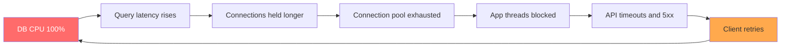
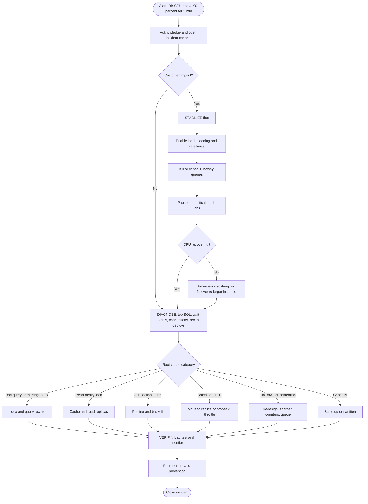
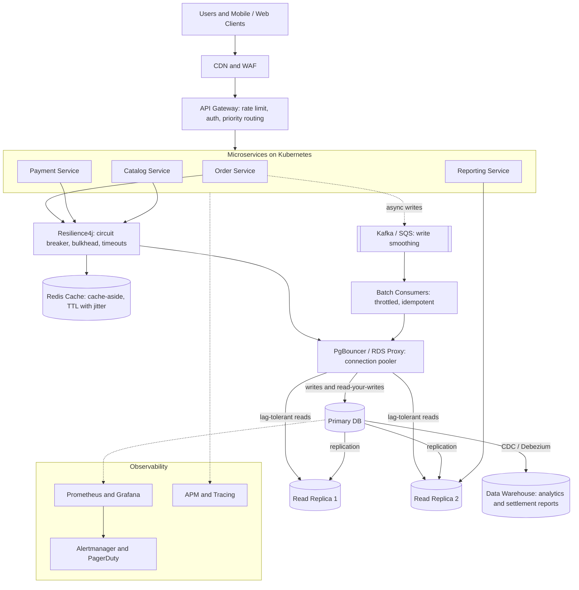
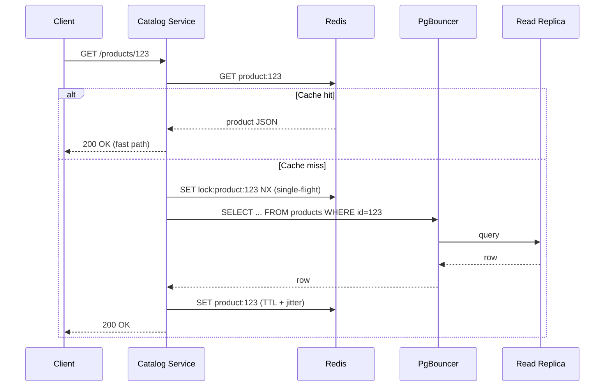
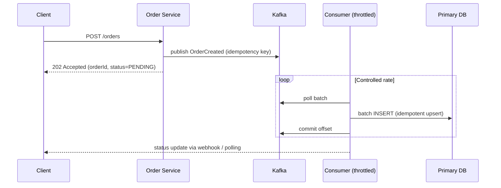

# Resolving 100% Database CPU in Production: An Enterprise Playbook

> **Audience:** Architects, SREs, backend engineers, engineering managers
> **Scope:** Relational databases (PostgreSQL / MySQL / Aurora / RDS), Java + Spring Boot microservices on Kubernetes (concepts apply to any stack)
> **Goal:** A one-stop reference covering the business problem, diagnosis, every viable solution with pros and cons, the selected decision, a step-by-step runbook, reference code, and prevention.

---

## Table of Contents

1. [Business Problem](#1-business-problem)
2. [Symptoms and Impact](#2-symptoms-and-impact)
3. [Why Database CPU Hits 100%: Root Cause Taxonomy](#3-why-database-cpu-hits-100-root-cause-taxonomy)
4. [Incident Response Flow](#4-incident-response-flow)
5. [Step 1: Stabilize and Diagnose (First 15 Minutes)](#5-step-1-stabilize-and-diagnose-first-15-minutes)
6. [Solution Options: Pros and Cons](#6-solution-options-pros-and-cons)
7. [Decision Matrix and Selected Decision (ADR)](#7-decision-matrix-and-selected-decision-adr)
8. [Target Architecture](#8-target-architecture)
9. [Step-by-Step Implementation Runbook](#9-step-by-step-implementation-runbook)
10. [Reference Code (Spring Boot / Java 21)](#10-reference-code-spring-boot--java-21)
11. [Observability and Alerting](#11-observability-and-alerting)
12. [Validation: Prove the Fix](#12-validation-prove-the-fix)
13. [Anti-Patterns and Pitfalls](#13-anti-patterns-and-pitfalls)
14. [Checklists and Post-Mortem Template](#14-checklists-and-post-mortem-template)

---

## 1. Business Problem

**Scenario:** An online order and payment platform processes ~2,000 transactions per second (TPS) at peak. During a flash sale (and again during the end-of-day settlement batch), the primary database CPU climbs to **100%**.

| Business Metric | Normal | During Incident |
|---|---|---|
| API p95 latency | 180 ms | 8,000+ ms |
| Checkout success rate | 99.5% | 71% |
| Timeouts / 5xx errors | < 0.1% | 18% |
| Settlement batch duration | 40 min | 4+ hours (SLA breach) |
| Estimated revenue impact | n/a | Significant, with lost carts, failed payments, support tickets |

**Why it matters to the business:**

- **Revenue loss:** every second of degraded checkout means abandoned carts.
- **SLA / regulatory risk:** delayed settlements and failed payments can breach partner or regulatory commitments.
- **Reputation:** customers see slow pages and failed payments.
- **Cascading failure:** a saturated database causes connection-pool exhaustion, thread starvation, retries, and a retry storm that makes it worse.

**Core question:** *How do we restore service quickly, find the true root cause, and re-architect so this class of incident cannot recur?*

---

## 2. Symptoms and Impact



This is a **positive feedback loop**. Retries add load to an already saturated database. Any solution must **break the loop** (shed load) and **remove the cause** (fix the workload).

---

## 3. Why Database CPU Hits 100%: Root Cause Taxonomy

CPU saturation is a *symptom*. Always classify the cause before choosing a fix.

| # | Category | Typical Cause | How to Recognize |
|---|---|---|---|
| 1 | **Inefficient queries** | Missing index, full table scans, non-sargable predicates (`WHERE DATE(col)=...`), `SELECT *`, big sorts/hash joins | A few queries dominate total execution time in `pg_stat_statements` |
| 2 | **N+1 query pattern** | ORM lazy loading fires 1 + N queries per request | Very high `calls` count with tiny per-call time |
| 3 | **Stale statistics / bad plans** | Outdated stats, plan regression after deploy, parameter sniffing | A query that was fast suddenly isn't; plan changed |
| 4 | **Connection storms** | No pooling, pool oversized, thundering herd after restart, retry storms | Hundreds or thousands of active connections, high context-switching |
| 5 | **Traffic spike** | Flash sale, marketing campaign, bot or scraper traffic | CPU tracks request rate; legitimate or illegitimate |
| 6 | **Heavy batch / reporting on OLTP** | Settlement, analytics, and exports running on the primary | CPU spikes at fixed times; long-running queries |
| 7 | **Lock contention / hot rows** | Many sessions updating the same row (counters, inventory) | High lock waits; CPU burned on spinning and retries |
| 8 | **Table / index bloat** | Dead tuples, no vacuum, huge unpartitioned tables | Slow scans, growing table size, autovacuum lag |
| 9 | **Excessive polling / chatty services** | Many services polling status every second | Same cheap query at very high frequency |
| 10 | **Undersized instance** | Genuine capacity ceiling after organic growth | CPU is high even with a well-tuned workload |

---

## 4. Incident Response Flow



---

## 5. Step 1: Stabilize and Diagnose (First 15 Minutes)

> **Rule:** *Stop the bleeding before performing surgery.* Mitigate first, then root-cause.

### 5.1 Immediate Stabilization Actions

| Action | Effect | Risk |
|---|---|---|
| Enable rate limiting / load shedding at API gateway | Reduces inbound load | Some legitimate requests rejected |
| Pause batch / reporting jobs | Frees CPU immediately | Delays business reports |
| Cancel the top runaway queries | Instant CPU relief | The query's work is lost; confirm it is safe |
| Disable retries or enable exponential backoff with jitter | Breaks the retry storm | None if done correctly |
| Scale the DB instance up (RDS/Aurora modify-instance) | More CPU headroom | Brief failover/downtime; cost |
| Serve degraded responses from cache | Cuts read load | Slightly stale data |

### 5.2 Diagnostic Queries: PostgreSQL

```sql
-- 1) What is running RIGHT NOW (longest first)?
SELECT pid,
       now() - query_start AS duration,
       state,
       wait_event_type,
       wait_event,
       usename,
       application_name,
       left(query, 200) AS query
FROM   pg_stat_activity
WHERE  state <> 'idle'
ORDER  BY duration DESC
LIMIT  20;

-- 2) Which queries consume the MOST total CPU time? (needs pg_stat_statements)
SELECT queryid,
       calls,
       round(total_exec_time::numeric, 2) AS total_ms,
       round(mean_exec_time::numeric, 2)  AS mean_ms,
       rows,
       left(query, 150)                   AS query
FROM   pg_stat_statements
ORDER  BY total_exec_time DESC
LIMIT  10;

-- 3) Connection count by state / app
SELECT application_name, state, count(*)
FROM   pg_stat_activity
GROUP  BY 1, 2
ORDER  BY 3 DESC;

-- 4) Tables with heavy sequential scans (index candidates)
SELECT relname, seq_scan, seq_tup_read, idx_scan,
       n_live_tup, n_dead_tup
FROM   pg_stat_user_tables
ORDER  BY seq_tup_read DESC
LIMIT  10;

-- 5) Cancel (gentle) or terminate (forceful) a runaway session
SELECT pg_cancel_backend(<pid>);     -- cancels the current query
SELECT pg_terminate_backend(<pid>);  -- kills the connection
```

### 5.3 Diagnostic Queries: MySQL / Aurora MySQL

```sql
-- Live sessions
SHOW FULL PROCESSLIST;

-- Top statements by total latency (sys schema)
SELECT query, exec_count, total_latency, avg_latency, rows_examined_avg
FROM   sys.statement_analysis
ORDER  BY total_latency DESC
LIMIT  10;

-- Statements doing full table scans
SELECT * FROM sys.statements_with_full_table_scans LIMIT 10;

-- Kill a runaway query
KILL QUERY <thread_id>;
```

### 5.4 Execution Plan Analysis

```sql
EXPLAIN (ANALYZE, BUFFERS, VERBOSE)
SELECT o.* FROM orders o
WHERE  o.customer_id = 42 AND o.status = 'PENDING'
ORDER  BY o.created_at DESC
LIMIT  50;
```

Look for: `Seq Scan` on large tables, large gaps between *estimated* and *actual* rows (stale stats), `Sort` spilling to disk, nested loops over large sets, and high `Buffers: shared read`.

### 5.5 Correlate with Change

Ask immediately: *What changed?* Check the last deployment, new feature flag, new index or dropped index, schema migration, traffic source (campaign or bot), cron or batch schedule, and failover or restart events.

---

## 6. Solution Options: Pros and Cons

Each option below is evaluated independently. In practice, **the best answer is a layered combination** (see [Section 7](#7-decision-matrix-and-selected-decision-adr)).

---

### Option A: Vertical Scaling (Scale Up the DB Instance)

**What:** Move to a larger instance class (more vCPUs and RAM).

| Pros | Cons |
|---|---|
| Fastest relief, with no code change | **Treats the symptom**, not the cause |
| Simple, low risk to the application | Expensive; cost grows linearly or worse |
| Good as an emergency measure | Has a hard ceiling (largest instance) |
| | May need a failover or brief downtime |
| | Inefficient queries just consume the new headroom |

**Verdict:** Use as a **tourniquet**, not a cure.

---

### Option B: Identify and Kill Runaway Queries

**What:** Cancel or terminate the sessions that dominate CPU.

| Pros | Cons |
|---|---|
| Immediate relief (seconds) | Does not prevent recurrence |
| Zero infrastructure change | Risk of killing a legitimate transaction (rollback cost) |
| Surfaces the offending query | Manual and reactive |

**Hardening:** Set guardrails so runaway queries are killed automatically (`statement_timeout`, `idle_in_transaction_session_timeout`, MySQL `max_execution_time`, Aurora/RDS parameter groups).

---

### Option C: Query Tuning and Indexing

**What:** Add or fix indexes, rewrite queries, remove `SELECT *`, fix non-sargable predicates, use keyset pagination, fix N+1, refresh statistics, and pin or fix bad plans.

| Pros | Cons |
|---|---|
| **Addresses the root cause** in the most common scenario | Requires skilled analysis and testing |
| Cheapest long-term; often 10x to 1000x gains | Indexes slow writes and consume storage |
| Permanent improvement | Index creation on large tables is slow and can lock (use `CONCURRENTLY`) |
| Benefits all downstream layers | Needs code changes and a release cycle |
| | Over-indexing is a risk |

**Verdict:** The single highest-ROI option; always required.

---

### Option D: Connection Pooling and Management

**What:** Use an application pool (HikariCP) *and* a database-side proxy pooler (PgBouncer, ProxySQL, RDS Proxy). Right-size pools, use backoff with jitter on retries.

| Pros | Cons |
|---|---|
| Removes connection-storm CPU overhead (context switching, auth, process-per-connection in PostgreSQL) | Adds a component (proxy) to operate |
| Protects the database from the thundering herd | Transaction-mode pooling limits some features (session variables, prepared statements, advisory locks) |
| Smooths load after restarts | Pool misconfiguration can itself cause starvation |
| Low cost and low risk | Does not fix slow queries |

**Rule of thumb:** a small pool (about `cores * 2 + effective_spindles`) usually outperforms a huge one.

---

### Option E: Caching (Redis / Caffeine / CDN)

**What:** Cache read-heavy, rarely changing data (product catalog, config, user profile, computed aggregates) with cache-aside, TTLs, and stampede protection.

| Pros | Cons |
|---|---|
| Removes entire classes of reads from the DB (often 60-90%) | **Cache invalidation is hard**; stale data risk |
| Sub-millisecond responses | New infrastructure and failure modes (cache outage, then DB stampede) |
| Scales horizontally and cheaply | Not applicable to write-heavy or highly personalized data |
| Reduces cost versus scaling the DB | Needs a consistency strategy per data type |

**Mandatory safeguards:** TTL jitter, request coalescing (single-flight), negative caching, and a circuit breaker so a cache outage does not stampede the database.

---

### Option F: Read Replicas and Read/Write Splitting

**What:** Send reads (reports, search, listings) to one or more replicas; keep writes on the primary.

| Pros | Cons |
|---|---|
| Offloads read CPU from the primary | **Replication lag** causes stale reads (read-your-writes issues) |
| Horizontal read scaling | Application routing complexity |
| Isolates reporting and batch from OLTP | Does not help write-heavy saturation |
| Replicas double as HA/failover targets | Additional cost per replica |

**Mitigation:** Route "read-your-own-writes" paths to the primary; monitor replica lag; use replicas only for lag-tolerant queries.

---

### Option G: Load Shedding, Rate Limiting, Circuit Breakers, Bulkheads

**What:** Protect the database by limiting concurrency and failing fast: API gateway rate limits, Resilience4j `RateLimiter`/`Bulkhead`/`CircuitBreaker`, priority queues (protect checkout over browsing), and graceful degradation.

| Pros | Cons |
|---|---|
| **Breaks the failure feedback loop** | Some requests are rejected or degraded by design |
| Keeps the critical path alive during overload | Requires careful priority and limit tuning |
| Cheap, fast to implement | Needs product agreement on what to degrade |
| Prevents cascading failure | Does not remove the underlying cause |

---

### Option H: Asynchronous Processing and Write Smoothing (Queue / Event-Driven)

**What:** Decouple spiky writes using Kafka/SQS: accept the request, enqueue, and let consumers write to the DB at a controlled rate. Batch inserts and use idempotent consumers.

| Pros | Cons |
|---|---|
| Flattens traffic spikes into steady throughput | **Eventual consistency**; the user gets "accepted", not "completed" |
| Enables batching (fewer, bigger writes) | More moving parts; need idempotency, ordering, and DLQ handling |
| Isolates user-facing latency from DB speed | UX and product changes needed |
| Natural back-pressure | Debugging and tracing are harder |

---

### Option I: Move Heavy Batch / Analytics Off the OLTP Primary

**What:** Run settlement reports and analytics on a replica, a data warehouse (Redshift/BigQuery/Snowflake), or via CDC (Debezium) to an analytical store; schedule batches off-peak; process in chunks with throttling.

| Pros | Cons |
|---|---|
| Removes the biggest "unfair" CPU consumers from OLTP | Data freshness delay (CDC lag) |
| Better tools for analytics workloads | Extra infrastructure and cost |
| Predictable OLTP performance | ETL/CDC pipeline to maintain |

---

### Option J: Partitioning and Data Archival

**What:** Partition large tables (by date/tenant), archive or purge cold data, and keep hot data small.

| Pros | Cons |
|---|---|
| Smaller working set, so faster scans and index lookups | Migration effort and risk on large tables |
| Partition pruning dramatically reduces scanned data | Queries must include the partition key to benefit |
| Cheap maintenance (drop old partitions instantly) | Operational complexity |
| Improves vacuum and index maintenance | Unique constraints across partitions are restricted |

---

### Option K: Sharding / Distributed SQL / NoSQL Re-platforming

**What:** Horizontally split data across multiple database nodes (by tenant or customer ID) or migrate to a distributed database (CockroachDB, Vitess, Aurora Limitless, DynamoDB).

| Pros | Cons |
|---|---|
| Near-linear write and read scale-out | **Highest complexity and cost** |
| Removes the single-node ceiling | Cross-shard joins and transactions are hard |
| Fault isolation per shard | Re-sharding is painful; big application changes |
| | Long delivery timeline (months) |

**Verdict:** Only justified when A through J are exhausted and growth demands it.

---

### Option L: Hot-Row / Contention Redesign

**What:** For counters and inventory, use sharded counters, optimistic locking, `SELECT ... FOR UPDATE SKIP LOCKED` work queues, or move hot counters to Redis with periodic flush.

| Pros | Cons |
|---|---|
| Eliminates lock-driven CPU waste | Application and data model changes |
| Increases write concurrency | Eventual consistency for some counters |
| | Requires careful correctness testing |

---

## 7. Decision Matrix and Selected Decision (ADR)

### 7.1 Scoring Matrix

Scale: 1 (poor) to 5 (excellent). For *Cost* and *Risk*, higher means cheaper or safer.

| Option | Speed of Relief | Fixes Root Cause | Cost | Risk | Scalability | Effort | **Total** |
|---|:-:|:-:|:-:|:-:|:-:|:-:|:-:|
| A. Vertical scale-up | 5 | 1 | 2 | 4 | 2 | 5 | **19** |
| B. Kill runaway queries (+ guardrails) | 5 | 2 | 5 | 3 | 1 | 5 | **21** |
| C. Query tuning and indexing | 3 | 5 | 5 | 4 | 4 | 3 | **24** |
| D. Connection pooling | 4 | 3 | 5 | 4 | 3 | 4 | **23** |
| E. Caching | 3 | 3 | 4 | 3 | 5 | 3 | **21** |
| F. Read replicas | 3 | 3 | 3 | 3 | 4 | 3 | **19** |
| G. Load shedding / circuit breakers | 5 | 2 | 5 | 4 | 3 | 4 | **23** |
| H. Async / queue write smoothing | 2 | 3 | 3 | 2 | 5 | 2 | **17** |
| I. Move batch/analytics off OLTP | 3 | 4 | 3 | 4 | 4 | 3 | **21** |
| J. Partitioning and archival | 2 | 4 | 4 | 3 | 4 | 2 | **19** |
| K. Sharding / re-platform | 1 | 4 | 1 | 1 | 5 | 1 | **13** |
| L. Hot-row redesign | 2 | 4 | 4 | 3 | 4 | 2 | **19** |

### 7.2 Key Insight

No single option wins. The winning strategy is **defense in depth**, applied in time-phased layers:

```mermaid
flowchart LR
    subgraph P0["Phase 0: Minutes (Stabilize)"]
        A1["Load shedding / rate limit - G"]
        A2["Kill runaway queries - B"]
        A3["Pause batch jobs - I"]
        A4["Emergency scale-up if needed - A"]
    end
    subgraph P1["Phase 1: Days (Fix Root Cause)"]
        B1["Indexing and query tuning - C"]
        B2["Fix N+1, keyset pagination - C"]
        B3["Pooling: HikariCP + PgBouncer - D"]
        B4["Timeouts and guardrails - B"]
    end
    subgraph P2["Phase 2: Weeks (Scale the Architecture)"]
        C1["Redis cache-aside - E"]
        C2["Read replicas and routing - F"]
        C3["Batch and reports to replica or DWH - I"]
        C4["Circuit breakers and bulkheads - G"]
    end
    subgraph P3["Phase 3: Quarter (Re-architect)"]
        D1["Partition and archive - J"]
        D2["Async write smoothing - H"]
        D3["Hot-row redesign - L"]
        D4["Sharding only if proven necessary - K"]
    end
    P0 --> P1 --> P2 --> P3
```



### 7.3 Architecture Decision Record (ADR-001)

| Field | Content |
|---|---|
| **Title** | Layered strategy to resolve and prevent 100% database CPU saturation |
| **Status** | Accepted |
| **Context** | Production DB CPU saturates at peak (flash sale, settlement), causing latency, timeouts, and a retry-storm feedback loop. Revenue and SLA are at risk. |
| **Decision** | Adopt a **four-phase layered approach**: (0) Stabilize with load shedding and query cancellation; (1) Fix root cause with indexing, query tuning, and connection pooling; (2) Scale reads using Redis caching and read replicas, and move batch/analytics off the primary; (3) Re-architect with partitioning, async write smoothing, and hot-row redesign. **Reject sharding for now.** |
| **Rationale** | Options C, D, G, and B give the highest ROI at lowest risk and cost. Scale-up (A) is used only as an emergency measure. Caching and replicas (E, F) address read amplification. Sharding (K) has the highest complexity and is premature before the cheaper options are exhausted. |
| **Consequences (+)** | Faster recovery, lower cost, resilience to spikes, and a permanent reduction in DB load. |
| **Consequences (-)** | Added components (Redis, PgBouncer, replicas); eventual-consistency trade-offs on cached and replica reads; discipline needed to maintain indexes and SLOs. |
| **Revisit when** | Sustained write load exceeds the single-primary ceiling after all optimizations, which would then trigger a sharding evaluation. |

---

## 8. Target Architecture



### Request Path Example: Read with Cache-Aside



### Write Path Example: Async Smoothing for Spikes



---

## 9. Step-by-Step Implementation Runbook

### Phase 0: Stabilize (T+0 to T+15 min)

| Step | Action | Owner | Done When |
|---|---|---|---|
| 0.1 | Declare incident, open war-room, assign Incident Commander | On-call | Channel active |
| 0.2 | Enable gateway rate limits and a "protect checkout" priority policy | Platform | 5xx rate falling |
| 0.3 | Pause settlement/report/export jobs | App team | Batch sessions gone from `pg_stat_activity` |
| 0.4 | Identify top 3 CPU queries (Section 5.2) and cancel confirmed runaways | DBA | CPU trending down |
| 0.5 | Disable aggressive client retries; enforce exponential backoff + jitter | App team | Request rate stabilizes |
| 0.6 | If CPU still above 90%, scale up instance (emergency) | DBA/Cloud | CPU below 70% |

### Phase 1: Fix the Root Cause (Day 1 to 3)

| Step | Action | Detail |
|---|---|---|
| 1.1 | Capture evidence | Export `pg_stat_statements`, plans (`EXPLAIN ANALYZE`), and metrics for the incident window |
| 1.2 | Rank offenders | By `total_exec_time` (aggregate cost), not just `mean_exec_time` |
| 1.3 | Fix indexing | `CREATE INDEX CONCURRENTLY` composite indexes matching `WHERE` + `ORDER BY`; verify with `EXPLAIN` |
| 1.4 | Rewrite queries | Remove `SELECT *`, make predicates sargable, replace `OFFSET` pagination with keyset, avoid functions on indexed columns |
| 1.5 | Fix N+1 | `@EntityGraph`, `JOIN FETCH`, batch fetching (`@BatchSize`), or DTO projections |
| 1.6 | Refresh stats | `ANALYZE` hot tables; check autovacuum health |
| 1.7 | Guardrails | `statement_timeout`, `idle_in_transaction_session_timeout`, `lock_timeout` |
| 1.8 | Pooling | Size HikariCP properly; introduce PgBouncer/RDS Proxy |
| 1.9 | Deploy + canary | Roll out gradually; compare CPU and latency before and after |

### Phase 2: Scale the Architecture (Week 1 to 4)

| Step | Action |
|---|---|
| 2.1 | Introduce Redis cache-aside for top read endpoints (catalog, config, profile) with TTL jitter and single-flight |
| 2.2 | Add read replicas; implement read/write routing; route reporting to a dedicated replica |
| 2.3 | Add Resilience4j circuit breakers, bulkheads, and timeouts around DB access |
| 2.4 | Re-schedule heavy batch jobs off-peak, chunked with throttling (e.g., 5,000 rows per chunk, pause between) |
| 2.5 | Stream CDC to a warehouse for analytics and settlement reporting |

### Phase 3: Re-Architect (Quarter)

| Step | Action |
|---|---|
| 3.1 | Partition large tables (e.g., `orders` by month); automate partition creation and archival |
| 3.2 | Introduce queue-based write smoothing for spiky write paths; guarantee idempotency |
| 3.3 | Redesign hot rows (inventory, counters) using sharded counters or Redis-backed buffering |
| 3.4 | Capacity model and load tests in CI; revisit sharding only if data shows it is necessary |

---

## 10. Reference Code (Spring Boot / Java 21)

### 10.1 Database Guardrails (PostgreSQL)

```sql
-- Apply at role/database level so every session inherits them
ALTER ROLE app_user SET statement_timeout = '5s';
ALTER ROLE app_user SET lock_timeout = '2s';
ALTER ROLE app_user SET idle_in_transaction_session_timeout = '10s';

-- Reporting role gets a longer timeout but is confined to the replica
ALTER ROLE report_user SET statement_timeout = '120s';
```

### 10.2 Safe Index Creation

```sql
-- Does not block writes; run outside a transaction
CREATE INDEX CONCURRENTLY idx_orders_customer_status_created
    ON orders (customer_id, status, created_at DESC);

ANALYZE orders;
```

### 10.3 Keyset Pagination (replace OFFSET)

```sql
-- Slow at depth: scans and discards 100000 rows
SELECT * FROM orders ORDER BY created_at DESC, id DESC OFFSET 100000 LIMIT 50;

-- Fast: seeks directly using the last-seen key
SELECT id, customer_id, status, created_at
FROM   orders
WHERE  (created_at, id) < (:lastCreatedAt, :lastId)
ORDER  BY created_at DESC, id DESC
LIMIT  50;
```

### 10.4 HikariCP Configuration (right-sized pool)

```yaml
spring:
  datasource:
    url: jdbc:postgresql://pgbouncer.internal:6432/appdb
    username: app_user
    hikari:
      maximum-pool-size: 20        # small and deliberate; not 200
      minimum-idle: 5
      connection-timeout: 2000     # fail fast (ms)
      idle-timeout: 300000
      max-lifetime: 1500000
      leak-detection-threshold: 20000
  jpa:
    open-in-view: false            # do not hold connections during view rendering
    properties:
      hibernate:
        jdbc.batch_size: 50
        order_inserts: true
        order_updates: true
        default_batch_fetch_size: 50   # mitigates N+1
```

### 10.5 Fixing N+1 with Entity Graph

```java
public interface OrderRepository extends JpaRepository<Order, Long> {

    // BAD: lazy items loaded one-by-one -> 1 + N queries
    List<Order> findByCustomerId(Long customerId);

    // GOOD: single query with join fetch
    @EntityGraph(attributePaths = {"items", "items.product"})
    List<Order> findWithItemsByCustomerId(Long customerId);

    // BEST for read models: DTO projection, fetch only what is needed
    @Query("""
           select new com.acme.dto.OrderSummary(o.id, o.status, o.total, o.createdAt)
           from Order o
           where o.customerId = :customerId
           order by o.createdAt desc
           """)
    List<OrderSummary> findSummaries(@Param("customerId") Long customerId, Pageable pageable);
}
```

### 10.6 Read/Write Routing

```java
public enum DbType { PRIMARY, REPLICA }

public class RoutingDataSource extends AbstractRoutingDataSource {
    @Override
    protected Object determineCurrentLookupKey() {
        return TransactionSynchronizationManager.isCurrentTransactionReadOnly()
                ? DbType.REPLICA
                : DbType.PRIMARY;
    }
}

@Configuration
class DataSourceConfig {

    @Bean
    DataSource routingDataSource(@Qualifier("primaryDs") DataSource primary,
                                 @Qualifier("replicaDs") DataSource replica) {
        var routing = new RoutingDataSource();
        routing.setTargetDataSources(Map.of(DbType.PRIMARY, primary, DbType.REPLICA, replica));
        routing.setDefaultTargetDataSource(primary);
        return new LazyConnectionDataSourceProxy(routing); // defers connection until first query
    }
}

@Service
class ProductService {

    @Transactional(readOnly = true)   // routed to REPLICA (lag-tolerant read)
    public ProductDto getProduct(Long id) { /* ... */ }

    @Transactional                    // routed to PRIMARY (write / read-your-writes)
    public void updateProduct(ProductDto dto) { /* ... */ }
}
```

### 10.7 Cache-Aside with TTL Jitter and Stampede Protection

```java
@Service
public class ProductCache {

    private final RedisTemplate<String, ProductDto> redis;
    private final ProductRepository repo;
    private final ConcurrentHashMap<Long, CompletableFuture<ProductDto>> inFlight = new ConcurrentHashMap<>();

    public ProductDto get(Long id) {
        String key = "product:" + id;
        ProductDto cached = redis.opsForValue().get(key);
        if (cached != null) return cached;

        // single-flight: only one loader per key per instance
        return inFlight.computeIfAbsent(id, k ->
            CompletableFuture.supplyAsync(() -> {
                ProductDto fresh = repo.findDtoById(k);
                long ttl = 300 + ThreadLocalRandom.current().nextInt(0, 60); // jitter avoids mass expiry
                redis.opsForValue().set(key, fresh, Duration.ofSeconds(ttl));
                return fresh;
            })
        ).whenComplete((v, t) -> inFlight.remove(id)).join();
    }

    public void evict(Long id) { redis.delete("product:" + id); } // invalidate on write
}
```

### 10.8 Resilience4j: Protect the Database

```yaml
resilience4j:
  bulkhead:
    instances:
      dbReports:
        max-concurrent-calls: 5        # reports can never starve checkout
        max-wait-duration: 0
      dbCheckout:
        max-concurrent-calls: 50
  circuitbreaker:
    instances:
      dbCircuit:
        sliding-window-size: 50
        failure-rate-threshold: 50
        slow-call-duration-threshold: 2s
        slow-call-rate-threshold: 60
        wait-duration-in-open-state: 15s
  ratelimiter:
    instances:
      expensiveSearch:
        limit-for-period: 100
        limit-refresh-period: 1s
        timeout-duration: 0
  retry:
    instances:
      dbRetry:
        max-attempts: 3
        wait-duration: 200ms
        enable-exponential-backoff: true
        exponential-backoff-multiplier: 2
        enable-randomized-wait: true    # jitter prevents synchronized retry storms
```

```java
@Service
class ReportService {

    @Bulkhead(name = "dbReports", fallbackMethod = "busy")
    @CircuitBreaker(name = "dbCircuit", fallbackMethod = "busy")
    @Transactional(readOnly = true)
    public Report generate(ReportRequest req) { /* runs on replica */ }

    Report busy(ReportRequest req, Throwable t) {
        throw new ResponseStatusException(HttpStatus.SERVICE_UNAVAILABLE,
                "Reports are temporarily limited. Please retry shortly.");
    }
}
```

### 10.9 Throttled Chunked Batch Processing

```java
@Scheduled(cron = "0 30 2 * * *")   // off-peak window
public void settle() throws InterruptedException {
    long lastId = 0;
    while (true) {
        List<Txn> chunk = repo.findPendingAfter(lastId, PageRequest.ofSize(5_000));
        if (chunk.isEmpty()) break;

        settlementService.settleBatch(chunk);   // one short transaction per chunk
        lastId = chunk.get(chunk.size() - 1).getId();

        Thread.sleep(200);                      // deliberate throttle: protect OLTP CPU
    }
}
```

### 10.10 Idempotent Queue Consumer (write smoothing)

```java
@KafkaListener(topics = "order-created", concurrency = "4")
public void consume(List<OrderEvent> batch) {
    jdbc.batchUpdate("""
        INSERT INTO orders (id, customer_id, total, status, created_at)
        VALUES (?, ?, ?, 'CONFIRMED', now())
        ON CONFLICT (id) DO NOTHING        -- idempotent: safe on redelivery
        """, batch, 500, (ps, e) -> {
            ps.setObject(1, e.orderId());
            ps.setLong(2, e.customerId());
            ps.setBigDecimal(3, e.total());
        });
}
```

### 10.11 Partitioning Example (PostgreSQL)

```sql
CREATE TABLE orders (
    id          BIGINT NOT NULL,
    customer_id BIGINT NOT NULL,
    status      TEXT   NOT NULL,
    created_at  TIMESTAMPTZ NOT NULL,
    PRIMARY KEY (id, created_at)
) PARTITION BY RANGE (created_at);

CREATE TABLE orders_2026_10 PARTITION OF orders
    FOR VALUES FROM ('2026-10-01') TO ('2026-11-01');

-- Archival is a metadata operation, not a giant DELETE
ALTER TABLE orders DETACH PARTITION orders_2025_10;
```

---

## 11. Observability and Alerting

### 11.1 Golden Signals for the Database

| Signal | Metric | Warning | Critical |
|---|---|---|---|
| Saturation | CPU utilization | > 70% for 10 min | > 85% for 5 min |
| Saturation | Active connections / max | > 70% | > 90% |
| Latency | Query p95 / p99 | 2x baseline | 5x baseline |
| Traffic | TPS / QPS | Anomalous vs. baseline | Sustained spike |
| Errors | Timeouts, deadlocks, rollbacks | Rising | Sustained |
| Replication | Replica lag | > 5 s | > 30 s |
| Health | Autovacuum lag, dead tuples, table bloat | Growing | Critical |
| Pool (app) | Hikari pending threads, acquire time | > 0 sustained | Timeouts |
| Cache | Hit ratio | < 85% | < 60% |

### 11.2 Prometheus Alert Rules (example)

```yaml
groups:
- name: database-saturation
  rules:
  - alert: DbCpuHigh
    expr: avg_over_time(aws_rds_cpuutilization_average{dbinstance_identifier="prod-primary"}[5m]) > 85
    for: 5m
    labels: { severity: critical }
    annotations:
      summary: "Primary DB CPU above 85% for 5 minutes"
      runbook: "https://github.com/<org>/<repo>/blob/main/db-cpu-100-percent-playbook.md"

  - alert: DbConnectionsNearLimit
    expr: pg_stat_activity_count / pg_settings_max_connections > 0.9
    for: 3m
    labels: { severity: warning }

  - alert: HikariPoolExhausted
    expr: hikaricp_connections_pending > 0
    for: 2m
    labels: { severity: warning }

  - alert: ReplicaLagHigh
    expr: pg_replication_lag_seconds > 30
    for: 5m
    labels: { severity: warning }
```

### 11.3 Continuous Query Governance

- Enable `pg_stat_statements` (or Performance Insights / Query Insights) permanently.
- Weekly review of the top 10 queries by total time.
- Slow-query log with a threshold (e.g., 500 ms) shipped to your log platform.
- Add a query-plan regression check to CI for critical queries.

---

## 12. Validation: Prove the Fix

| Test | Method | Pass Criteria |
|---|---|---|
| Before/after benchmark | Replay the incident-window traffic profile (k6/Gatling/JMeter) | CPU below 60% at 1.5x peak |
| Spike test | Ramp 5x traffic in 60 s | No cascading failure; graceful degradation |
| Soak test | 4-hour steady peak load | No leaks, stable p99, no vacuum lag |
| Failure injection | Kill the cache, lag a replica, restart the pooler | Circuit breakers open; the DB is not stampeded |
| Batch test | Run settlement at peak | OLTP p95 unaffected; batch completes inside its window |
| Plan regression | Compare `EXPLAIN` before/after | No new sequential scans on hot tables |

**Success KPIs:** p95 latency back to baseline; CPU peak under 65%; checkout success above 99.5%; settlement inside SLA; zero pages for DB CPU for 30 days.

---

## 13. Anti-Patterns and Pitfalls

| Anti-Pattern | Why It Fails | Do Instead |
|---|---|---|
| "Just scale up" every time | Costs grow; the cause remains | Scale up only as a tourniquet; fix queries |
| Huge connection pools (200+ per pod) | More concurrency means more contention and CPU | Small pools + pooler proxy |
| Unlimited retries without backoff | Retry storm amplifies the incident | Exponential backoff + jitter + circuit breaker |
| Adding indexes blindly | Slows writes, wastes storage | Index only what plans prove is needed |
| `OFFSET` pagination on deep pages | O(n) scan per request | Keyset pagination |
| Running reports on the primary | Steals CPU from checkout | Replica or warehouse |
| Cache without TTL jitter or single-flight | Mass expiry causes a DB stampede | Jitter, locking, circuit breaker |
| Killing sessions with no diagnosis | Problem returns in an hour | Capture evidence first |
| Changing many things at once | Cannot attribute the improvement | One change at a time, measured |
| Premature sharding | Massive complexity | Exhaust cheaper options first |
| Ignoring autovacuum / stats | Plan quality degrades silently | Monitor and tune |

---

## 14. Checklists and Post-Mortem Template

### 14.1 On-Call Quick Checklist

- [ ] Incident declared; commander assigned
- [ ] Rate limits / load shedding enabled
- [ ] Batch jobs paused
- [ ] Top CPU queries identified (`pg_stat_statements` / `sys.statement_analysis`)
- [ ] Runaway queries cancelled (evidence saved first)
- [ ] Retries throttled with backoff
- [ ] Recent deploys / config changes reviewed
- [ ] Emergency scale-up decision made
- [ ] Customer and stakeholder communication sent
- [ ] Root cause category identified (Section 3)

### 14.2 Prevention Checklist

- [ ] `pg_stat_statements` / Performance Insights enabled
- [ ] Timeouts configured (`statement_timeout`, `lock_timeout`, idle-in-transaction)
- [ ] Pool sizes reviewed; PgBouncer / RDS Proxy in place
- [ ] Read replicas and read/write routing in place
- [ ] Redis cache for top read endpoints
- [ ] Reporting and batch isolated from the OLTP primary
- [ ] Circuit breakers, bulkheads, rate limits configured
- [ ] Alerts and dashboards live; runbook linked from alerts
- [ ] Quarterly load test and game day
- [ ] Capacity plan reviewed against growth forecast

### 14.3 Post-Mortem Template

```markdown
# Incident Post-Mortem: DB CPU Saturation (<date>)

## Summary
One-paragraph description of what happened and the customer impact.

## Timeline (UTC)
| Time | Event |
|---|---|

## Impact
- Duration:
- Users / transactions affected:
- Revenue / SLA impact:

## Root Cause
(Category from Section 3 + the specific query, deploy, or traffic pattern)

## What Went Well / What Went Poorly / Where We Got Lucky

## Action Items
| # | Action | Owner | Priority | Due |
|---|---|---|---|---|

## Lessons Learned
```

---

## Summary

1. **Stabilize first** (rate-limit, pause batch, cancel runaway queries, break the retry storm).
2. **Diagnose with data** (top SQL by total time, wait events, plans, recent changes).
3. **Fix the root cause** (indexing, query rewrite, N+1 elimination, pooling).
4. **Scale smartly** (cache, read replicas, move batch/analytics off the primary, resilience patterns).
5. **Re-architect deliberately** (partition, async write smoothing, hot-row redesign); **shard only with proof**.
6. **Prevent recurrence** (observability, guardrails, load tests, runbooks, post-mortems).

> *Scaling the database is the last resort. Reducing the work the database has to do is the first.*

---

*License: MIT. Contributions welcome via pull request.*
