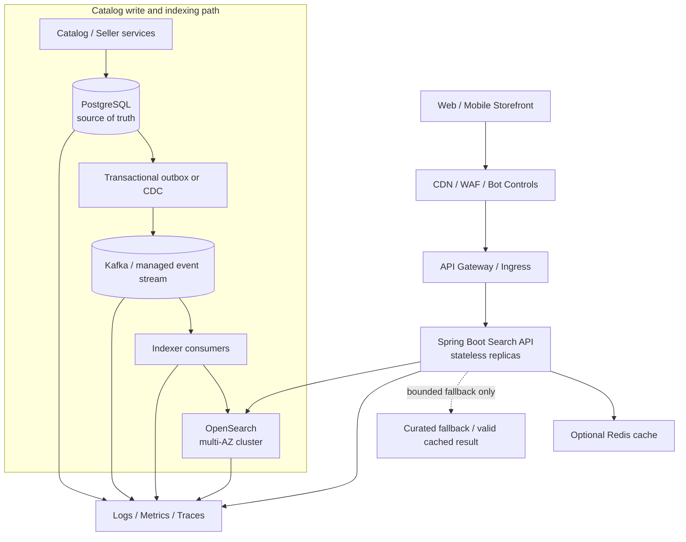
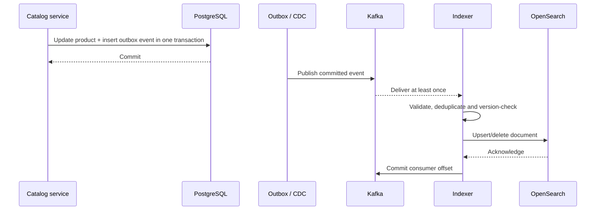
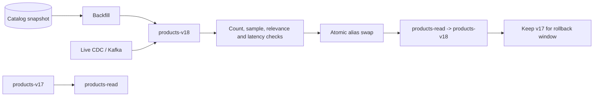
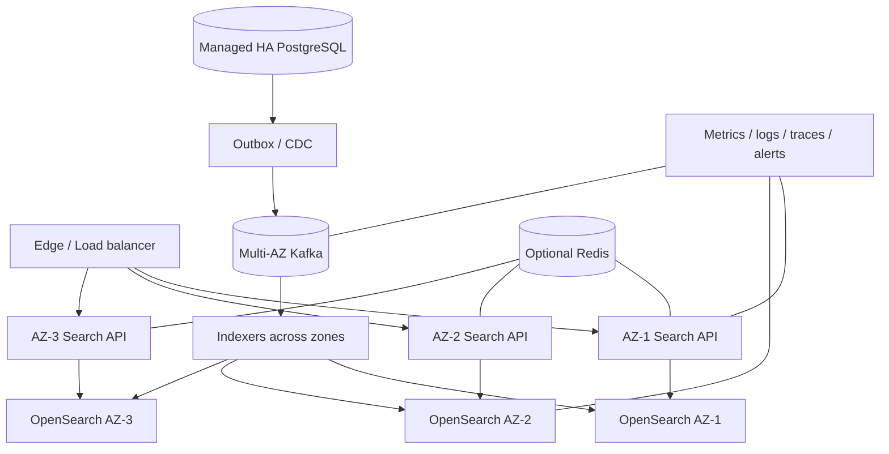

# Production-Grade E-commerce Product Search Architecture

## Scalable, maintainable design targeting 99.9% availability

**Reference stack:** Java 21, Spring Boot, OpenSearch, PostgreSQL,
Kafka/CDC, optional Redis/CDN, Kubernetes\
**Audience:** Solution Architects, Principal Engineers, backend/platform
teams\
**Updated:** October 2026

> This is an implementation-oriented reference architecture. A 99.9%
> availability target is not guaranteed by choosing these technologies;
> it must be validated through SLO measurement, capacity testing,
> failure drills, backups, and operational ownership.

## 1. Executive recommendation

Use **OpenSearch as a dedicated search read model** and keep the
relational catalog database as the source of truth.

-   **PostgreSQL** owns canonical product, seller, lifecycle and catalog
    data.
-   **OpenSearch** serves full-text relevance, filters, facets, sorting,
    autocomplete and cursor pagination.
-   **Transactional outbox + Kafka/CDC** propagates changes reliably and
    asynchronously.
-   **Spring Boot Search API** validates requests, applies business
    policy and builds bounded search queries.
-   **Redis/CDN** are optional performance accelerators, never required
    for correctness.
-   **Checkout** revalidates authoritative price, promotion eligibility,
    stock and seller/product status.
-   **Multi-AZ deployment, explicit timeouts, load shedding, monitoring,
    snapshots and runbooks** support the availability objective.

Principles: correctness first; search index is rebuildable; strict
API/query limits; deterministic sort order; controlled degradation;
observable freshness; start with a modular service and split only when
justified.

## 2. Business scope and SLOs

### User journeys

Keyword search, exact SKU/brand/category lookup, sorting, filtering,
facets, autocomplete, typo tolerance, category browsing, pagination,
product delisting, catalog/price/stock updates, multi-locale and
regional catalogs.

### Initial non-functional targets

These are starting targets to validate against real traffic and data:

  ------------------------------------------------------------------------
  Dimension                           Initial target Notes
  --------------------- ---------------------------- ---------------------
  Availability                         99.9% monthly About 43.8 minutes of
                                                     downtime per 30-day
                                                     month

  Search latency          p95 ≤ 250 ms, p99 ≤ 700 ms Measure separately
                                                     for simple and
                                                     facet-heavy queries

  Search freshness       p95 \< 5 sec, p99 \< 30 sec High-risk fields may
                                                     require stricter
                                                     controls

  Server error rate        \< 0.1% of valid requests Define exclusions
                                                     explicitly

  Recovery                          Explicit RTO/RPO Must be proven by
                                                     drills, not asserted
  ------------------------------------------------------------------------

Define an SLI at the API boundary: a "good" request is valid and returns
a schema-valid response within the latency threshold. Track 5xx, timeout
and slow responses as bad events. Exclude documented client 4xx errors
and caller cancellations. Track availability and latency separately.

## 3. High-level architecture



**Query path:** storefront → gateway → Search API → optional cache →
OpenSearch → stable response. The browser never accesses OpenSearch
directly.

**Update path:** product mutation and outbox event commit atomically in
the database. CDC/outbox publisher sends events to the stream.
Idempotent indexers update the search projection.

  -----------------------------------------------------------------------
  Component                           Responsibility
  ----------------------------------- -----------------------------------
  API gateway/WAF                     TLS, routing, edge rate limits, bot
                                      controls

  Search API                          Validation, auth/visibility, query
                                      policy, response shaping

  PostgreSQL                          Canonical catalog and lifecycle
                                      state

  OpenSearch                          Search-oriented projection and
                                      ranking

  Outbox/CDC + stream                 Durable change propagation and
                                      replay

  Indexer                             Transform, version-check, bulk
                                      upsert/delete, DLQ

  Redis/CDN                           Optional acceleration for reusable
                                      content

  Observability                       SLOs, traces, lag, saturation and
                                      alerting
  -----------------------------------------------------------------------

## 4. Public API contract

Example:

`GET /v1/products/search?q=wireless%20headphones&category=audio&brand=acme&minPrice=1000&maxPrice=15000&sort=price_asc&pageSize=24&cursor=...`

  -----------------------------------------------------------------------
  Parameter                           Validation
  ----------------------------------- -----------------------------------
  `q`                                 Trim/normalize, max length
                                      e.g. 128, reject control characters

  `category`, `brand`, `sellerId`     Resolve valid IDs and enforce
                                      visibility rules

  `minPrice`, `maxPrice`              Use currency-aware integer minor
                                      units; min ≤ max

  `minRating`                         Supported range and precision

  `inStock`                           Explicit boolean semantics

  `sort`                              Enum allow-list only

  `pageSize`                          Default 24, hard cap e.g. 100

  `cursor`                            Opaque, signed, expires, bound to
                                      query and authorization scope

  `locale`, `region`, `currency`      Must be supported and consistent
  -----------------------------------------------------------------------

Example response:

``` json
{
  "items": [{
    "id": "P-10023",
    "title": "Acme Wireless Headphones",
    "brand": "Acme",
    "price": {"amountMinor": 499900, "currency": "INR"},
    "availability": "IN_STOCK",
    "rating": 4.4,
    "thumbnailUrl": "https://cdn.example.com/products/P-10023.webp"
  }],
  "facets": {"brands": [{"id": "acme", "count": 42}]},
  "page": {"nextCursor": "opaque-signed-token", "hasMore": true},
  "meta": {"sort": "price_asc", "indexVersion": "products-v17", "tookMs": 31}
}
```

Use stable error codes such as `INVALID_SEARCH_REQUEST`,
`SEARCH_TEMPORARILY_UNAVAILABLE`, and `RATE_LIMITED`. Never return raw
engine errors, stack traces or internal index names.

### Sort semantics

  -----------------------------------------------------------------------
  Public sort             Primary sort            Tie-breaker
  ----------------------- ----------------------- -----------------------
  `relevance`             `_score` descending     `productId` ascending

  `price_asc` /           Effective price         `productId` ascending
  `price_desc`                                    

  `newest`                `publishedAt`           `productId` ascending
                          descending              

  `rating`                Rating descending       `productId` ascending

  `popularity`            Curated popularity      `productId` ascending
                          score descending        
  -----------------------------------------------------------------------

Define missing-value behavior. Tie-breakers are important for stable
pagination. Popularity should be a documented, bounded signal rather
than an opaque script.

### Price and inventory correctness

Use integer minor units and explicit currency. Never compare amounts
across currencies. Define whether sorting uses list price, current
selling price, region price, or segment-specific price. Search prices
and stock can be slightly stale; checkout must validate the actual
payable price, promotions, inventory, seller state and purchase
constraints.

## 5. Search document and mapping

Store a denormalized document optimized for search, not a mirror of
every database table.

``` json
{
  "productId": "P-10023",
  "tenantId": "default",
  "status": "ACTIVE",
  "title": "Acme Wireless Noise Cancelling Headphones",
  "description": "Over-ear wireless headphones...",
  "brandId": "acme",
  "brandName": "Acme",
  "categoryIds": ["electronics", "audio", "headphones"],
  "attributes": {"color": ["black"], "formFactor": ["over-ear"]},
  "skuTokens": ["ACM-10023"],
  "priceMinor": 499900,
  "currency": "INR",
  "region": "IN",
  "rating": 4.4,
  "reviewCount": 812,
  "popularityScore": 82.7,
  "publishedAt": "2026-09-20T10:15:00Z",
  "availability": "IN_STOCK",
  "documentVersion": 183
}
```

Mapping rules:

-   `text` for analyzed full-text fields; `keyword` for IDs, exact
    filters and facets.
-   Numeric/date types for range filters and sorting.
-   Explicit mappings and controlled templates; avoid unbounded dynamic
    fields.
-   Use stable product IDs as document IDs and monotonic versions to
    prevent stale events overwriting newer data.
-   Use nested fields only when object correlation semantics require
    them.
-   Version analyzer changes and build a new index for incompatible
    mapping/analyzer changes.

Illustrative OpenSearch mapping:

``` json
PUT products-v17
{
  "settings": {
    "number_of_shards": 3,
    "number_of_replicas": 1,
    "analysis": {
      "analyzer": {
        "product_text": {
          "type": "custom",
          "tokenizer": "standard",
          "filter": ["lowercase", "asciifolding"]
        }
      }
    }
  },
  "mappings": {
    "dynamic": "strict",
    "properties": {
      "productId": {"type": "keyword"},
      "tenantId": {"type": "keyword"},
      "status": {"type": "keyword"},
      "title": {
        "type": "text",
        "analyzer": "product_text",
        "fields": {"raw": {"type": "keyword", "ignore_above": 256}}
      },
      "description": {"type": "text", "analyzer": "product_text"},
      "brandId": {"type": "keyword"},
      "brandName": {"type": "text", "fields": {"raw": {"type": "keyword"}}},
      "categoryIds": {"type": "keyword"},
      "skuTokens": {"type": "keyword"},
      "priceMinor": {"type": "long"},
      "currency": {"type": "keyword"},
      "region": {"type": "keyword"},
      "rating": {"type": "scaled_float", "scaling_factor": 10},
      "reviewCount": {"type": "integer"},
      "popularityScore": {"type": "float"},
      "publishedAt": {"type": "date"},
      "availability": {"type": "keyword"},
      "documentVersion": {"type": "long"}
    }
  }
}
```

Shard count, replica count, refresh interval and node size are
workload-dependent examples, not production defaults. Benchmark catalog
size, document size, query mix, indexing rate, recovery and reindex
overlap. Reserve disk/CPU/memory headroom.

## 6. Query and relevance design

Request pipeline:

1.  Normalize and validate query.
2.  Apply tenant/channel/region and publication constraints.
3.  Boost exact SKU/ID matches.
4.  Search title, brand, category labels and description with
    field-specific weights.
5.  Apply filters separately from scoring.
6.  Apply controlled synonyms and typo tolerance.
7.  Apply bounded business boosts.
8.  Apply allow-listed sort, facets and cursor pagination.
9.  Emit latency, result count and zero-result metrics.

Illustrative query:

``` json
POST products-read/_search
{
  "size": 24,
  "track_total_hits": 10000,
  "_source": ["productId", "title", "brandName", "priceMinor", "currency",
              "rating", "reviewCount", "availability", "publishedAt"],
  "query": {
    "bool": {
      "filter": [
        {"term": {"status": "ACTIVE"}},
        {"term": {"region": "IN"}},
        {"term": {"currency": "INR"}},
        {"term": {"availability": "IN_STOCK"}},
        {"terms": {"categoryIds": ["audio"]}},
        {"range": {"priceMinor": {"gte": 100000, "lte": 1500000}}}
      ],
      "must": [{
        "multi_match": {
          "query": "wireless headphones",
          "type": "best_fields",
          "fields": ["title^5", "brandName^3", "description", "categoryText^2"],
          "operator": "and",
          "fuzziness": "AUTO"
        }
      }]
    }
  },
  "sort": [{"_score": "desc"}, {"productId": "asc"}],
  "aggs": {
    "brands": {"terms": {"field": "brandId", "size": 30}},
    "categories": {"terms": {"field": "categoryIds", "size": 30}}
  }
}
```

This is illustrative. Do not fuzzy-match every field on every request;
broad fuzzy, wildcard, regex, script, and high-cardinality aggregation
queries can amplify resource use. Apply query budgets and benchmark
representative worst cases.

Relevance practices: - Exact SKU/ID matches get controlled boosts. -
Maintain a labeled query/product evaluation set. - Measure CTR,
add-to-cart, conversion, zero-result and reformulation rates. - Use
synonyms only with evidence; version and test synonym sets. - Use
language-specific analyzers for supported locales. - Bound
popularity/freshness boosts so new products are not permanently
buried. - Keep paid placements distinct and auditable. - A/B test
ranking changes and maintain rollback.

Zero-result recovery: check exact identifiers, offer spelling
suggestions, apply configured synonyms, suggest removing a filter
transparently, or show clearly labeled alternatives. Never silently
rewrite a SKU.

## 7. Facets and filters

-   Exact filters use `keyword`; numeric/date filters use typed fields.
-   Define whether counts represent products, variants, or offers.
-   Document OR semantics within one facet and AND semantics across
    facets.
-   Decide whether selected zero-count facets remain visible.
-   Limit bucket counts and high-cardinality aggregations.
-   Use curated price bands or bounded range aggregations.
-   Avoid exact total-hit counting when the UI only needs `hasMore`.
-   Test whether facet counts reflect all filters or intentionally
    ignore the selected facet filter.

## 8. Pagination

Avoid deep `from`/`size` offsets. Prefer `search_after` plus Point in
Time (PIT) where supported:

-   Sort deterministically, including a unique tie-breaker.
-   Return an opaque, signed cursor with last sort values, PIT
    reference, expiry, query/index version and authorization scope.
-   Bind the cursor to normalized query, filters, sort, locale and
    tenant.
-   Enforce cursor expiry and maximum page size/page count.
-   Close PIT contexts and keep their lifetime conservative.
-   Do not expose engine internals.
-   If the UX requires arbitrary page jumps, agree on the trade-off;
    cursor pagination does not provide cheap random access.

## 9. Reliable data synchronization

### Outbox pattern

Avoid a database write followed by a separate Kafka publish without
recovery: the database may commit while publication fails.



Event fields should include `eventId`, `eventType`, `schemaVersion`,
`productId`, `aggregateVersion`, `occurredAt`, and tenant/context.
Prefer complete projection payloads or load the canonical current
document by ID; partial patches are harder to replay safely.

Indexer requirements: - Idempotent upsert/delete and monotonic version
checks. - Bounded batch size/concurrency and bulk API usage. - Handle
per-item bulk failures even when the HTTP request succeeds. -
Exponential backoff with jitter for transient errors; do not retry
permanent mapping failures forever. - DLQ for poison events, alerting
and controlled replay. - Schema validation, tombstone/delete handling,
lag monitoring and reconciliation. - Backpressure when OpenSearch is
overloaded.

### Freshness policy by field

  -----------------------------------------------------------------------
  Field                   Search projection       Final authority
                          policy                  
  ----------------------- ----------------------- -----------------------
  Title, description,     Eventual consistency    Catalog
  image                   generally acceptable    

  Category/brand          Eventual consistency    Catalog/taxonomy
                          with bounded lag        

  Display price           Short lag may be        Pricing/offer service
                          acceptable; checkout    
                          revalidates             

  Inventory               May be stale;           Inventory service
                          conservative            
                          availability policy     

  Delist/prohibited item  Prioritize rapid        Catalog/compliance
                          propagation; add        
                          fail-closed safeguard   
                          where needed            

  Seller suspension       Fast event and          Seller/compliance
                          visibility safeguard    
  -----------------------------------------------------------------------

For urgent delisting, consider a fast deny-list or authoritative
visibility check rather than relying only on eventual indexing. Avoid
making a slow authoritative service a mandatory synchronous dependency
for every search request unless its capacity and availability budget are
explicitly designed for that role.

### Versioned index and alias cutover



1.  Create the new index with versioned mapping/analyzers.
2.  Establish a consistent snapshot/watermark.
3.  Backfill and replay changes during the backfill.
4.  Wait for lag to meet the release threshold.
5.  Validate counts, samples, facets, relevance and latency.
6.  Run shadow queries/canary.
7.  Atomically swap the read alias.
8.  Monitor API and business metrics; retain the old index for rollback.

## 10. Availability design for 99.9%



Baseline guidance: - At least two API replicas; three across independent
zones is preferable. - Kubernetes topology spread/anti-affinity,
readiness/liveness probes, graceful shutdown and disruption budgets. -
OpenSearch replicas across zones and enough spare capacity to tolerate
node/AZ loss and recovery. - Managed database HA, backups and
point-in-time recovery. - Kafka replication and producer/consumer
durability settings aligned with required loss tolerance. - Separate
query and indexing capacity when supported and justified. - IaC, version
pinning, controlled rollout and tested rollback. - Follow the exact
cloud/provider and OpenSearch-version requirements for cluster-manager
quorum and node roles.

### Failure behavior

  -----------------------------------------------------------------------
  Failure                 Expected behavior       Guardrail
  ----------------------- ----------------------- -----------------------
  API pod lost            Remaining replicas      Health checks, replicas
                          serve traffic           

  AZ lost                 Remaining zones serve   Headroom and topology
                          at reduced capacity     spread

  OpenSearch slow/down    Timeout; safe           Deadlines, concurrency
                          cache/curated fallback  limits, circuit breaker
                          if valid; otherwise 503 

  Redis down              Bypass cache within     Cache is optional,
                          origin capacity         protect against
                                                  stampede

  Kafka down              Search serves last      Outbox retention and
                          indexed state; indexing lag alert
                          lag grows               

  Indexer down            Search continues on     Replay, DLQ and lag
                          last good index         alerts

  Bad index release       Revert alias            Versioned index and
                                                  rollback runbook

  Cache stampede          Coalesce requests or    TTL jitter and
                          briefly serve eligible  admission control
                          stale results           

  Region outage           Fail over only if       Replication, routing,
                          cross-region design was RTO/RPO drills
                          tested                  
  -----------------------------------------------------------------------

Multi-AZ is not multi-region. Do not claim cross-region failover without
tested data replication, routing, consistency, and operational
procedures.

### Timeouts and overload

-   Define an end-to-end deadline and smaller dependency timeouts.
-   Retry only transient failures and only within the remaining budget.
-   Avoid retries at every layer; retry amplification causes outages.
-   Use bounded concurrency, queues, bulkheads and load shedding.
-   Return `429` for caller-specific overload and controlled `503` for
    unavailable service.
-   Liveness should detect a stuck process, not restart every pod
    because a shared dependency is unavailable.
-   A fallback must preserve tenant, region, compliance and visibility
    constraints. Never use broad SQL wildcard scans as an emergency
    fallback.

## 11. Cache strategy

Cache only when measured reuse justifies it. Candidate content: popular
normalized searches, category landing pages, autocomplete, taxonomy and
static assets.

Example key:

`search:v1:{tenant}:{region}:{currency}:{locale}:{query}:{filtersHash}:{sort}:{pageSize}:{cursorHash}:{indexVersion}`

-   Include every response-affecting dimension; use canonical filter
    serialization.
-   Do not share personalized prices across users/segments.
-   Short TTLs (e.g. 15--60 seconds) are a starting point, not a rule;
    tune to freshness requirements.
-   Add TTL jitter, request coalescing and bounded
    stale-while-revalidate.
-   Cache invalidation for arbitrary query combinations is hard;
    index-versioned keys help cutovers.
-   Track hit rate, staleness, eviction and origin load.
-   Authorization and visibility checks must never be bypassed by a
    cache hit.

## 12. Autocomplete

-   Debounce keystrokes client-side and cancel superseded requests.
-   Use short deadlines and small result limits (e.g. 5--10).
-   Separate query suggestions from product suggestions.
-   Rank by popularity, availability, locale and approved policy
    signals.
-   Do not return unpublished or restricted products.
-   Rate-limit and monitor separately; autocomplete can generate more
    requests than submitted searches.
-   Apply privacy-aware retention and redaction to query analytics.

## 13. Java 21 / Spring Boot implementation

Suggested modular structure:

``` text
product-search/
  search-api/
    api/              # REST controllers and DTOs
    application/      # use cases and orchestration
    domain/           # sort policy and search semantics
    infrastructure/
      opensearch/
      cache/
      security/
      observability/
  search-indexer/
    consumer/
    transformation/
    indexing/
  catalog-contracts/
    events/
  deploy/
    kubernetes/
    terraform/
  docs/
    architecture.md
    runbooks/
```

A modular monolith is a good starting point for the Search API. Deploy
the indexer separately when independent scaling or fault isolation
justifies it.

Illustrative DTOs:

``` java
public enum ProductSort {
    RELEVANCE, PRICE_ASC, PRICE_DESC, NEWEST, RATING, POPULARITY
}

public record ProductSearchRequest(
    String query,
    List<String> categoryIds,
    List<String> brandIds,
    Long minPriceMinor,
    Long maxPriceMinor,
    Integer minRating,
    Boolean inStock,
    ProductSort sort,
    Integer pageSize,
    String cursor
) {}

public record Money(long amountMinor, String currency) {}

public record ProductSearchItem(
    String id, String title, String brand, Money price,
    String availability, Double rating, String thumbnailUrl
) {}

public record ProductSearchResponse(
    List<ProductSearchItem> items,
    Map<String, List<FacetBucket>> facets,
    String nextCursor,
    boolean hasMore,
    long tookMs
) {}

public record FacetBucket(String id, String label, long count) {}
```

Implementation rules: - Validate DTOs at the boundary and perform
cross-field validation. - Keep sort fields in enums/allow-lists; never
accept arbitrary field names or scripts. - Keep query building outside
controllers and test it independently. - Use the OpenSearch Java client
compatible with the selected server version. - Reuse configured clients
and set connection/request/socket timeouts. - Map engine failures to
stable application errors. - Propagate trace/correlation IDs; never log
secrets. - Use Spring Security/OAuth2 where needed, Bean Validation,
Micrometer and OpenTelemetry. - Add Kafka support for the indexer, Redis
only if justified, and Resilience4j or equivalent only for explicit
bounded resilience patterns. - Use Testcontainers in CI for integration
tests against a real supported OpenSearch version. An in-memory adapter
helps local development but cannot prove real query semantics. - Pin
versions and run compatibility/security checks.

## 14. Security and abuse resistance

-   Private OpenSearch endpoints; no browser or public admin access.
-   TLS, service authentication and least-privilege roles.
-   Enforce tenant, region, seller, status and compliance filters
    server-side.
-   WAF/bot controls, per-IP/user quotas, query length limits, page-size
    caps, filter-count limits and concurrency limits.
-   Restrict expensive wildcard, regex, script and fuzzy query patterns.
-   Use typed query builders rather than concatenating raw query DSL.
-   Redact credentials, tokens and sensitive query content from logs.
-   Define privacy-aware analytics retention and access.
-   Audit ranking overrides, synonym changes, index cutovers and reindex
    operations.
-   Scan images/dependencies and patch supported runtimes.
-   Treat anonymous product search as an abuse surface: scraping and
    expensive queries can exhaust capacity.

## 15. Observability and alerts

Instrument gateway → API → OpenSearch and database/outbox → Kafka →
indexer → OpenSearch.

**API:** QPS, p50/p95/p99, 4xx/5xx, timeout rate, rejected requests,
zero-result rate, cache hit rate, fallback rate, in-flight calls.

**OpenSearch:** health, unassigned shards, CPU, heap/memory pressure,
disk watermarks, query/fetch latency, rejected requests, queues,
merge/refresh time, recovery and snapshot status.

**Pipeline:** outbox backlog, oldest event age, Kafka consumer lag,
event-to-searchable latency, bulk failures/retries, DLQ size, schema
errors, reconciliation mismatches.

**Business:** CTR, add-to-cart, conversion, query reformulation,
zero-result searches, unavailable-product clicks, stale-price
complaints, experiment metrics.

Alert on SLO burn rate, sustained search timeouts/rejections,
disk/memory pressure, unassigned shards, lag beyond freshness budget,
DLQ growth, failed snapshots, cache failure with origin overload, and
sudden relevance/zero-result regression. Alerts need a runbook and clear
owner.

## 16. Capacity and performance planning

Do not guess node counts without: - Active products/variants and
average/p95 document size. - Update rate and bursts. -
Search/autocomplete QPS and peak-to-average ratio. - Query mix, facet
cardinality and concurrency. - Required latency/freshness, replica count
and growth rate. - Temporary capacity for recovery and reindexing.

Workflow: 1. Create representative catalog and query corpus. 2. Measure
document/index size and shard distribution. 3. Load test read and
indexing traffic together. 4. Test cold/warm cache, facets, broad
queries and worst-case filters. 5. Simulate node/AZ loss under peak
traffic. 6. Reindex while serving live-like traffic. 7. Record latency,
CPU, heap, disk I/O, rejections and freshness lag. 8. Set alerts with
headroom; repeat after mapping/analyzer/version/query changes.

Optimize `_source` fields, filter context, page size, bucket count,
exact-hit tracking and indexing batch/refresh behavior. Avoid leading
wildcard and unbounded scripts. Preserve disk capacity for merges,
replicas, recovery and blue/green reindex.

## 17. Disaster recovery

-   Database backups with point-in-time recovery and tested restores.
-   Kafka retention adequate for the agreed replay window.
-   OpenSearch snapshots to durable object storage.
-   Version-controlled templates, mappings, analyzers, synonyms,
    pipelines, dashboards and IaC.
-   Explicit RTO/RPO; measure them in drills.
-   Restore a snapshot or rebuild from a consistent source snapshot plus
    change replay.
-   Validate counts, sampled records, facets, relevance and latency
    before cutover.
-   Exercise total index loss, database failover, stream outage and
    region failure if multi-region is in scope.

The search index is rebuildable, but rebuild time and resource cost may
be substantial. Never claim an RTO until a full recovery drill proves
it.

## 18. Testing and release gates

**Unit tests:** validation, query normalization, sort allow-list,
tie-breakers, cursor binding/expiry, event transforms, version checks,
cache keys.

**Integration tests:** exact OpenSearch version, mappings/analyzers,
facet semantics, PIT/search_after, bulk partial failures,
duplicate/reordered events, DLQ replay, outbox restart, Redis outage.

**Resilience/performance:** peak and burst load, expensive queries,
node/AZ loss, Kafka outage/recovery, API pod termination, cache
stampede, live reindex, backup restore.

**Release gates:** mapping/query tests pass; relevance regression stays
within threshold; load test passes with headroom; indexing lag meets
budget; dashboards/rollback are ready; security and compatibility checks
pass.

## 19. Deployment and rollout

-   Infrastructure as code for network, search, database, stream, cache,
    access and alerting.
-   Immutable scanned images and externalized configuration/secrets.
-   Readiness, graceful shutdown, disruption budgets and zone spread.
-   Canary API release; compare latency, errors, result counts and
    business metrics.
-   Version mappings/analyzers separately from API code.
-   Alias-based index cutover and rollback.
-   Feature flags/A-B tests for ranking.
-   Backward-compatible contracts during mixed-version rollout.

## 20. Technology alternatives

  -----------------------------------------------------------------------
  Concern                 Default                 Alternatives
  ----------------------- ----------------------- -----------------------
  Search engine           OpenSearch              Elasticsearch, Solr,
                                                  managed search service

  Source of truth         Existing relational     MySQL or established
                          catalog,                transactional DB
                          e.g. PostgreSQL         

  Event path              Outbox + Kafka/CDC      Managed event bus or
                                                  simpler reliable outbox
                                                  publisher

  API                     Java 21 + Spring Boot   Existing organization
                                                  standard

  Cache                   Optional Redis          CDN/edge cache; no
                                                  cache if low reuse

  Runtime                 Kubernetes/managed      Managed app platform if
                          containers              it meets SLO

  Telemetry               OpenTelemetry +         Existing enterprise
                          Micrometer              platform
  -----------------------------------------------------------------------

Do not operate Kafka merely by default: choose the simplest event path
that provides required durability, replay and throughput. Add Redis only
when measurements justify it.

## 21. Delivery roadmap

**Phase 1 --- Reliable MVP** - Agree on data ownership, API contract,
visibility, currency and sort semantics. - Implement OpenSearch mapping,
keyword search, filters, facets, sorts and bounded pagination. - Build
Search API and outbox/CDC indexing. - Add idempotency, basic dashboards,
security and integration tests.

**Phase 2 --- Production hardening** - Define SLOs, deadlines, load
shedding and overload responses. - Add PIT/cursor pagination, DLQ,
reconciliation, alias cutover and rollback. - Test peak load, node/AZ
loss, stream outage and backup restore.

**Phase 3 --- Discovery quality** - Add autocomplete, synonyms, typo
handling and zero-result recovery. - Establish relevance dataset,
privacy-aware analytics and experiments. - Tune cache from measured
workload.

**Phase 4 --- Advanced scale** - Separate query/indexing capacity where
needed. - Add multi-region only if RTO/RPO requires it and the team can
operate it. - Add personalization, offer/variant search or
semantic/hybrid retrieval only when business metrics justify complexity.

## 22. Essential runbooks

1.  Search latency/error spike: inspect traffic, recent deploys,
    OpenSearch rejections, saturation and cache hit rate.
2.  Cluster yellow/red: inspect unassigned shards, node/zone health,
    disk and recovery backlog.
3.  Index freshness lag: inspect outbox age, Kafka lag, consumers, DLQ
    and bulk failures.
4.  Bad index release: pause writes if necessary, restore alias, verify
    query compatibility.
5.  Poison event: inspect schema/mapping, fix transform, replay in a
    controlled way.
6.  Cache outage: bypass safely, cap origin concurrency, monitor
    stampede.
7.  Price/availability mismatch: compare source and projection, check
    event lag and checkout validation.
8.  Reindex: verify snapshot/watermark, replay, validation, alias
    cutover and rollback.
9.  Disaster recovery: restore/rebuild, replay events, validate and
    record actual RTO/RPO.
10. Abuse event: apply rate limits, protect origin, inspect query
    patterns and follow incident response.

Each runbook needs an owner, dashboard links, version-appropriate
commands, rollback criteria and escalation path.

## 23. Architecture decision summary

**Decision:** OpenSearch read model; relational catalog source of truth;
outbox/CDC + event stream; stateless Spring Boot API.

**Benefits:** scalable search semantics, decoupled read/write workloads,
replayable index updates, safe index versioning, horizontal API scale.

**Costs:** eventual consistency, search infrastructure cost,
mapping/event versioning, reindex capacity, and complex personalized
pricing/cache semantics.

**Avoid:** SQL wildcard scans as primary search; search index as
price/stock authority; unprotected dual writes; arbitrary sort fields;
unbounded aggregations; cache-only availability; untested 99.9% claims.

## 24. Go-live checklist

-   [ ] API, sort, facet, currency and visibility semantics documented.
-   [ ] Request/query limits and authorization filters enforced.
-   [ ] Source of truth defined for every indexed field.
-   [ ] Outbox/CDC, version checks, idempotency, DLQ and reconciliation
    tested.
-   [ ] Versioned index and alias rollback exercised.
-   [ ] Multi-zone deployment and failure-domain spread verified.
-   [ ] Timeouts, retry budgets, bulkheads and load shedding tested.
-   [ ] Peak/burst tests pass with headroom; node/AZ loss tested.
-   [ ] SLO dashboards and paging alerts are live.
-   [ ] Search endpoints and admin surfaces secured; logs redacted.
-   [ ] Backup restore and recovery drills completed.
-   [ ] Relevance regression corpus and zero-result dashboard exist.
-   [ ] Runbooks have owners and escalation paths.

## 25. Official documentation

Check compatibility against the exact versions deployed:

-   OpenSearch: https://opensearch.org/docs/latest/
-   OpenSearch Java client:
    https://opensearch.org/docs/latest/clients/java/
-   OpenSearch search plugins:
    https://opensearch.org/docs/latest/search-plugins/
-   OpenSearch snapshots:
    https://opensearch.org/docs/latest/tuning-your-cluster/availability-and-recovery/snapshots/
-   Spring Boot: https://docs.spring.io/spring-boot/index.html
-   Spring for Apache Kafka:
    https://docs.spring.io/spring-kafka/reference/
-   PostgreSQL: https://www.postgresql.org/docs/
-   Apache Kafka: https://kafka.apache.org/documentation/
-   OpenTelemetry: https://opentelemetry.io/docs/
-   Kubernetes probes:
    https://kubernetes.io/docs/concepts/configuration/liveness-readiness-startup-probes/
-   Kubernetes topology spread:
    https://kubernetes.io/docs/concepts/scheduling-eviction/topology-spread-constraints/

## Final recommendation

For a typical established e-commerce catalog, start with **Java 21 +
Spring Boot Search API + OpenSearch + relational source of truth +
transactional outbox/CDC + Kafka or an appropriately simpler managed
event path + optional Redis/CDN + multi-zone deployment + end-to-end
observability**.

Keep the first release explicit and bounded. Prove the 99.9% target
through measured SLOs, representative load tests, multi-zone failure
tests, recovery drills and operational runbooks. Introduce
personalization, semantic search, multi-region active-active and
additional services only when validated business requirements justify
their cost and operational complexity.
