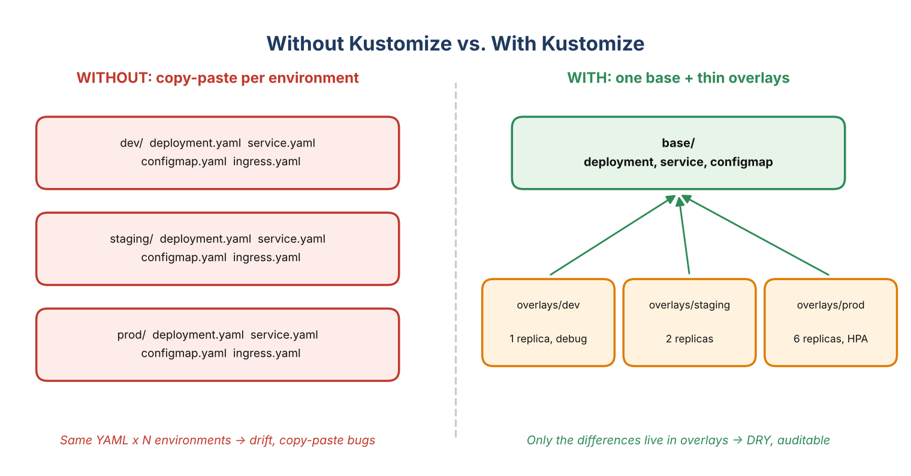
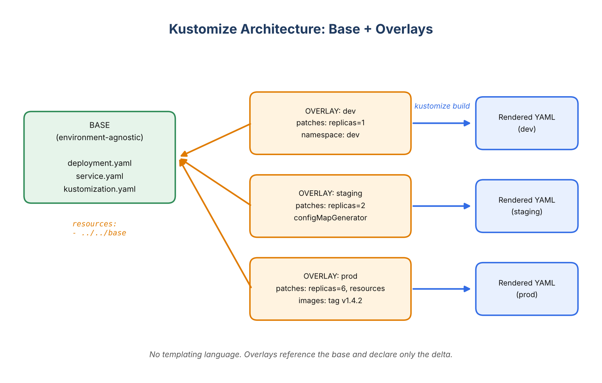
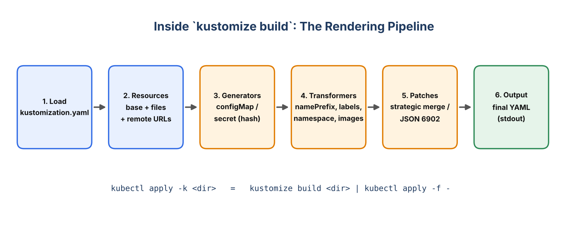
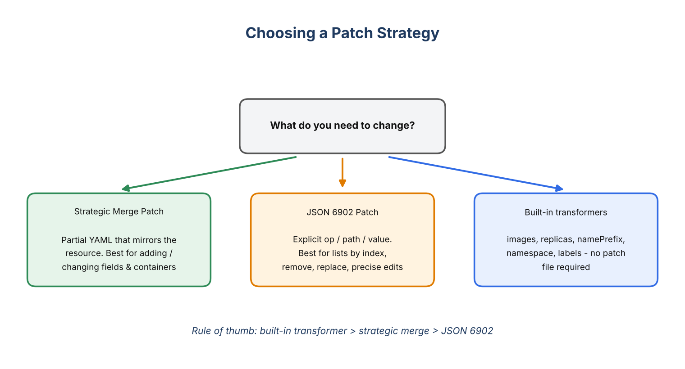
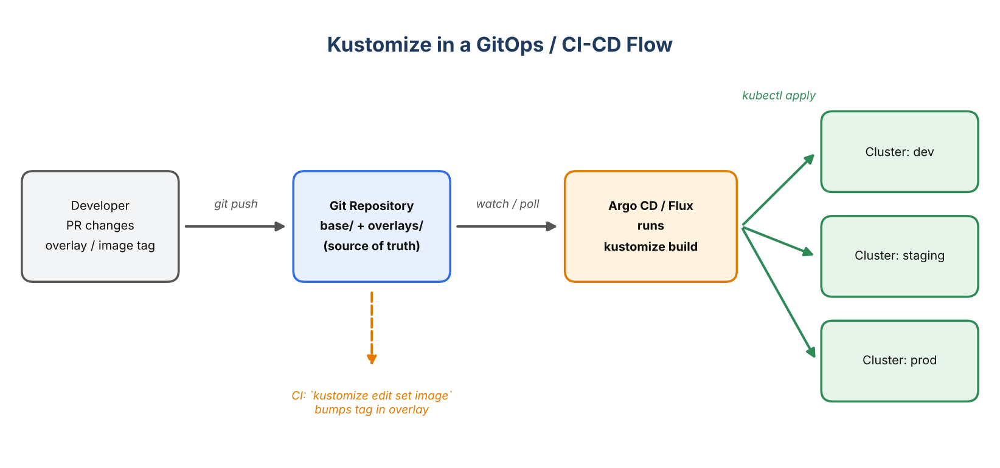

# Kustomize Explained: The Complete, One-Stop Guide to Template-Free Kubernetes Configuration

### From "why does my prod YAML differ from staging?" to GitOps-ready overlays, generators, patches, components and production best practices

*Reading time: ~25 minutes · Level: Beginner → Advanced · Tags: Kubernetes, Kustomize, DevOps, GitOps, Cloud Native*

---

## TL;DR

**Kustomize** is a Kubernetes-native configuration management tool that lets you customize plain YAML manifests **without templates**. You keep one environment-agnostic **base**, then layer thin **overlays** (dev, staging, prod) that declare only what differs: replica counts, image tags, resource limits, config values, namespaces, labels.

It is built into `kubectl` (`kubectl apply -k`), understood natively by Argo CD and Flux, and it removes the copy-paste drift that quietly breaks multi-environment deployments.

If you remember only one thing: **Kustomize = base YAML + declared differences = final YAML. No `{{ }}`, no DSL, no forked manifests.**

---

## Table of Contents

1. The problem Kustomize solves
2. What is Kustomize?
3. Why it matters (significance)
4. Core concepts: base, overlay, kustomization.yaml
5. Hands-on: building a real multi-environment app
6. Transformers (names, labels, images, replicas)
7. Generators (ConfigMaps and Secrets with hash suffixes)
8. Patches: strategic merge vs JSON 6902
9. Replacements, components and remote bases
10. Using Helm charts inside Kustomize
11. Kustomize in CI/CD and GitOps (Argo CD, Flux)
12. When to use Kustomize (scenarios)
13. What happens if you don't use it (impact)
14. Kustomize vs Helm vs raw YAML
15. Pitfalls, anti-patterns and best practices
16. Cheat sheet
17. FAQ and conclusion

---

## 1. The Problem: YAML Sprawl and Environment Drift

You have a microservice, `orders-service`. It needs a Deployment, a Service, a ConfigMap and an Ingress. That's four files. Now you need three environments: dev, staging and production.

The naive approach looks like this:

```
k8s/
├── dev/      deployment.yaml service.yaml configmap.yaml ingress.yaml
├── staging/  deployment.yaml service.yaml configmap.yaml ingress.yaml
└── prod/     deployment.yaml service.yaml configmap.yaml ingress.yaml
```

Twelve files, 90% identical. Then reality arrives:

- Someone adds a `readinessProbe` to `prod/deployment.yaml` and forgets staging. Staging no longer predicts production behaviour.
- A security fix (`runAsNonRoot: true`) lands in two of three folders.
- A new engineer asks "why does prod have 6 replicas and a different JVM flag?" and the only way to find out is to `diff` three directories by eye.
- Add a fourth environment (a DR region, a per-PR preview environment) and you copy-paste again.

This is **configuration drift**, and it is one of the most common root causes of "it worked in staging" incidents.



Kubernetes itself has no built-in concept of "the same app, slightly different per environment". Teams historically filled that gap with `sed`/`envsubst` scripts, Helm templates, Jsonnet or in-house tooling. Kustomize is the answer that stays closest to native Kubernetes.

---

## 2. What Is Kustomize?

Kustomize is a tool for **declaratively customizing Kubernetes resource YAML** while leaving the original files untouched. It originated at Google and is now maintained under Kubernetes SIG CLI (`kubernetes-sigs/kustomize`).

Three ideas define it:

1. **Template-free.** Your base manifests are valid Kubernetes YAML that you can `kubectl apply` as-is. There is no templating language to learn, no variables inside the YAML, no rendering step that changes the meaning of the file.
2. **Declarative and composable.** A `kustomization.yaml` file declares *what you want changed*. Kustomize computes the result. Kustomizations can include other kustomizations.
3. **Built for Kubernetes.** It understands resource kinds and their relationships. If it renames a ConfigMap, it also updates every Pod spec that references it.

It ships in two forms:

- **Standalone binary:** `kustomize build <dir>`
- **Embedded in kubectl:** `kubectl kustomize <dir>` and `kubectl apply -k <dir>` (since kubectl 1.14). The embedded version usually lags behind the standalone release, so check `kubectl version` and `kustomize version` if you depend on newer features.

---

## 3. Why It Matters: The Significance

**Single source of truth.** One base describes the application. Every environment inherits from it. A fix in the base reaches every environment automatically.

**Reviewable differences.** An overlay is tiny. A code reviewer sees "prod sets replicas to 6 and raises memory limits" in 15 lines instead of scanning three near-identical 200-line files.

**No new language.** Everything is YAML that kubectl understands. Debugging means reading YAML, not debugging a template engine.

**Safe, predictable upgrades.** Because the base is untouched, you can pull upstream manifests (a vendor's operator install, a platform team's standard app skeleton) as a base and layer your own changes on top without forking.

**GitOps-native.** Argo CD and Flux render Kustomize directly. Your Git repository becomes the declared desired state per environment, and a promotion is a small, auditable pull request.

**Zero extra infrastructure.** No server-side component, no CRD, no cluster install. It is a client-side build step.

---

## 4. Core Concepts

### 4.1 The kustomization.yaml file

Every Kustomize directory contains a file named `kustomization.yaml` (or `Kustomization`). It is the entry point that lists resources and customizations:

```yaml
apiVersion: kustomize.config.k8s.io/v1beta1
kind: Kustomization

resources:
  - deployment.yaml
  - service.yaml

namePrefix: demo-
```

> Do not confuse this with the Flux `Kustomization` custom resource (`kustomize.toolkit.fluxcd.io/v1`). The Flux object is a cluster-side controller instruction that *points at* a directory containing a `kustomization.yaml`.

### 4.2 Base

A **base** is a directory with a `kustomization.yaml` and the common, environment-agnostic manifests. It must be deployable on its own in principle.

### 4.3 Overlay

An **overlay** is a directory with its own `kustomization.yaml` that references a base (or another overlay) under `resources:` and declares modifications.

### 4.4 The architecture at a glance



### 4.5 What happens during `kustomize build`



The order matters conceptually: resources are loaded and merged, generators create ConfigMaps/Secrets, transformers apply cross-cutting changes (names, namespaces, labels, images), patches apply targeted edits, and the final YAML is written to stdout. Nothing is applied to your cluster until you pipe the output to `kubectl apply` (or use `kubectl apply -k`).

---

## 5. Hands-On: A Real Multi-Environment Application

We will deploy a Spring Boot service named `orders-service` to dev, staging and prod. Here is the final layout:

```
orders-service/
├── base/
│   ├── kustomization.yaml
│   ├── deployment.yaml
│   ├── service.yaml
│   └── application.properties
├── components/
│   └── monitoring/
│       └── kustomization.yaml
└── overlays/
    ├── dev/
    │   └── kustomization.yaml
    ├── staging/
    │   └── kustomization.yaml
    └── prod/
        ├── kustomization.yaml
        ├── patch-resources.yaml
        ├── hpa.yaml
        └── pdb.yaml
```

### 5.1 The base

`base/deployment.yaml`

```yaml
apiVersion: apps/v1
kind: Deployment
metadata:
  name: orders-service
spec:
  replicas: 2
  selector:
    matchLabels:
      app: orders-service
  template:
    metadata:
      labels:
        app: orders-service
    spec:
      containers:
        - name: orders-service
          image: ghcr.io/example/orders-service:1.0.0
          ports:
            - containerPort: 8080
          env:
            - name: SPRING_PROFILES_ACTIVE
              value: default
          envFrom:
            - configMapRef:
                name: orders-config
          readinessProbe:
            httpGet:
              path: /actuator/health/readiness
              port: 8080
            initialDelaySeconds: 15
          livenessProbe:
            httpGet:
              path: /actuator/health/liveness
              port: 8080
            initialDelaySeconds: 30
          resources:
            requests:
              cpu: 100m
              memory: 256Mi
            limits:
              memory: 512Mi
```

`base/service.yaml`

```yaml
apiVersion: v1
kind: Service
metadata:
  name: orders-service
spec:
  selector:
    app: orders-service
  ports:
    - port: 80
      targetPort: 8080
```

`base/application.properties`

```properties
LOG_LEVEL=INFO
PAYMENT_TIMEOUT_MS=3000
```

`base/kustomization.yaml`

```yaml
apiVersion: kustomize.config.k8s.io/v1beta1
kind: Kustomization

resources:
  - deployment.yaml
  - service.yaml

labels:
  - pairs:
      app.kubernetes.io/part-of: commerce
      app.kubernetes.io/managed-by: kustomize

configMapGenerator:
  - name: orders-config
    envs:
      - application.properties
```

You can already render and inspect the base:

```bash
kustomize build base
# or
kubectl kustomize base
```

### 5.2 The dev overlay

`overlays/dev/kustomization.yaml`

```yaml
apiVersion: kustomize.config.k8s.io/v1beta1
kind: Kustomization

namespace: orders-dev
namePrefix: dev-

resources:
  - ../../base

replicas:
  - name: orders-service
    count: 1

images:
  - name: ghcr.io/example/orders-service
    newTag: 1.4.2-rc1

configMapGenerator:
  - name: orders-config
    behavior: merge
    literals:
      - LOG_LEVEL=DEBUG

patches:
  - target:
      kind: Deployment
      name: orders-service
    patch: |-
      - op: replace
        path: /spec/template/spec/containers/0/env/0/value
        value: dev
```

That is the entire difference between dev and the base: a namespace, a name prefix, one replica, a newer image tag, debug logging and a Spring profile.

Render it:

```bash
kustomize build overlays/dev
```

Abridged output (the ConfigMap hash suffix will differ on your machine):

```yaml
apiVersion: v1
data:
  LOG_LEVEL: DEBUG
  PAYMENT_TIMEOUT_MS: "3000"
kind: ConfigMap
metadata:
  labels:
    app.kubernetes.io/managed-by: kustomize
    app.kubernetes.io/part-of: commerce
  name: dev-orders-config-7h2kd8m6bt
  namespace: orders-dev
---
apiVersion: apps/v1
kind: Deployment
metadata:
  name: dev-orders-service
  namespace: orders-dev
spec:
  replicas: 1
  template:
    spec:
      containers:
        - envFrom:
            - configMapRef:
                name: dev-orders-config-7h2kd8m6bt
          image: ghcr.io/example/orders-service:1.4.2-rc1
          name: orders-service
          ...
```

Notice what Kustomize did automatically: it prefixed the names, set the namespace everywhere, applied the labels, **and rewrote the `configMapRef` inside the Deployment to point at the new hashed ConfigMap name**. That reference tracking is the "Kubernetes-aware" part.

### 5.3 The production overlay

`overlays/prod/kustomization.yaml`

```yaml
apiVersion: kustomize.config.k8s.io/v1beta1
kind: Kustomization

namespace: orders-prod

resources:
  - ../../base
  - hpa.yaml
  - pdb.yaml

components:
  - ../../components/monitoring

images:
  - name: ghcr.io/example/orders-service
    newTag: 1.4.1          # promoted, battle-tested version

replicas:
  - name: orders-service
    count: 6

configMapGenerator:
  - name: orders-config
    behavior: merge
    literals:
      - LOG_LEVEL=WARN
      - PAYMENT_TIMEOUT_MS=1500

patches:
  - path: patch-resources.yaml
  - target:
      kind: Deployment
      name: orders-service
    patch: |-
      - op: add
        path: /spec/template/spec/containers/0/env/-
        value:
          name: JAVA_TOOL_OPTIONS
          value: "-XX:MaxRAMPercentage=75 -XX:+UseZGC"
```

`overlays/prod/patch-resources.yaml` (a strategic merge patch)

```yaml
apiVersion: apps/v1
kind: Deployment
metadata:
  name: orders-service
spec:
  template:
    spec:
      containers:
        - name: orders-service
          resources:
            requests:
              cpu: 500m
              memory: 1Gi
            limits:
              memory: 2Gi
```

`overlays/prod/hpa.yaml` (a resource that exists *only* in prod)

```yaml
apiVersion: autoscaling/v2
kind: HorizontalPodAutoscaler
metadata:
  name: orders-service
spec:
  scaleTargetRef:
    apiVersion: apps/v1
    kind: Deployment
    name: orders-service
  minReplicas: 6
  maxReplicas: 20
  metrics:
    - type: Resource
      resource:
        name: cpu
        target:
          type: Utilization
          averageUtilization: 65
```

`overlays/prod/pdb.yaml`

```yaml
apiVersion: policy/v1
kind: PodDisruptionBudget
metadata:
  name: orders-service
spec:
  minAvailable: 4
  selector:
    matchLabels:
      app: orders-service
```

### 5.4 Apply, diff, delete

```bash
# Preview what would change in the cluster (server-side diff)
kubectl diff -k overlays/prod

# Validate against the API server without persisting
kubectl apply -k overlays/prod --dry-run=server

# Deploy
kubectl apply -k overlays/prod

# Tear down everything this overlay created
kubectl delete -k overlays/prod
```

Note that `kubectl apply -k` is equivalent to `kustomize build overlays/prod | kubectl apply -f -`.

---

## 6. Transformers: Cross-Cutting Changes

Transformers modify every (or selected) resource in the build. The most important ones:

### 6.1 `namespace`

Sets `metadata.namespace` on all namespaced resources.

```yaml
namespace: orders-prod
```

Kustomize does **not** create the Namespace object for you. Add a `namespace.yaml` to `resources:` if it doesn't exist yet.

### 6.2 `namePrefix` / `nameSuffix`

```yaml
namePrefix: dev-
nameSuffix: -v2
```

Handy for running multiple copies of the same app in one namespace (for example, preview environments). Kustomize updates references between resources (Service selectors don't change, but things like `configMapRef`, `secretKeyRef`, `serviceAccountName` and `scaleTargetRef` do).

### 6.3 `labels` and `commonAnnotations`

```yaml
labels:
  - pairs:
      team: payments
      env: prod
    includeSelectors: false     # default; metadata labels only
    includeTemplates: true      # also stamp pod templates

commonAnnotations:
  owner: payments-platform@example.com
```

`commonLabels` still works but is deprecated in favour of `labels`, mainly because `commonLabels` also rewrites selectors, which is a classic footgun (see the pitfalls section).

### 6.4 `images`

Change an image name, tag or digest without writing a patch:

```yaml
images:
  - name: ghcr.io/example/orders-service
    newName: registry.internal.example.com/orders-service
    newTag: 1.4.1
  - name: busybox
    digest: sha256:<digest>
```

This is the transformer your CI pipeline will use most.

### 6.5 `replicas`

```yaml
replicas:
  - name: orders-service
    count: 6
```

---

## 7. Generators: ConfigMaps and Secrets Done Right

### 7.1 configMapGenerator

Generate ConfigMaps from literals, files or env files:

```yaml
configMapGenerator:
  - name: app-config
    literals:
      - FEATURE_X=true
    files:
      - logback.xml
    envs:
      - app.env
```

### 7.2 The hash suffix: free rolling updates

By default Kustomize appends a content hash to the generated name (`app-config-9tf2m8b6kc`) and rewrites every reference. Why this matters:

- With a static ConfigMap name, editing the ConfigMap does **not** restart Pods that consume it as environment variables. You find out days later, when a Pod restarts and picks up new values unexpectedly.
- With the hash suffix, a config change produces a new name, which changes the Pod template, which triggers a **normal rolling update**. Config changes become deployments, with rollout and rollback semantics.

If you need a stable name (for example, an external system refers to it), disable it:

```yaml
generatorOptions:
  disableNameSuffixHash: true
```

### 7.3 secretGenerator (with a big caveat)

```yaml
secretGenerator:
  - name: db-credentials
    type: Opaque
    envs:
      - db.env          # kept OUT of Git, injected at build time
```

> **Never commit real secrets to Git, even base64 encoded.** `secretGenerator` is a convenience for building Secret objects; it is not a secret store. For production use one of: External Secrets Operator, Sealed Secrets, SOPS (for example via the KSOPS plugin), or your cloud secret manager's CSI driver.

### 7.4 Merging and replacing across layers

In overlays, set `behavior: merge` to add or override keys in the base's generated ConfigMap, `behavior: replace` to replace it entirely, or `behavior: create` (the default) for new ones. The prod overlay above uses `merge` to change just two keys.

---

## 8. Patches: Targeted Edits

When transformers aren't enough, patch. Kustomize supports two patch formats, both through the unified `patches:` field.



### 8.1 Strategic merge patch

A partial resource. Kustomize merges it into the matching resource by kind + name, and it understands Kubernetes list semantics (containers are merged by `name`, not replaced wholesale).

```yaml
patches:
  - path: patch-resources.yaml
```

Or inline, with an explicit target:

```yaml
patches:
  - target:
      kind: Deployment
      labelSelector: "tier=backend"
    patch: |-
      apiVersion: apps/v1
      kind: Deployment
      metadata:
        name: ignored
      spec:
        template:
          spec:
            terminationGracePeriodSeconds: 60
```

To delete a field in a strategic merge patch, set it to `null`, or use `$patch: delete` on a list element:

```yaml
spec:
  template:
    spec:
      containers:
        - name: sidecar
          $patch: delete
```

### 8.2 JSON 6902 patch

An explicit list of operations (`add`, `remove`, `replace`, `move`, `copy`, `test`) with JSON-pointer paths. Use it when you need list index precision or exact control.

```yaml
patches:
  - target:
      group: apps
      version: v1
      kind: Deployment
      name: orders-service
    patch: |-
      - op: replace
        path: /spec/template/spec/containers/0/image
        value: ghcr.io/example/orders-service:hotfix
      - op: add
        path: /spec/template/spec/containers/0/env/-
        value: {name: TRACE, value: "on"}
      - op: remove
        path: /spec/template/spec/containers/0/livenessProbe
```

### 8.3 Targeting multiple resources

The `target` selector supports `group`, `version`, `kind`, `name` (regex), `namespace`, `labelSelector` and `annotationSelector`. One patch can therefore modify every Deployment with a given label, which is great for platform-wide policies such as adding a security context.

### 8.4 Which patch format should I use?

- Built-in transformer exists (`images`, `replicas`, `namespace`, `labels`)? **Use it.**
- Changing fields on a known resource? **Strategic merge.** It reads like normal Kubernetes YAML.
- Editing arrays by position, removing fields, or you need `test` guards? **JSON 6902.**

> `patchesStrategicMerge` and `patchesJson6902` are deprecated. Use `patches:`. Running `kustomize edit fix` migrates old files.

---

## 9. Replacements, Components and Remote Bases

### 9.1 `replacements`: copy a value from one field to another

When the same value must appear in several places (a hostname, a service name, a version string), `replacements` pulls it from a source field and writes it into targets, which replaces the older `vars` feature.

```yaml
resources:
  - cluster-info.yaml     # a plain ConfigMap named cluster-info
  - ingress.yaml

replacements:
  - source:
      kind: ConfigMap
      name: cluster-info
      fieldPath: data.PUBLIC_HOST
    targets:
      - select:
          kind: Ingress
          name: orders-service
        fieldPaths:
          - spec.rules.0.host
          - spec.tls.0.hosts.0
```

### 9.2 Components: reusable, optional features

A **Component** (`kind: Component`) is a reusable bundle of patches, generators and resources that overlays opt into. Unlike a base, a component is *applied on top of* the resources of the overlay that includes it, so it can modify them.

`components/monitoring/kustomization.yaml`

```yaml
apiVersion: kustomize.config.k8s.io/v1alpha1
kind: Component

patches:
  - target:
      kind: Deployment
    patch: |-
      - op: add
        path: /spec/template/metadata/annotations
        value:
          prometheus.io/scrape: "true"
          prometheus.io/port: "8080"
          prometheus.io/path: /actuator/prometheus
```

Use it in an overlay:

```yaml
components:
  - ../../components/monitoring
```

Typical components: `monitoring`, `istio-sidecar-injection`, `pod-security-hardening`, `debug-tools`, `ha-spread-constraints`. Mix and match per environment without duplicating YAML.

### 9.3 Remote bases

A base can live in another Git repository, pinned to a tag or commit:

```yaml
resources:
  - https://github.com/my-org/platform-manifests//apps/orders?ref=v2.3.0
```

Always pin `?ref=` to a tag or a commit SHA. An unpinned remote base means your deployment changes when someone else pushes.

---

## 10. Using Helm Charts Inside Kustomize

Kustomize can inflate a Helm chart and then patch the rendered output, so you can customize third-party charts without forking them:

```yaml
apiVersion: kustomize.config.k8s.io/v1beta1
kind: Kustomization

helmCharts:
  - name: ingress-nginx
    repo: https://kubernetes.github.io/ingress-nginx
    version: <chart-version>
    releaseName: ingress
    namespace: ingress-nginx
    valuesInline:
      controller:
        replicaCount: 3

patches:
  - target:
      kind: Deployment
      name: ingress-ingress-nginx-controller
    patch: |-
      - op: add
        path: /spec/template/spec/priorityClassName
        value: system-cluster-critical
```

This requires the Helm binary and an explicit flag:

```bash
kustomize build --enable-helm .
```

The flag is needed because it executes Helm; the embedded `kubectl kustomize` may not offer it, so use the standalone binary in CI or let Argo CD handle it. It is a pragmatic pattern for "Helm for third-party software, Kustomize for our own overlays".

---

## 11. Kustomize in CI/CD and GitOps



### 11.1 CI: promoting an image

Your pipeline builds an image and updates the overlay, not the manifests:

```bash
cd overlays/staging
kustomize edit set image \
  ghcr.io/example/orders-service=ghcr.io/example/orders-service:${GIT_SHA}
git commit -am "deploy orders-service ${GIT_SHA} to staging"
git push
```

Promotion to prod is the same command in `overlays/prod`, typically in a pull request that a human approves. The Git history is your deployment audit log.

### 11.2 Validation gates

Run these on every pull request:

```bash
# 1. It must build
kustomize build overlays/prod > /tmp/prod.yaml

# 2. Schema validation (kubeconform is one option)
kubeconform -strict -summary /tmp/prod.yaml

# 3. Policy checks (OPA/Conftest, Kyverno CLI, etc.)
conftest test /tmp/prod.yaml

# 4. See the real impact on the cluster
kubectl diff -k overlays/prod
```

### 11.3 Argo CD

Argo CD auto-detects a `kustomization.yaml` in the source path and renders it:

```yaml
apiVersion: argoproj.io/v1alpha1
kind: Application
metadata:
  name: orders-prod
  namespace: argocd
spec:
  project: default
  source:
    repoURL: https://github.com/my-org/orders-gitops.git
    targetRevision: main
    path: overlays/prod
  destination:
    server: https://kubernetes.default.svc
    namespace: orders-prod
  syncPolicy:
    automated:
      prune: true
      selfHeal: true
```

### 11.4 Flux

```yaml
apiVersion: kustomize.toolkit.fluxcd.io/v1
kind: Kustomization
metadata:
  name: orders-prod
  namespace: flux-system
spec:
  interval: 5m
  path: ./overlays/prod
  prune: true
  sourceRef:
    kind: GitRepository
    name: orders-gitops
  targetNamespace: orders-prod
```

Both controllers continuously reconcile the cluster to what Git says, so manual `kubectl edit` changes in prod are reverted. That is exactly the drift protection you want.

---

## 12. When Should You Use Kustomize? (Scenarios)

**Scenario 1: Multiple environments of one application.** dev/staging/prod (or per-region, per-customer, per-PR previews) that share 90% of their config. This is the core use case.

**Scenario 2: Multi-cluster and multi-region fleets.** A base for the app, overlays for `us-east`, `eu-west`, `ap-south`, each with different replicas, node selectors, endpoints and compliance settings.

**Scenario 3: Customizing third-party or upstream manifests.** Install an operator, a vendor's YAML or a platform team's golden manifests, then patch them (add resource limits, change namespace, inject labels) without forking. When upstream releases a new version you update the pinned base, and your overlay still applies.

**Scenario 4: Platform-wide policies.** One component or patch that adds `securityContext`, `topologySpreadConstraints`, monitoring annotations or a company label to every workload.

**Scenario 5: GitOps.** You want declarative, per-environment desired state in Git with reviewable diffs and automated reconciliation.

**Scenario 6: Config changes that must trigger rollouts.** You want ConfigMap or Secret changes to produce a rolling update automatically (hash suffixes).

**Scenario 7: Teams that dislike templating.** You want manifests that remain valid, lintable, readable Kubernetes YAML at every stage.

**Scenario 8: Short-lived environments.** Spin up `pr-1234` by creating a tiny overlay with a `namePrefix`, a `namespace` and a unique ingress host.

---

## 13. What Happens If You Don't Use It? (Impact)

You don't *have* to use Kustomize. Plenty of teams run on alternatives. But if you have multiple environments and use neither Kustomize nor an equivalent, these are the failure modes you accept:

1. **Configuration drift.** Environments diverge silently. Staging stops being a faithful rehearsal of prod. Bugs appear only in production.
2. **Copy-paste errors and inconsistent fixes.** Security patches and probe fixes get applied to some copies and not others. The number of places to edit grows as (resources × environments).
3. **Slow, risky changes.** A cross-cutting change (a new label, a new annotation, a new registry) becomes a find-and-replace across dozens of files.
4. **Unreviewable pull requests.** Reviewers can't tell what is intentionally different between environments, so real differences hide among noise.
5. **Home-grown scripts.** `sed`, `envsubst` and bash wrappers creep in. They are untested, undocumented, don't understand Kubernetes references, and tend to rot or become one person's tribal knowledge.
6. **Silent config staleness.** Without hash-suffixed generated ConfigMaps, a changed ConfigMap isn't rolled out, so Pods run with old config until they happen to restart.
7. **Painful onboarding.** New engineers have to learn which of the twelve near-identical files is the "real" one.
8. **Forked upstream manifests.** Editing a vendor's YAML in place makes upgrades a manual three-way merge every time.
9. **Harder compliance and audit.** "Show me every difference between prod and staging" should be a 20-line answer, not a diff of two directory trees.
10. **Higher blast radius in GitOps.** Without a layered structure, a single wrong edit in a shared file can hit every environment at once.

If you only have a single environment and a handful of manifests, the cost of skipping Kustomize is low. The cost compounds quickly with every new environment, cluster or team.

---

## 14. Kustomize vs Helm vs Raw YAML

**Raw YAML + copy-paste:** simplest to start, worst at scale. Drift is guaranteed.

**Helm:**
- A *package manager and templating engine*. Charts are parameterized with Go templates and `values.yaml`.
- Strengths: distribution and versioning of apps, a huge public chart ecosystem, release tracking with install/upgrade/rollback, dependency management, hooks.
- Trade-offs: templates are not valid YAML until rendered, logic in templates can become hard to read, and you are limited to the parameters a chart author chose to expose.

**Kustomize:**
- A *patch-and-overlay engine* for plain YAML.
- Strengths: no templating, native to kubectl, great for customizing resources you own or don't control, explicit and reviewable diffs.
- Trade-offs: no packaging or release concept, limited logic (no loops or conditionals), heavy customization can become many small patches.

**Practical guidance:**
- *Your own services, multiple environments:* Kustomize is usually the lightest fit.
- *Distributing software to many consumers with configuration knobs:* Helm.
- *Consuming third-party charts but needing extra changes:* Helm chart + Kustomize on top (via `helmCharts` or Argo CD).
- *Complex conditional logic:* consider Helm, or generate manifests with a program (CUE, Jsonnet, cdk8s) and let Kustomize handle overlays.

They are not rivals so much as tools for different jobs, and many mature platforms use both.

---

## 15. Pitfalls, Anti-Patterns and Best Practices

### Pitfalls

**`commonLabels` and immutable selectors.** `commonLabels` also modifies `spec.selector.matchLabels`. A Deployment's selector is immutable, so adding or changing a common label later makes `kubectl apply` fail. Prefer `labels:` (with `includeSelectors: false`) for metadata, and keep selector labels stable.

**Name prefixes and cross-references.** Kustomize fixes up known references (ConfigMap/Secret refs, Service account names, HPA targets). References it doesn't know about, such as hostnames embedded in application config or CRD fields, are not updated. Use `replacements` or the `configurations` field to teach it.

**The Namespace object isn't created.** The `namespace:` transformer only sets the field; add a Namespace manifest if needed.

**Deep overlay chains.** `prod-eu → prod → base → shared-base` becomes impossible to reason about. Keep inheritance shallow.

**Patches that silently match nothing.** A typo in a patch target can lead to errors or, with loose selectors, to unintended matches. Always review `kustomize build` output.

**Secrets in Git.** Covered above: don't.

**Load restrictions.** By default a kustomization can only reference files within its own directory tree. Referencing `../../shared/file.yaml` outside the root fails. Restructure as bases or components instead of disabling the restriction (`--load-restrictor LoadRestrictionsNone`).

**Version skew.** The kustomize embedded in `kubectl` differs from your CI's standalone version and from Argo CD's bundled version. Pin versions and test builds where they run.

### Best practices

1. **Keep the base environment-neutral.** No hardcoded hosts, replica counts or secrets for a specific environment.
2. **Overlays contain only differences.** If an overlay grows to look like a full copy, refactor.
3. **Prefer built-in transformers, then strategic merge, then JSON 6902.**
4. **Use components for optional, cross-cutting features** instead of duplicating patches.
5. **Pin remote bases** to tags or SHAs.
6. **Keep generated config hashing on** unless you have a clear reason not to.
7. **Render and validate in CI** (`kustomize build`, `kubeconform`, policy checks, `kubectl diff`).
8. **Review the rendered output, not just the overlay**, for production changes. Some teams commit rendered manifests to a separate branch for transparency.
9. **Name directories predictably** (`base/`, `components/`, `overlays/<env>/`) and document the layout in the repo README.
10. **One app, one directory tree.** Compose apps at a higher level (an "apps of apps" structure in Argo CD, or a Flux Kustomization per app) rather than one mega-kustomization.
11. **Use `kustomize edit` in automation** instead of `sed` for image updates.
12. **Don't over-engineer.** If a single `images:` entry and a `replicas:` entry express the difference, you are done.

---

## 16. Cheat Sheet

**Commands**

```bash
kustomize build <dir>                 # render to stdout
kubectl kustomize <dir>               # same, via kubectl
kubectl apply -k <dir>                # build + apply
kubectl diff -k <dir>                 # show cluster diff
kubectl delete -k <dir>               # delete rendered resources
kubectl get -k <dir>                  # list live resources

kustomize create --autodetect         # generate a kustomization.yaml
kustomize edit add resource foo.yaml
kustomize edit set image app=repo/app:1.2.3
kustomize edit set namespace my-ns
kustomize edit set nameprefix dev-
kustomize edit fix                    # migrate deprecated fields

kustomize build --enable-helm .       # inflate helmCharts
```

**Frequently used fields in `kustomization.yaml`**

- `resources` : files, directories or remote URLs to include
- `components` : reusable optional feature bundles
- `namespace`, `namePrefix`, `nameSuffix` : naming transformers
- `labels`, `commonAnnotations` : metadata transformers
- `images`, `replicas` : the two CI favourites
- `configMapGenerator`, `secretGenerator`, `generatorOptions` : generators
- `patches` : strategic merge and JSON 6902 patches
- `replacements` : copy field values between resources
- `helmCharts` : inflate Helm charts (needs `--enable-helm`)

**Mental model**

```
final YAML = base resources
           + generators
           + transformers (name / namespace / labels / images / replicas)
           + patches
           + components
```

---

## 17. FAQ

**Is Kustomize built into kubectl?**
Yes, via `kubectl kustomize` and `kubectl apply -k`. The standalone `kustomize` CLI is released more often and may support newer features.

**Does Kustomize need anything installed in the cluster?**
No. It is purely a client-side build step.

**Can I use Kustomize with Helm?**
Yes. Inflate charts with `helmCharts`, or point Argo CD/Flux at a Helm chart and post-process the output with Kustomize.

**How do I roll back?**
Revert the Git commit and let your GitOps controller reconcile. Or re-apply the previous overlay revision. Kustomize itself has no release history; Git is the history.

**Does `kubectl apply -k` prune deleted resources?**
Not by default. Use `kubectl apply -k --prune` with a label selector (or `--applyset` where available), or let Argo CD/Flux handle pruning.

**Can Kustomize do conditionals and loops?**
Not by design. If you need that logic, generate the YAML with another tool and use Kustomize for the environment layering.

**How do I debug a patch that isn't applying?**
Run `kustomize build` and inspect the output, check that the `target` matches the resource's *original* name, kind, group and version, and remember that transformers like `namePrefix` run alongside patching.

---

## Conclusion

Kustomize earns its place by doing one thing well: **keeping environment-specific differences small, explicit and reviewable while the bulk of your Kubernetes YAML stays shared and valid.** It's native to `kubectl`, understood by every major GitOps tool, requires nothing in the cluster, and scales from a single Deployment to a multi-region fleet.

A practical adoption path:

1. Move your existing manifests into a `base/` and add a minimal `kustomization.yaml`.
2. Create one overlay per environment containing only the differences (namespace, replicas, image tag, config).
3. Replace `sed`/copy-paste in your pipeline with `kustomize edit set image`.
4. Add `kustomize build` + schema validation + `kubectl diff` to pull request checks.
5. Introduce components for cross-cutting concerns, and connect Argo CD or Flux for continuous reconciliation.

Do that, and "why is prod different from staging?" becomes a question you can answer with a 20-line file.

---

### Further reading

- Kustomize documentation: https://kubectl.docs.kubernetes.io/references/kustomize/
- Kustomize source and examples: https://github.com/kubernetes-sigs/kustomize
- Kubernetes docs, "Declarative Management of Kubernetes Objects Using Kustomize": https://kubernetes.io/docs/tasks/manage-kubernetes-objects/kustomization/
- Argo CD Kustomize support: https://argo-cd.readthedocs.io/en/stable/user-guide/kustomize/
- Flux Kustomize controller: https://fluxcd.io/flux/components/kustomize/

*If this guide helped you, clap, share it with a teammate still copy-pasting YAML, and follow for more cloud-native deep dives.*
