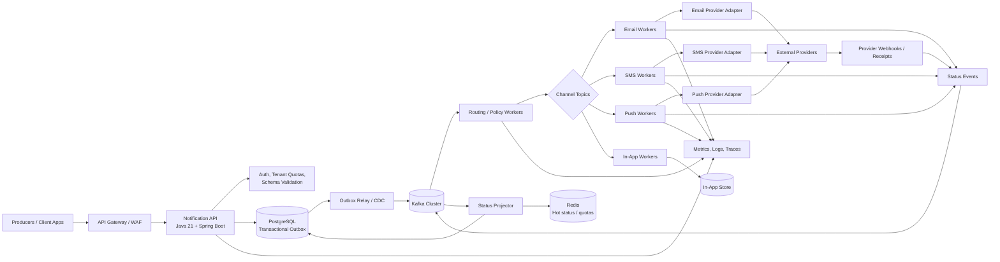
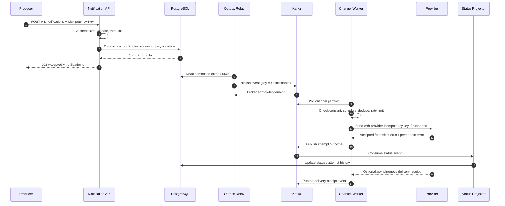
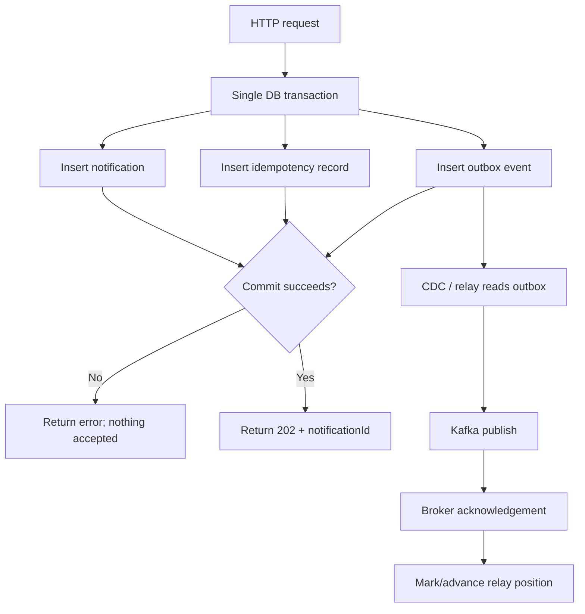
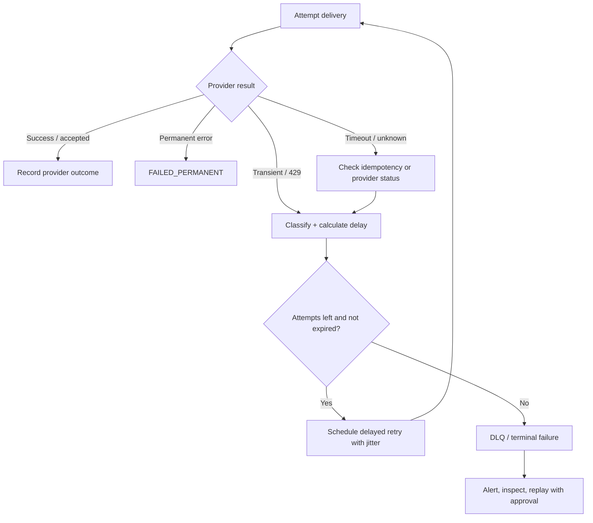

# Production-Grade Notification Platform: 10,000 Notifications per Second

**Reference architecture and implementation guide**  
**Stack:** Java 21, Spring Boot 3.x, Kafka, PostgreSQL, Redis, Kubernetes, OpenTelemetry  
**Target:** Sustain 10,000 notification dispatches/second with bounded latency, durable acceptance, horizontal scale, retries, and operational controls.

> **Important sizing note:** 10,000 notifications/second is a workload target, not a guarantee from a technology choice. Actual capacity depends on payload size, channel mix, provider quotas, regional topology, delivery semantics, and the latency objective. Validate the design with provider-specific load tests and failure tests before production launch.

---

## 1. Executive summary

Build the platform as an **asynchronous, event-driven notification pipeline**. The API accepts and validates requests, durably records them, and returns quickly. Kafka buffers bursts and distributes work. Channel-specific workers deliver email, SMS, push, or in-app notifications through provider adapters. A separate status pipeline records outcomes and powers queries, metrics, and callbacks.

### Design principles

1. **Durable acceptance:** Do not return `202 Accepted` until the notification command has been durably persisted (or explicitly document a weaker contract).
2. **At-least-once processing internally:** Expect retries and duplicates. Use stable idempotency keys and provider idempotency support where available.
3. **Bounded work:** Every queue, thread pool, batch, retry loop, and outbound connection pool has explicit limits.
4. **Channel isolation:** A slow SMS provider must not starve push or email traffic.
5. **Backpressure over overload:** Rate-limit, defer, or reject work predictably rather than letting memory and latency grow without bound.
6. **Observable delivery:** Track acceptance, queue delay, provider response, retries, terminal failure, and delivery receipts separately.
7. **Multi-AZ first:** Replicate critical state and brokers across availability zones. Multi-region active-active is a further design decision, not a default checkbox.
8. **Privacy and compliance:** Encrypt sensitive payloads, minimize PII in logs, enforce tenant boundaries, consent, opt-out, retention, and audit requirements.

## 2. Define the workload and SLOs

Before sizing, agree on what “10,000 per second” means.

| Dimension | Initial planning assumption | Why it matters |
|---|---|---|
| Throughput | 10,000 accepted notification jobs/s sustained | API and durable-ingress capacity |
| Burst | 2–3× baseline for short intervals | Buffer and rate-limit sizing |
| Payload | 1–4 KB average event, bounded maximum | Network, Kafka, storage, and memory |
| Channels | Email, SMS, push, in-app; independently scaled | Provider throughput differs substantially |
| Acceptance latency | Example target p99 < 100 ms | API path should not wait for provider delivery |
| Dispatch latency | Example target p95 < 1 s after enqueue under normal load | Queueing plus worker/provider latency |
| Availability | Example 99.9% or 99.95% monthly | Determines redundancy and operational cost |
| Delivery semantics | At-least-once processing; duplicates handled idempotently | End-to-end exactly-once delivery is generally not realistic |
| Retention | E.g. 7–30 days for operational events, longer only if required | Cost and privacy |
| Geography | One region / multi-AZ initially | Multi-region changes consistency and failover design |

These are **starting targets**, not universal guarantees. Provider delivery time is outside the platform's full control, especially for SMS and email.

### Rate math

- 10,000/s = 600,000/minute = 36 million/hour = 864 million/day if sustained.
- At 2 KB of event data, raw ingress is roughly 20 MB/s before protocol, replication, indexing, and storage overhead.
- At 10,000/s, even a 1% retry rate adds 100 extra attempts/s. Retry storms can overwhelm a provider unless retries are delayed and rate-limited.
- If a provider can accept only 2,000/s, the platform cannot deliver 10,000/s through that provider continuously. The queue will grow unless traffic is split across eligible providers or the contract allows delayed delivery.

## 3. High-level architecture



### Component responsibilities

- **API gateway/WAF:** TLS termination, authentication integration, request-size limits, IP and tenant throttles, bot/abuse protection.
- **Notification API:** Validate request, check tenant policy and idempotency, persist notification and outbox record in one database transaction, return a stable notification ID.
- **PostgreSQL:** System of record for request acceptance, idempotency keys, notification metadata, outbox, and operational status. Partition large tables by time or tenant where appropriate.
- **Outbox relay / CDC:** Publishes committed outbox rows to Kafka. Debezium CDC or a carefully implemented polling relay can be used. Marking an outbox row as published and publishing to Kafka cannot be made one atomic operation without a distributed transaction; design for replay and duplicates.
- **Kafka:** Durable event log and workload buffer. Partition for parallelism; replicate across availability zones; monitor under-replicated partitions and consumer lag.
- **Router/policy layer:** Apply preferences, consent, quiet hours, localization, template rendering policy, priority, and channel fallback rules.
- **Channel workers:** Independently autoscaled consumers with bounded concurrency and provider-specific rate limiting.
- **Provider adapters:** Encapsulate provider APIs, credentials, quotas, request mapping, timeout policy, retry classification, and provider failover.
- **Status projector:** Consumes state events and updates query-optimized status tables/cache.
- **Observability:** End-to-end correlation IDs, metrics, traces, structured logs, dashboards, alerts, and audit trails.

## 4. End-to-end request and delivery flow



**Important:** A provider's “accepted” response is not the same as “delivered.” Model statuses separately: `ACCEPTED`, `QUEUED`, `DISPATCHING`, `PROVIDER_ACCEPTED`, `DELIVERED`, `RETRY_SCHEDULED`, `FAILED_PERMANENT`, `EXPIRED`, `SUPPRESSED`, and `UNKNOWN`. Not every channel/provider reports delivery receipts.

## 5. API contract

### Submit a notification

`POST /v1/notifications`

Headers:
- `Authorization: Bearer ...`
- `Idempotency-Key: <client-generated stable key>`
- `Content-Type: application/json`
- Optional: `traceparent`

Example request:

```json
{
  "tenantId": "merchant-42",
  "channel": "PUSH",
  "recipient": {
    "userId": "user-123",
    "address": "device-token-or-address-reference"
  },
  "templateId": "payment-received-v3",
  "templateData": {
    "amount": "1250.00",
    "currency": "INR"
  },
  "priority": "NORMAL",
  "scheduledAt": null,
  "expiresAt": "2026-10-20T20:00:00Z",
  "metadata": {
    "businessEventId": "payment-987"
  }
}
```

Example response:

```json
{
  "notificationId": "01J...ULID",
  "status": "ACCEPTED",
  "acceptedAt": "2026-10-20T13:30:00Z"
}
```

Use an opaque, non-PII recipient reference when possible. Avoid accepting arbitrary template HTML or unbounded metadata from clients.

### API behavior

- `202 Accepted`: durable command committed; actual delivery is asynchronous.
- `400`: invalid schema or unsupported channel.
- `401/403`: authentication/authorization failure.
- `409`: same idempotency key reused with a different request payload.
- `429`: tenant or global ingress quota exceeded; include `Retry-After` where meaningful.
- `503`: durable ingress unavailable; do not pretend the request was accepted.
- Provide `GET /v1/notifications/{id}` for status and a paginated attempt history endpoint for authorized operators.
- Provide bulk submission only with explicit maximum batch size, per-item results, and bounded payload size.

## 6. Durable acceptance and the transactional outbox

A common failure is writing to the database and publishing to Kafka in separate operations:

1. DB commit succeeds, Kafka publish fails: notification can be lost from the queue.
2. Kafka publish succeeds, DB transaction fails: consumers may process an event for a nonexistent record.
3. Publisher crashes after broker acknowledgement but before recording publication: event may be published again.

Use a transactional outbox:



Recommended implementation options:
- **CDC:** PostgreSQL WAL → Debezium → Kafka. Good for high throughput and decoupling relay load, but requires operational expertise.
- **Polling relay:** Claim small batches using `FOR UPDATE SKIP LOCKED`, publish, then mark sent. Simpler to start, but benchmark DB load and relay throughput carefully.
- Keep the outbox append-only or aggressively partition/clean it. Do not let the outbox table grow without a retention process.
- Use Kafka producer idempotence and acknowledgements appropriate to the durability objective. Kafka producer idempotence prevents duplicates from certain producer retries, but it does not make the database + Kafka transaction atomic.

## 7. Kafka design and partitioning

### Topic layout

An example topic set:

- `notification.commands.v1` — accepted commands, if routing is centralized.
- `notification.email.ready.v1`
- `notification.sms.ready.v1`
- `notification.push.ready.v1`
- `notification.inapp.ready.v1`
- `notification.attempt-events.v1`
- `notification.delivery-receipts.v1`
- `notification.retry.1m.v1`, `notification.retry.5m.v1`, `notification.retry.30m.v1` — optional retry tiers, or use a durable retry scheduler.
- `notification.dlq.v1` — exhausted or poison events, with restricted access.

Do not put all traffic in one consumer group if channels have different latency, quota, or retry needs.

### Partition key

- Key by `notificationId` to keep events for one notification ordered within a partition.
- If strict per-recipient ordering is required, key by a stable recipient ID, but watch for hot recipients and reduced parallelism.
- Avoid keying by a low-cardinality value such as channel or tenant alone.
- Use enough partitions to support target consumer parallelism, then validate partition count, broker disk/network, message size, and rebalancing cost. A starting experiment might test 48–96 partitions per high-volume ready topic, but this is **not** a universal production number.
- Consumer parallelism is bounded by partition count per consumer group. More partitions have metadata, file, and operational costs.

### Kafka durability checklist

- Replication factor typically 3 across distinct AZs.
- `min.insync.replicas=2` with producer `acks=all` where the chosen availability/durability tradeoff fits.
- Enable producer idempotence and bounded delivery timeout.
- Use compression such as LZ4 or Zstandard after benchmarking CPU vs network.
- Use a schema registry and backward-compatible schema evolution (Avro/Protobuf/JSON Schema).
- Set explicit retention based on replay/recovery requirements and disk budget.
- Monitor consumer lag by partition, under-replicated partitions, request latency, disk utilization, ISR shrink events, and broker network saturation.
- Test AZ failure, broker replacement, consumer rebalances, and replay from retained offsets.

## 8. Java 21 / Spring Boot service design

### Suggested services

A modular deployment is often a good balance between maintainability and independent scaling:

1. `notification-api` — REST API, authentication integration, validation, durable writes.
2. `outbox-publisher` — CDC connector or relay process.
3. `notification-router` — consent, preference, templates, routing, scheduled work.
4. `notification-worker-email`
5. `notification-worker-sms`
6. `notification-worker-push`
7. `notification-status-projector`
8. `notification-admin` — operational actions, templates, tenant quotas, audit.

Do not split every class into a microservice. Separate processes when they need different scaling, failure isolation, security boundaries, or release cadence.

### Java 21 recommendations

- Use Spring Boot 3.x on a currently supported patch release and Java 21 LTS; pin versions through a dependency BOM and keep patch upgrades routine.
- Use virtual threads for blocking request/provider I/O where the framework and client support it. They do **not** increase CPU capacity or bypass provider rate limits.
- For Kafka consumers, use the Kafka client/container concurrency model, bounded in-flight records, and deliberate acknowledgement semantics. Do not spawn an unbounded virtual thread per record.
- Bound HTTP connection pools, request concurrency, queues, and deadlines even when using virtual threads.
- Prefer asynchronous provider SDKs only when they materially improve measured throughput/latency and are operationally understood.
- Use immutable request DTOs, validation, explicit timeouts, and structured error types.
- Use bulkheads per provider, circuit breakers for sustained failures, and rate limiters aligned to provider quotas.
- Keep expensive template rendering, large payload transformations, and CPU-bound work in bounded executors. Virtual threads are primarily a scalability aid for blocking I/O.

### Example project package layout

```text
notification-platform/
├── notification-api/
│   └── src/main/java/com/acme/notify/api/
│       ├── NotificationController.java
│       ├── NotificationService.java
│       ├── NotificationRequest.java
│       └── IdempotencyService.java
├── notification-domain/
│   └── src/main/java/com/acme/notify/domain/
│       ├── Notification.java
│       ├── NotificationStatus.java
│       ├── Channel.java
│       └── NotificationPolicy.java
├── notification-persistence/
│   └── src/main/java/com/acme/notify/persistence/
│       ├── NotificationRepository.java
│       ├── OutboxRepository.java
│       └── IdempotencyRepository.java
├── notification-worker/
│   └── src/main/java/com/acme/notify/worker/
│       ├── KafkaNotificationConsumer.java
│       ├── ProviderAdapter.java
│       ├── RetryPolicy.java
│       └── RateLimiter.java
├── deploy/
│   ├── helm/
│   ├── dashboards/
│   └── runbooks/
└── docs/
    ├── architecture.md
    └── load-test-plan.md
```

## 9. Data model

Keep the write path small. Separate immutable event history from mutable current status when scale warrants it.

### `notification`

| Column | Purpose |
|---|---|
| `notification_id` | ULID/UUID, primary key |
| `tenant_id` | Tenant ownership and quota scope |
| `channel` | EMAIL/SMS/PUSH/INAPP |
| `recipient_ref` | Encrypted or tokenized destination reference |
| `template_id`, `template_version` | Reproducible rendering |
| `payload_ref` or encrypted payload | Prefer object storage/reference for large payloads |
| `status` | Current projected status |
| `priority`, `scheduled_at`, `expires_at` | Dispatch policy |
| `created_at`, `updated_at` | Operational timestamps |
| `idempotency_key_hash` | Unique scoped idempotency identity |

### `notification_outbox`

| Column | Purpose |
|---|---|
| `event_id` | Unique event identifier |
| `aggregate_id` | `notification_id` |
| `event_type` | `NotificationAccepted` |
| `payload` | Minimal event payload |
| `created_at` | Ordering/retention |
| `published_at` or CDC position | Relay bookkeeping |

### `notification_attempt`

Store one row per attempt or use a Kafka event log plus a compacted projection, depending on query requirements.

| Field | Purpose |
|---|---|
| `notification_id`, `attempt_no` | Unique attempt identity |
| `provider`, `provider_message_id` | Trace external request |
| `started_at`, `completed_at` | Latency measurement |
| `result_code`, `error_class` | Retry classification |
| `next_attempt_at` | Scheduled retry |
| `request_correlation_id` | Traceability without logging PII |

### Database guidance

- Use connection pooling with a carefully sized pool. More connections are not automatically more throughput.
- Batch writes where safe; avoid one transaction per tiny bookkeeping update if it becomes the bottleneck.
- Use prepared statements and indexes only for real access patterns.
- Partition high-volume time-series tables (outbox, attempts, events) by time where retention and query patterns justify it.
- Avoid synchronous status updates on the hot API path beyond the acceptance transaction.
- Use Redis for hot idempotency lookups, short-lived quotas, or cache—not as the sole durable source of truth for accepted notifications.
- Consider object storage for large rendered payloads; do not put huge bodies in every Kafka event.

## 10. Idempotency and duplicate prevention

“Exactly once” across an API, database, Kafka, and external provider is generally not a realistic end-to-end guarantee. Design for **at-least-once execution plus idempotent effects**.

1. Client sends a stable `Idempotency-Key`.
2. API scopes it by tenant and endpoint; store a hash of the key and a canonical request hash.
3. If the same key and same payload recur, return the original `notificationId`.
4. If the same key has a different payload, return `409 Conflict`.
5. Worker uses `notificationId` as the internal dedupe identity.
6. Before calling the provider, record/claim an attempt with a lease or compare-and-set transition if required.
7. Pass a stable provider idempotency key when supported.
8. If the provider times out after receiving the request, the result may be unknown. Query provider status or retry with the same idempotency key where supported; otherwise accept that duplicate delivery is possible and document it.
9. Consumers must be safe when a Kafka event is replayed.

Do not hold a database transaction open while waiting on an external provider API.

## 11. Rate limiting, backpressure, and fair scheduling

Rate limits should exist at multiple levels:

- Global ingress.
- Per tenant and API key.
- Per channel.
- Per provider account and endpoint.
- Per destination (e.g., SMS recipient) to prevent abuse.
- Per template/campaign for marketing traffic.

Use a distributed token bucket or leaky bucket backed by Redis or a dedicated quota service. For the hottest paths, avoid a Redis round trip for every single notification if a local token allocation/batching design can safely reduce calls. Ensure local token leases cannot exceed global quotas materially.

### Backpressure behavior

- If durable ingress is healthy but downstream providers are slow, accept only within agreed backlog and age limits.
- If the queue age exceeds a threshold, apply priority-aware admission control, pause low-priority campaigns, or return `429/503` before accepting more.
- If Kafka is unhealthy and the outbox is approaching capacity, stop accepting work rather than silently dropping it.
- Use separate quotas and topics for transactional/critical traffic vs marketing/bulk traffic.
- Apply a maximum notification age. Expired messages should become `EXPIRED`, not be sent late without policy approval.

## 12. Retry policy and dead-letter handling



Recommended policy:
- Retry transient network failures, provider `429`, and selected `5xx` responses.
- Do not retry invalid addresses, blocked recipients, invalid templates, or permanent provider rejections without remediation.
- Use exponential backoff with full jitter, e.g. randomized delay in a capped exponential window.
- Honor provider `Retry-After`.
- Set per-channel maximum attempts, total delivery deadline, and maximum retry age.
- Use delayed retry topics or a durable scheduler. Avoid sleeping inside consumer threads.
- Avoid retrying the entire original batch when only one item failed.
- DLQ records must include error classification, attempt count, original event reference, and trace IDs—but no unnecessary sensitive content.
- Replay must be an audited operator action with rate limits and duplicate safeguards.

## 13. Provider adapter and failover design

Define a provider interface so vendor-specific details do not leak into business logic:

```java
public interface NotificationProvider {
    ProviderResult send(DeliveryCommand command);
    ProviderCapabilities capabilities();
}

public record ProviderResult(
        Outcome outcome,
        String providerMessageId,
        String providerCode,
        boolean retryable) {

    public enum Outcome {
        ACCEPTED, REJECTED_PERMANENTLY, RETRYABLE_FAILURE, UNKNOWN
    }
}
```

This is a conceptual contract; adapt it for asynchronous clients and provider SDK types.

### Failover rules

- Fail over on clearly transient provider outages only when the alternate provider is configured and eligible.
- Avoid immediate dual-send after an ambiguous timeout unless provider idempotency or a reconciliation process prevents duplicates.
- Maintain provider-specific rate limits and circuit breakers.
- Route by country, sender identity, message type, price, compliance, and delivery performance where required.
- Keep provider credentials in a secrets manager; rotate and scope them.
- Test webhook signature verification and replay protection.

## 14. Capacity planning and initial sizing method

Do not estimate production capacity from CPU count alone. Benchmark the complete path.

### Worker concurrency formula

A rough concurrency estimate using Little's Law:

`concurrency ≈ target throughput × average time in flight`

If a provider call takes 200 ms on average and the target is 10,000 attempts/s, the naive in-flight requirement is about 2,000 concurrent calls **if one provider handled the entire workload**. With multiple providers/channels, calculate each independently. Respect provider quotas; excessive concurrency can make latency worse.

### Initial load-test matrix

| Test | Load | Duration | Purpose |
|---|---:|---:|---|
| Baseline | 10k/s | 60 min | Sustained target, latency and resource stability |
| Burst | 20–30k/s | 1–5 min | Buffering, backpressure, recovery |
| Provider slowdown | 50% slower responses | 15 min | Bulkhead and queue-age behavior |
| Provider outage | One adapter unavailable | 15 min | Circuit breaker, retry budget, isolation |
| Kafka broker/AZ loss | Steady 10k/s | During failure | Durability and failover |
| DB primary failover | Steady 10k/s | During failover | Acceptance correctness |
| Consumer restart/rebalance | Steady 10k/s | Repeated | Duplicate handling and lag recovery |
| Replay | Controlled backlog | Defined batch | Catch-up rate without harming live traffic |
| Payload extremes | Max allowed payload | 10k/s or safe ramp | Memory and network bounds |

Measure p50/p95/p99 latency, accepted rate, provider attempt rate, delivery success, retry rate, duplicate rate, queue age, Kafka lag, DB transaction latency, CPU, heap, GC pauses, network, disk, and connection-pool wait time.

### Backlog recovery

If incoming rate is `λ` and sustainable processing rate is `μ`, backlog grows while `λ > μ`. After traffic returns to normal, the system can drain only if `μ > λ`. Approximate drain time:

`drain time ≈ backlog / (processing rate − incoming rate)`

A platform running at exactly 10k/s cannot drain a backlog while continuing to receive 10k/s. Capacity headroom is essential.

## 15. Kubernetes deployment and high availability

- Run stateless API and worker pods across at least three AZs where available.
- Use PodDisruptionBudgets, topology spread constraints, readiness/liveness probes, and graceful shutdown.
- Use HPA based on a combination of CPU and workload signals such as Kafka lag/oldest-message age. CPU alone is often a poor signal for provider-bound workers.
- Scale workers per channel independently; cap replicas to provider quotas and database connection budgets.
- Keep requests/limits realistic and test JVM container ergonomics.
- Use rolling updates with termination grace periods long enough to finish/commit bounded in-flight work.
- Use managed Kafka/PostgreSQL/Redis where the operational tradeoff favors managed services; still test failover behavior and service limits.
- Store configuration and secrets separately. Never bake credentials into images or Helm values committed to source control.
- Deploy across AZs with anti-affinity/spread; use multi-region only when RTO/RPO and business requirements justify its complexity.

### Example deployment shape (illustrative only)

| Tier | Initial deployment approach |
|---|---|
| API | 3+ replicas, spread across AZs, autoscale on CPU/RPS/latency |
| Router | 3+ replicas, scale by Kafka lag |
| Email/SMS/Push workers | Independent deployments and autoscaling policies |
| Kafka | 3+ brokers across AZs; partition/replica sizing from benchmark |
| PostgreSQL | HA managed cluster, multi-AZ failover, backups and PITR |
| Redis | HA managed deployment if used for shared quotas/cache |
| Observability | Highly available metrics/logs/traces, retention and cost controls |

This is a deployment pattern, not a final node count. Final sizing requires benchmarks, provider quotas, message size, replication, and failure headroom.

## 16. Security, privacy, and compliance

- Authenticate service-to-service calls with short-lived credentials and least privilege.
- Enforce tenant-level authorization on every read and administrative action.
- Encrypt in transit and at rest; manage keys through KMS/HSM as appropriate.
- Tokenize or encrypt recipient addresses; keep secrets and raw payloads out of logs, traces, and metric labels.
- Apply consent, opt-out, suppression lists, quiet hours, and jurisdiction-specific rules before dispatch.
- Sanitize templates and prevent server-side template injection.
- Validate webhook signatures, timestamp windows, and replay protection.
- Add per-tenant quotas, abuse detection, anomaly alerts, and emergency kill switches.
- Define retention and deletion workflows for request data, delivery logs, and backups.
- Audit template changes, provider configuration changes, manual retries, and DLQ replays.
- For regulated workloads, involve security, privacy, and legal teams to map actual obligations rather than assuming a generic checklist is sufficient.

## 17. Observability: metrics, logs, traces, alerts

### Core metrics

**Ingress**
- `notification_api_requests_total` by route/status class (avoid high-cardinality tenant IDs)
- `notification_accept_latency_seconds`
- `notification_rejected_total` by reason
- `notification_idempotency_replays_total`

**Pipeline**
- Kafka consumer lag and oldest-message age by topic/partition
- Outbox oldest-unpublished age and pending row count
- `notification_processing_latency_seconds`
- `notification_attempts_total` by channel/provider/outcome
- `notification_retry_total` and `notification_dlq_total`
- `notification_delivery_latency_seconds` where receipt data exists

**Dependencies**
- Provider request latency, timeout, `429`, `5xx`, circuit-breaker state
- DB pool wait, transaction latency, replication lag
- Kafka broker request latency, ISR, disk, network
- Redis latency/errors if used

### Example alert conditions

- Oldest ready-message age exceeds the channel's SLO for 5 minutes.
- Outbox backlog increases continuously or oldest row exceeds threshold.
- Provider timeout/429 rate breaches a baseline-adjusted threshold.
- Kafka under-replicated partitions persist beyond a short transient window.
- DB connection pool is exhausted or transaction p99 spikes.
- DLQ rate jumps or a tenant's send rate changes abnormally.
- Delivery success falls sharply for a provider/region.

Use OpenTelemetry for traces and metrics instrumentation, Prometheus-compatible metrics, and centralized structured logs. Keep labels bounded; notification IDs and recipient IDs belong in traces/logs, not metric labels.

## 18. Failure scenarios and expected behavior

| Failure | Expected response |
|---|---|
| API pod crashes before DB commit | Client retries with same idempotency key; no accepted notification exists |
| API crashes after commit before response | Client retries; API returns the original notification ID |
| Outbox relay crashes after publish | Event may replay; consumer deduplication prevents duplicate internal effects |
| Kafka partition temporarily unavailable | Producer/relay retries within deadline; outbox remains durable |
| Worker crashes after provider accepted send | Outcome may be ambiguous; use provider idempotency/reconciliation where available |
| Provider rate-limits | Honor `Retry-After`, reduce concurrency, schedule retry |
| One provider is down | Circuit-break that provider; isolate channel; fail over only by safe policy |
| Database failover | API may briefly reject; never claim acceptance before commit |
| Redis outage | Fail closed or use bounded local fallback according to quota/security policy; do not bypass hard limits blindly |
| Poison message | Quarantine after bounded attempts; alert and provide audited replay |
| Region loss | Follow documented RPO/RTO and regional recovery plan; do not assume automatic active-active correctness |

## 19. Deployment and release strategy

1. Build immutable container images; scan dependencies and images.
2. Use a dependency BOM and automated patch updates.
3. Run unit, integration, contract, migration, load, and fault-injection tests in CI.
4. Apply database migrations with backward-compatible expand/contract steps.
5. Use canary or progressive rollout for API and worker changes.
6. Version Kafka event schemas; deploy consumers that can read old and new versions before producers emit new fields.
7. Monitor error rates, lag, latency, and delivery success during rollout.
8. Roll back application code quickly; treat schema and event changes with compatibility discipline.
9. Keep a tested restore procedure for database backups and a documented Kafka replay procedure.
10. Perform periodic game days for provider outage, AZ loss, credential rotation, and queue backlog.

## 20. Runbooks to prepare before launch

- Provider outage / high `429` rate
- Kafka lag growth / under-replicated partitions
- Outbox relay stalled
- DB saturation / failover
- DLQ growth and safe replay
- Sudden tenant traffic spike / abuse
- Invalid template rollout
- Delivery receipt webhook failure
- Region recovery
- PII exposure or credential compromise

Every runbook should contain: detection signal, impact, immediate containment, diagnosis steps, safe mitigations, rollback path, customer communication owner, and post-incident follow-up.

## 21. Recommended implementation roadmap

### Phase 1 — Reliable baseline
- API + PostgreSQL transactional outbox
- Kafka topics and schemas
- One channel adapter
- Idempotency, bounded retries, DLQ
- Metrics, dashboards, and basic runbooks

### Phase 2 — Scale and isolation
- Independent channel workers
- Provider rate limits, bulkheads, circuit breakers
- Consumer-lag-based autoscaling
- Partitioning and database retention
- Load test to 10k/s sustained and burst traffic

### Phase 3 — Production hardening
- Multi-AZ failure tests
- Provider failover and delivery receipt reconciliation
- Tenant fairness and priority queues
- Security reviews, privacy deletion, audited operations
- SLO-based alerts and game days

### Phase 4 — Multi-region (only if required)
- Define regional ownership and routing
- Decide active-passive vs active-active
- Define idempotency scope and conflict resolution
- Replicate or reconstruct events according to RPO/RTO
- Test regional failover and failback, including provider rate limits

## 22. Final architecture decisions

For a general-purpose production platform targeting 10,000 notifications/s, the recommended baseline is:

- Java 21 + Spring Boot for APIs and worker services.
- PostgreSQL as the durable acceptance store and transactional outbox.
- Kafka as the scalable, replayable event backbone.
- Separate channel worker deployments and provider adapters.
- Redis only for appropriate low-latency shared state (quotas/cache), not as the sole durable queue.
- At-least-once event processing with explicit idempotency and ambiguous-outcome handling.
- Multi-AZ deployment, bounded queues/concurrency, backpressure, and provider-aware rate limits.
- OpenTelemetry, dashboards, SLO alerts, load testing, and fault injection as release requirements.

The key performance insight is that **the API should acknowledge durable acceptance, not wait for delivery**. The key reliability insight is that **every boundary can retry, replay, or time out**, so the system must be designed for duplicates, backpressure, and reconciliation from the start.

---

## Appendix A — Example Spring Boot API skeleton

This is a focused skeleton to illustrate the contract; it is not a complete deployable application. Persistence, authentication, schema validation, migration scripts, and tests must be implemented before production use.

```java
package com.acme.notify.api;

import jakarta.validation.Valid;
import jakarta.validation.constraints.NotBlank;
import jakarta.validation.constraints.NotNull;
import org.springframework.http.HttpStatus;
import org.springframework.web.bind.annotation.*;

import java.time.Instant;
import java.util.Map;

@RestController
@RequestMapping("/v1/notifications")
public class NotificationController {
    private final NotificationAcceptanceService acceptanceService;

    public NotificationController(NotificationAcceptanceService acceptanceService) {
        this.acceptanceService = acceptanceService;
    }

    @PostMapping
    @ResponseStatus(HttpStatus.ACCEPTED)
    public AcceptedNotification submit(
            @RequestHeader("Idempotency-Key") @NotBlank String idempotencyKey,
            @Valid @RequestBody SubmitNotificationRequest request) {
        return acceptanceService.accept(idempotencyKey, request);
    }

    public record SubmitNotificationRequest(
            @NotBlank String tenantId,
            @NotNull Channel channel,
            @NotBlank String recipientRef,
            @NotBlank String templateId,
            Map<String, Object> templateData,
            Instant scheduledAt,
            Instant expiresAt) {}

    public enum Channel { EMAIL, SMS, PUSH, INAPP }

    public record AcceptedNotification(
            String notificationId,
            String status,
            Instant acceptedAt) {}
}
```

The service layer should execute one database transaction that:
1. Checks/inserts the tenant-scoped idempotency record.
2. Inserts the notification record.
3. Inserts the outbox event.
4. Commits and returns the stable ID.

A duplicate request with the same idempotency key and same canonical payload should return the existing ID. A key reused for a different payload should return `409 Conflict`.

## Appendix B — Illustrative Kafka producer settings

Tune these against the selected Kafka distribution and client version; values below are examples, not universal defaults.

```properties
# Durability and retry safety
acks=all
enable.idempotence=true
retries=2147483647

# Throughput: benchmark batch size and linger against latency SLO
compression.type=lz4
linger.ms=5
batch.size=65536

# Bound delivery time; align with outbox relay behavior
delivery.timeout.ms=120000
request.timeout.ms=30000
```

Set producer buffer memory, max in-flight requests, record size, serializer limits, and application-level publish concurrency deliberately. Do not copy settings blindly: benchmark throughput, p99 publish latency, memory use, and recovery behavior.

## Appendix C — Production readiness checklist

- [ ] Written SLOs for acceptance latency, queue age, and delivery outcomes.
- [ ] Confirmed provider quotas and commercial limits for every target region/channel.
- [ ] Durable acceptance transaction and transactional outbox verified.
- [ ] Idempotency behavior tested across client retries and API crashes.
- [ ] Consumer replay and duplicate processing tested.
- [ ] Retry budget, expiry, jitter, `Retry-After`, and DLQ policy configured.
- [ ] Per-tenant and per-provider quotas enabled.
- [ ] Backpressure and overload responses tested.
- [ ] Multi-AZ broker and database failover tested.
- [ ] Dashboards, alerts, and runbooks reviewed by on-call engineers.
- [ ] PII minimization, encryption, retention, consent, and opt-out reviewed.
- [ ] Load test demonstrates 10k/s sustained with headroom and acceptable p99.
- [ ] Burst and backlog-drain tests meet recovery objectives.
- [ ] Schema evolution and rolling deployment tested.
- [ ] Backup restore and regional recovery exercises completed where required.
