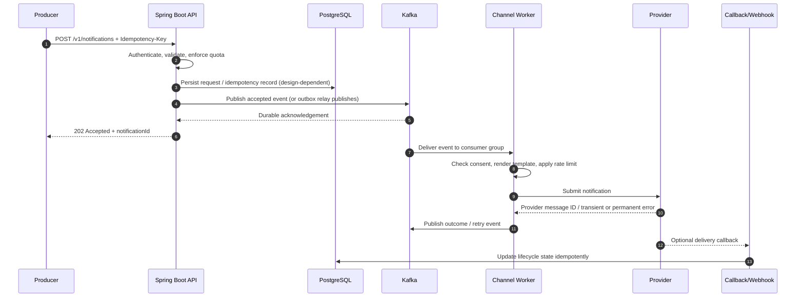

# Production-Grade Notification Platform: 10,000 Notifications per Second

> **Audience:** backend engineers, staff/principal engineers, architects, SREs and technical interview candidates  
> **Reference stack:** Java 21, Spring Boot 3.x, Kafka, PostgreSQL, Redis, Kubernetes, OpenTelemetry  
> **Goal:** design a notification platform that can accept and process a target workload of 10,000 notification requests/second with low latency, fault isolation and operational safety.

---

## 1. Executive summary

Build an **asynchronous, event-driven notification platform**. The API validates and durably accepts requests, then returns `202 Accepted`. Partitioned durable messaging buffers bursts and decouples request ingestion from channel providers. Independently scaled worker pools deliver email, SMS, push, in-app and webhook notifications.

The target of 10,000 notifications/second is a **capacity objective, not a guarantee from the technology choices alone**. It must be validated with representative payloads, provider quotas, regional network behavior, retries, database writes and failure scenarios. Clarify whether the target means:
- 10,000 API requests accepted per second;
- 10,000 logical notifications enqueued per second; or
- 10,000 successful provider submissions per second.

Those are different SLOs. A single request may fan out into multiple channel deliveries, and a provider's accepted message is not proof the end user received or read it.

### Design decisions

- **Durable Kafka log** as the primary buffer and fan-out mechanism.
- **Java 21 + Spring Boot** for API and worker services.
- **At-least-once processing** with idempotency, deduplication and replay-safe handlers.
- **Channel-specific worker pools and quotas** so a slow SMS provider does not stall email.
- **PostgreSQL** for durable business metadata and delivery state; **Redis** for short-lived deduplication, quotas and cache where appropriate.
- **Multi-AZ** deployment, replication, observability, backpressure, circuit breakers, DLQs and tested disaster recovery.
- Avoid synchronous provider calls on the API request path.

## 2. Requirements and SLOs

### Functional requirements
1. Accept single and batch notification requests.
2. Support email, SMS, mobile push, in-app and webhook channels.
3. Template rendering, locale, personalization and channel fallback.
4. Scheduled sends, priorities, tenant quotas and user preferences.
5. Consent checks, unsubscribe/suppression lists and audit history.
6. Delivery lifecycle: accepted, queued, submitting, provider-accepted, delivered/failed where callbacks support it.
7. Retry, DLQ, controlled replay, cancellation when still possible and status lookup.

### Non-functional requirements
- **Throughput:** design target 10,000 logical notification requests/s; benchmark each stage.
- **API latency:** example target p95 under 100 ms for durable acceptance, excluding caller network latency. This is a starting SLO, not a universal promise.
- **Availability:** example 99.9% monthly API availability; define separate SLOs for provider submission and end-user delivery.
- **Durability:** acknowledge only after the event is durably committed according to the Kafka replication/acknowledgement policy.
- **Isolation:** per-tenant quotas, bulkheads per channel/provider, no unbounded queues.
- **Security:** authentication, authorization, encryption, secrets management, PII minimization and audit.
- **Recovery:** define RPO/RTO for Kafka, database and regional outage; test recovery rather than relying on configuration alone.

### Define the unit of work

Use a `notification_request` for the caller's intent and a `delivery` for each destination/channel attempt. If one API request asks for email + SMS, it can create two deliveries. All capacity math should use the actual unit being measured.

## 3. High-level architecture


The SVG above is included beside this Markdown file. Keep the image file in the same directory when viewing the Markdown. GitHub renders Mermaid diagrams too; the SVG provides a quick architecture overview.

### Components and responsibilities

| Component | Responsibility | Scaling strategy |
|---|---|---|
| Load balancer / API gateway | TLS, WAF, authentication, request limits | Horizontal |
| Notification API | Validate, authorize, idempotency, durable enqueue | Stateless replicas |
| Kafka | Durable buffer, replay, ordered partitions | Partitions + brokers |
| Orchestrator / router | Resolve preferences, templates, channel fan-out | Consumer group |
| Channel workers | Provider calls, rate limiting, result handling | Independent per channel/provider |
| PostgreSQL | Request metadata, state transitions, audit references | HA primary/replicas; partition/archive as needed |
| Redis | Short-lived dedupe, quotas, hot preference cache | Cluster/replication; never sole durable record |
| Provider adapters | Normalize vendor APIs and callbacks | Per-provider pool |
| Observability | Metrics, traces, logs, alerting | Shared platform |
| DLQ / retry topics | Isolate poison messages and delayed retry | Partitioned, retention controlled |

**Important:** do not make PostgreSQL a synchronous write bottleneck for every high-volume delivery transition without load testing. Use append-oriented event processing, batched writes, bounded concurrency and suitable partitioning/retention. If the product requires a transactional database write and event publish to be atomic, use a transactional outbox or a carefully designed CDC path.

## 4. Request and delivery flow



### Two safe ingestion patterns

**Pattern A — Kafka is the acceptance boundary:** API validates and publishes the event; returns `202` only after broker acknowledgement. Store request metadata asynchronously or in a way that does not create an unhandled dual-write problem. This keeps the API path lean.

**Pattern B — transactional outbox:** API commits request + outbox row in one PostgreSQL transaction. A relay/CDC process publishes outbox rows to Kafka. Return `202` after the database commit. This gives atomic database intent + publish intent, but acceptance durability now depends on PostgreSQL and relay lag. Do not commit a DB row and separately publish to Kafka without an outbox or equivalent reconciliation mechanism.

Choose one pattern intentionally. Avoid writing to DB and Kafka independently and hoping both succeed.

## 5. Throughput and capacity planning

### First-order math

At 10,000 logical notifications/s:

- Per minute: `10,000 × 60 = 600,000`
- Per hour: `10,000 × 3,600 = 36,000,000`
- Per day at a sustained rate: `864,000,000`

If the average serialized event is 1.5 KB, raw ingress is about **15 MB/s** (about 120 Mbit/s) before replication, protocol overhead, indexes, status events, callbacks and retries. With Kafka replication factor 3, the replicated write volume is roughly 45 MB/s at this simplified level, before overhead. Measure real serialized size and compression ratio.

If the workload is 10,000 **provider submissions/s**, worker capacity must account for provider latency and vendor rate limits. Little's Law gives approximate in-flight work:

`concurrency ≈ throughput × average service time`

For 10,000 submissions/s and 200 ms average provider latency, the theoretical in-flight count is 2,000 concurrent submissions. Add headroom, but do not exceed provider quotas or create unbounded pending requests. Actual concurrency is split across channels, providers and regions.

### Capacity worksheet

| Input | Example / how to choose |
|---|---|
| Sustained rate | 10,000/s |
| Peak multiplier | Measure; e.g. 2–5× short bursts |
| Average event size | Measure p50/p95 serialized bytes |
| Kafka replication factor | Commonly 3 across failure domains |
| Retention | Based on replay window, compliance and cost |
| Consumer processing time | Measure by channel and provider |
| Provider quota | Contractual limit per account/region/sender |
| Retry amplification | Measure under realistic failure rates |
| Headroom | Start with 30–50%, then prove in load tests |
| Availability target | Specify API and each channel separately |

### Partition planning

Do not select a partition count from a generic rule. Benchmark a representative partition count and measure:
- producer throughput and broker disk/network;
- consumer throughput per partition;
- hot-key skew and tenant distribution;
- rebalance duration and recovery behavior;
- ordering requirements.

Use a stable key such as `tenantId` or `notificationId` only when its ordering semantics are needed. A tenant-only key can create hot partitions for large tenants. Randomized or hash-distributed keys improve balance but may sacrifice per-tenant ordering. Prefer separate topics by channel/workload when isolation and retention differ.

## 6. API contract

### Submit a notification

`POST /v1/notifications`

Headers:
- `Authorization: Bearer <token>`
- `Idempotency-Key: <caller-generated-unique-key>`
- `Content-Type: application/json`

Request example:

```json
{
  "tenantId": "merchant-42",
  "recipient": {
    "userId": "user-987",
    "email": "customer@example.com"
  },
  "channels": ["EMAIL", "PUSH"],
  "templateId": "payment-receipt",
  "templateVersion": "12",
  "locale": "en-IN",
  "priority": "NORMAL",
  "data": {
    "orderId": "ord-123",
    "amount": "1499.00",
    "currency": "INR"
  },
  "expiresAt": "2026-10-20T20:00:00Z",
  "metadata": {
    "correlationId": "checkout-abc"
  }
}
```

Response (`202 Accepted`):

```json
{
  "notificationId": "01J...ULID",
  "status": "ACCEPTED",
  "acceptedAt": "2026-10-20T14:00:00Z",
  "statusUrl": "/v1/notifications/01J...ULID"
}
```

Return `202` only when the system's declared durable-acceptance condition is met. A validation or quota failure should return a suitable 4xx response. If the durable buffer is unavailable and the request cannot be safely accepted, fail fast with `503` rather than silently dropping it.

### API design guidance
- Use `POST /v1/notifications:batch` for batch submission with a maximum batch size and payload limit.
- `GET /v1/notifications/{id}` for status.
- `POST /v1/notifications/{id}:cancel` only for work not yet irreversibly submitted.
- Never log access tokens, full message bodies or sensitive recipient details.
- Keep request size bounded; large payloads should be referenced from secure object storage, not embedded in every event.

## 7. Event schema and state model

Prefer a versioned envelope with explicit schema compatibility:

```json
{
  "eventId": "01J...EVENT",
  "eventType": "NotificationAccepted",
  "schemaVersion": 1,
  "occurredAt": "2026-10-20T14:00:00Z",
  "tenantId": "merchant-42",
  "notificationId": "01J...ULID",
  "traceId": "optional-trace-id",
  "payload": {
    "channels": ["EMAIL"],
    "templateId": "payment-receipt",
    "templateVersion": "12",
    "recipientRef": "encrypted-or-tokenized-reference"
  }
}
```

Do not place unnecessary PII or full secrets in Kafka. Use schema registry or equivalent compatibility checks. Prefer immutable event facts; store mutable delivery state separately.

### State transitions

`ACCEPTED → QUEUED → PROCESSING → PROVIDER_ACCEPTED → DELIVERED`

Failure branches:
- `RETRY_SCHEDULED` for transient errors;
- `FAILED_PERMANENT` for invalid recipient/template, blocked consent, or non-retryable provider errors;
- `EXPIRED` when TTL has elapsed;
- `DLQ` for exhausted attempts or malformed/poison messages.

Provider callback semantics vary. A provider's `accepted` response is not the same as `delivered`. Make state transitions monotonic where possible, deduplicate callbacks, and record provider timestamps.

## 8. Java 21 + Spring Boot service design

Suggested repository layout:

```text
notification-platform/
├── README.md
├── docs/
│   ├── architecture.md
│   ├── runbook.md
│   └── adr/
├── docker-compose.yml
├── infra/
│   ├── kafka/
│   ├── kubernetes/
│   └── dashboards/
├── notification-api/
│   └── src/main/java/com/acme/notify/api/
│       ├── NotificationController.java
│       ├── NotificationService.java
│       ├── NotificationRequest.java
│       ├── IdempotencyService.java
│       └── KafkaNotificationPublisher.java
├── notification-worker/
│   └── src/main/java/com/acme/notify/worker/
│       ├── NotificationConsumer.java
│       ├── DeliveryOrchestrator.java
│       ├── ProviderAdapter.java
│       ├── RetryPolicy.java
│       └── DeliveryStateRepository.java
├── notification-contracts/
│   └── src/main/java/com/acme/notify/contracts/
└── load-tests/
    └── k6/
```

Use a multi-module Gradle or Maven build, shared event contracts, and separate deployables for API and workers. The API should not load provider SDKs or perform provider network calls.

### API controller sketch

```java
@RestController
@RequestMapping("/v1/notifications")
@RequiredArgsConstructor
class NotificationController {
    private final NotificationService service;

    @PostMapping
    ResponseEntity<AcceptedNotification> submit(
            @RequestHeader("Idempotency-Key") String idempotencyKey,
            @Valid @RequestBody NotificationRequest request) {
        AcceptedNotification accepted = service.accept(idempotencyKey, request);
        return ResponseEntity.accepted().body(accepted);
    }
}
```

The service implementation must ensure the response is not returned before its configured durable-acceptance boundary. Validate that the idempotency key is scoped by tenant and endpoint, and persist its result long enough to cover client retries.

### Kafka producer principles

- Configure `acks=all`, idempotent producer enabled, and a replication factor/minimum ISR policy aligned with the durability SLO.
- Tune `linger.ms`, batch size, compression and buffer memory using measured latency/throughput. Batching improves throughput but can increase tail latency.
- Bound producer buffers and send deadlines. Surface publish failures; do not swallow exceptions.
- Keep the event small and avoid synchronous per-event metadata lookups.
- Monitor request latency, broker request latency, record errors, under-replicated partitions and producer buffer wait.

Illustrative properties (not universal production tuning):

```yaml
spring:
  kafka:
    producer:
      acks: all
      properties:
        enable.idempotence: true
        compression.type: lz4
        linger.ms: 5
        batch.size: 65536
        delivery.timeout.ms: 120000
        request.timeout.ms: 30000
```

Validate property compatibility with the chosen Spring Kafka and Kafka client versions. A long delivery timeout does not mean API requests should wait that long; enforce a shorter API deadline and define what happens when publish is unresolved.

### Consumer principles

- Use bounded concurrency; size it against partition count and provider quotas.
- Commit offsets only after the message has reached a safe processing boundary. For asynchronous provider calls, define carefully when processing is considered complete and persist enough state to recover.
- Use bounded connection pools and request timeouts.
- Avoid blocking the consumer thread for long retry sleeps. Publish delayed retries to retry topics or use a scheduler designed for it.
- Handle duplicates by stable delivery IDs and idempotent state transitions.
- Pause partitions or reduce fetch/processing when downstream systems are unhealthy.

### Virtual threads?

Java 21 virtual threads can simplify blocking I/O-heavy worker code, but they do **not** increase provider quotas, CPU capacity or downstream throughput. Use bounded concurrency, explicit timeouts, connection-pool limits and rate limiters. Benchmark the chosen HTTP client and SDK; don't launch unlimited virtual threads that queue against a small connection pool.

## 9. Idempotency, duplicates and delivery semantics

A distributed platform cannot generally guarantee exactly-once delivery to an external provider and the end user. A timeout can occur after a provider accepted the request but before the worker received the response.

Use:
1. Client `Idempotency-Key`, scoped to tenant and operation.
2. A durable uniqueness constraint for request acceptance, such as `(tenant_id, idempotency_key)`.
3. Stable `deliveryId` per notification + destination + channel.
4. Idempotent state updates and callback deduplication.
5. Provider idempotency keys where supported.
6. A reconciliation workflow for ambiguous provider timeouts.

Redis can accelerate dedupe but should not be the only record if losing the key could cause duplicate sends. Define TTLs according to retry windows and business semantics.

## 10. Retry, backoff and dead-letter strategy

Classify errors:
- **Permanent:** malformed address, unsupported destination, template error, consent suppression → fail without retry.
- **Transient:** throttling, network reset, provider 5xx → retry with exponential backoff and jitter.
- **Ambiguous:** timeout after submission → query provider status if possible or retry only with provider idempotency/reconciliation safeguards.

Example backoff schedule: `1s, 2s, 4s, 8s, 16s` plus randomized jitter, capped by a maximum delay and message expiry. Respect `Retry-After` and provider-specific policies. Avoid synchronized retry storms.

Use retry topics or a delayed queue; do not busy-loop. After a bounded number of attempts or expiry, move the message to a DLQ with the failure category, attempt count, correlation IDs and a safe payload reference. DLQ replay must be audited, rate-limited and idempotent. Alert on DLQ growth.

## 11. Rate limits, fairness and overload protection

Use layered controls:
- Per-tenant API quotas and burst limits.
- Per-channel/provider submission limits based on contract.
- Token-bucket or leaky-bucket rate limiters.
- Global and regional concurrency limits.
- Circuit breakers for failing providers.
- Bulkheads so each provider has separate thread/connection budgets.
- Queue age/lag thresholds that trigger admission control.
- Priority classes with reserved capacity, avoiding starvation of normal traffic.

When overloaded, return `429` for tenant quota breaches and `503` when the platform cannot durably accept new work. Do not accept unlimited backlog merely because Kafka can store it; queue age, retention, storage and expiry are product constraints.

## 12. Storage model

Illustrative relational tables:

```sql
CREATE TABLE notification_request (
  notification_id  VARCHAR(32) PRIMARY KEY,
  tenant_id        VARCHAR(100) NOT NULL,
  idempotency_key  VARCHAR(200) NOT NULL,
  request_hash     VARCHAR(64) NOT NULL,
  status           VARCHAR(32) NOT NULL,
  created_at       TIMESTAMPTZ NOT NULL DEFAULT now(),
  expires_at       TIMESTAMPTZ,
  UNIQUE (tenant_id, idempotency_key)
);

CREATE TABLE notification_delivery (
  delivery_id       VARCHAR(40) PRIMARY KEY,
  notification_id   VARCHAR(32) NOT NULL,
  tenant_id         VARCHAR(100) NOT NULL,
  channel           VARCHAR(16) NOT NULL,
  provider          VARCHAR(64),
  status            VARCHAR(32) NOT NULL,
  attempt_count     INT NOT NULL DEFAULT 0,
  next_attempt_at   TIMESTAMPTZ,
  provider_message_id VARCHAR(200),
  updated_at        TIMESTAMPTZ NOT NULL DEFAULT now()
);

CREATE INDEX idx_delivery_retry
  ON notification_delivery (next_attempt_at)
  WHERE status = 'RETRY_SCHEDULED';
```

This is a starting point, not a complete migration. Add foreign keys where appropriate, partition large tables by time/tenant based on query patterns, archive old rows, and plan index bloat. At high volume, write amplification and status-update churn can dominate. Consider append-only delivery events plus a compact current-state projection. Avoid a single hot row updated for every event.

## 13. High availability and disaster recovery

- Run API and workers across at least three availability zones where supported.
- Deploy Kafka brokers across failure domains, replication factor 3, `min.insync.replicas` aligned with `acks=all`, and monitor ISR health.
- PostgreSQL: managed HA or tested primary/standby failover, point-in-time recovery and restore drills.
- Redis: use HA/cluster configuration appropriate to workload; treat cache loss as a recoverable event.
- Use Kubernetes disruption budgets, topology spread, readiness/liveness probes and rolling deployments.
- Use multiple provider credentials/accounts only where contractually supported and safe.
- Define regional failover explicitly: active-active can introduce duplicate processing and ordering complexity; active-passive is simpler but has recovery time.
- Document RPO, RTO, data residency, key rotation and regional provider behavior.
- Run game days: broker loss, zone loss, database failover, provider throttling, DNS/network failure, expired credentials and consumer poison message.

## 14. Security, privacy and compliance

- OAuth2/JWT or mTLS for service-to-service access; authorize tenant scope server-side.
- Encrypt transport and storage; use managed KMS/secrets manager and rotation.
- Minimize PII in events, logs, metrics labels and traces. Use tokenized recipient references or envelope encryption where appropriate.
- Enforce consent, opt-out, suppression and quiet hours before sending.
- Use approved templates and escape rendered content to prevent injection.
- Prevent SSRF in webhook delivery: allowlist/validate destinations, block private/link-local/metadata IP ranges, revalidate redirects and defend against DNS rebinding.
- Sign webhook callbacks, verify timestamps, enforce replay protection and use secret rotation.
- Set retention/deletion policies for content, recipient identifiers, provider callbacks and audit records.
- Keep high-cardinality IDs out of metrics labels.

## 15. Observability and SRE

### Golden signals
- **Traffic:** accepted requests/s, deliveries/s, per-tenant and per-channel volume.
- **Latency:** API p50/p95/p99; queue age; provider call latency; end-to-end delivery latency where measurable.
- **Errors:** validation, quota, broker publish, provider 4xx/5xx, callback verification, retries and DLQ.
- **Saturation:** Kafka lag/disk/ISR, CPU, memory, GC, connection pools, DB connections, Redis latency, worker concurrency and provider quota utilization.

### Useful metrics
- `notification_api_accepted_total`
- `notification_api_rejected_total{reason}`
- `notification_publish_duration_seconds`
- `notification_queue_oldest_age_seconds{topic}`
- `notification_consumer_lag{group,topic}`
- `notification_provider_submit_total{provider,channel,result}`
- `notification_provider_latency_seconds{provider,channel}`
- `notification_retry_total{reason}`
- `notification_dlq_depth{channel}`
- `notification_delivery_state_age_seconds{state}`

Keep labels bounded. Never label metrics with user IDs, email addresses, notification IDs or raw exception strings.

### Alerts
- API error rate or p99 breaches SLO.
- Oldest queued message age exceeds delivery objective.
- Consumer lag grows continuously despite autoscaling.
- Kafka under-replicated partitions or ISR below safe threshold.
- Provider throttling/5xx surge, quota nearing exhaustion, or credentials nearing expiry.
- DB connection exhaustion, replication lag or failed backups.
- DLQ depth and retry rate spike.
- Consent/suppression lookup failures (fail closed for legally required checks).

Use OpenTelemetry traces across API → Kafka headers → worker → provider adapter. Sampling should preserve errors and slow traces without producing unbounded telemetry cost.

## 16. Kubernetes deployment principles

- Separate Deployments for API, orchestrator and each channel/provider worker group.
- Autoscale API on CPU/request rate/latency; workers on consumer lag and oldest-message age as well as CPU.
- Scale workers only when provider quotas and DB pools permit it.
- Use resource requests/limits, PodDisruptionBudgets, topology spread, readiness probes and graceful shutdown.
- Terminate consumers gracefully: stop polling, finish or safely hand off in-flight work, then commit only safe offsets.
- Use rolling deployments and schema compatibility rules; avoid deploying incompatible producer/consumer schemas simultaneously.
- Use NetworkPolicies, workload identity, secret mounts and image signing/scanning.
- Avoid scaling all workers from CPU alone: an I/O-bound worker may have low CPU while the queue grows.

## 17. Testing and performance qualification

### Test ladder
1. Unit tests for validation, templates, retry classification, idempotency and state transitions.
2. Contract tests for event schemas and provider adapters.
3. Integration tests using real Kafka/PostgreSQL/Redis-compatible test dependencies.
4. Load test API acceptance and consumer/provider throughput separately.
5. Soak test at target load for hours to expose memory leaks, compaction, GC, connection leaks and backlog growth.
6. Burst test above target; measure time to recover.
7. Fault injection: kill brokers/workers, throttle providers, inject latency and make DB unavailable.
8. DR restore/failover and replay drills.

### Example k6 API load test

This tests **acceptance throughput**, not actual provider delivery. Point it at a dedicated test environment and ensure the producer credentials and test destinations are approved.

```javascript
import http from 'k6/http';
import { check } from 'k6';

export const options = {
  scenarios: {
    notification_ingest: {
      executor: 'constant-arrival-rate',
      rate: 10000,
      timeUnit: '1s',
      duration: '5m',
      preAllocatedVUs: 500,
      maxVUs: 3000,
    },
  },
  thresholds: {
    http_req_failed: ['rate<0.001'],
    http_req_duration: ['p(95)<100'],
  },
};

export default function () {
  const key = `${__VU}-${__ITER}-${Date.now()}`;
  const payload = JSON.stringify({
    tenantId: 'load-test',
    recipient: { email: 'approved-test-inbox@example.com' },
    channels: ['EMAIL'],
    templateId: 'load-test-template',
    data: { message: 'load test' },
  });

  const response = http.post(
    `${__ENV.BASE_URL}/v1/notifications`,
    payload,
    {
      headers: {
        'Content-Type': 'application/json',
        'Authorization': `Bearer ${__ENV.TOKEN}`,
        'Idempotency-Key': key,
      },
      timeout: '5s',
    },
  );

  check(response, {
    'accepted or intentionally throttled': (r) =>
      r.status === 202 || r.status === 429,
  });
}
```

At 10,000 iterations/s, the load generator itself must be distributed and sized. A single k6 process may not generate the required load. During a capacity test, count 429s separately; they are not successful acceptance. Tune the thresholds and test data for the declared SLO.

### Capacity acceptance checklist
- [ ] Sustains target rate for a defined soak duration with no growing backlog.
- [ ] Meets API p95/p99 SLO while Kafka and downstream services are healthy.
- [ ] Recovers from burst load within a defined time.
- [ ] Provider throttling does not cause retry storms.
- [ ] Duplicate producer requests do not create duplicate logical deliveries.
- [ ] Broker/zone failure behavior matches durability SLO.
- [ ] DLQ replay is bounded and auditable.
- [ ] No PII leakage in logs/metrics/traces.
- [ ] Cost per million notifications is measured by channel and region.

## 18. Operational runbook

### Queue lag rising
1. Check oldest message age, lag by partition and arrival rate versus completion rate.
2. Check provider quota, error rates, latency, circuit breaker state and credentials.
3. Check consumer rebalances, hot partitions, worker CPU/GC and DB pool saturation.
4. Scale workers only if provider quotas and downstream pools allow it.
5. If provider is unhealthy, stop retry storms, defer work and apply admission control.
6. Communicate delivery delay and monitor backlog drain rate.

### Provider outage
1. Open/confirm incident; check provider status and other regions/accounts.
2. Open circuit breaker and stop aggressive retries.
3. Move transient work to delayed retry with jitter and expiry.
4. Fail over only if configured, contractually allowed and idempotency behavior is understood.
5. Reconcile ambiguous submissions before replaying.
6. After recovery, ramp traffic gradually and watch quota and queue age.

### Duplicate deliveries reported
1. Trace `notificationId`, `deliveryId`, provider message ID and idempotency key.
2. Check API retries, broker redelivery, offset commits, provider timeouts and callback duplication.
3. Determine whether provider accepted the first request before timeout.
4. Fix at the boundary where idempotency is missing; replay only after reconciliation.

## 19. Architecture choices and trade-offs

| Choice | Benefits | Costs / risks |
|---|---|---|
| Kafka | High throughput, replay, consumer isolation | Operational complexity, partition planning |
| Managed queue service | Less broker operations | Vendor limits, semantics and cost vary |
| PostgreSQL | Strong metadata constraints and queries | High write volume can bottleneck |
| Redis | Fast counters/cache/dedupe acceleration | Volatile state and consistency pitfalls |
| Separate channel workers | Failure and scaling isolation | More deployables and operations |
| Multi-region active-active | Lower regional latency, regional resilience | Harder dedupe, ordering, routing and DR |
| Provider fallback | Better availability | Duplicate risk, compliance and cost complexity |

Kafka is a strong default for a high-throughput event platform, but a managed queue can be the better choice when the team wants less operational overhead and its throughput/ordering/retention features satisfy requirements.

## 20. Recommended implementation roadmap

**Phase 1 — Correctness first**
- Define delivery semantics, SLOs, channel scope, consent and idempotency contract.
- Build API, schema, durable enqueue, one channel worker, status lifecycle and DLQ.
- Add metrics, tracing, security and a minimal runbook.

**Phase 2 — Prove throughput**
- Run realistic load tests and establish per-partition, per-worker and provider limits.
- Tune batching, compression, concurrency, DB writes and indexes.
- Test sustained load, bursts, provider throttling and broker failures.

**Phase 3 — Production hardening**
- Add multi-AZ deployment, autoscaling on lag/queue age, quotas, circuit breakers, outbox/reconciliation if required.
- Add consent/suppression, template versioning, callback verification, retention and privacy controls.
- Run failover and restore drills.

**Phase 4 — Scale and optimize**
- Isolate hot tenants and expensive channels.
- Introduce regional routing or multiple providers where justified.
- Optimize cost per million notifications, provider mix, event size and storage retention.

## 21. Production readiness checklist

- [ ] Acceptance boundary documented and implemented consistently.
- [ ] No DB/Kafka dual-write gap; outbox or equivalent recovery exists where needed.
- [ ] Idempotency keys are tenant-scoped, durable and tested.
- [ ] At-least-once processing and external duplicate risks are documented.
- [ ] Provider quotas, concurrency and timeout budgets are configured.
- [ ] Retry/backoff/expiry/DLQ and replay procedures are tested.
- [ ] Consent, unsubscribe and quiet-hour policies are enforced.
- [ ] Kafka, DB and Redis are deployed with appropriate HA and backup/recovery.
- [ ] Metrics, traces, dashboards and actionable alerts exist.
- [ ] SLOs and error budgets are agreed with product stakeholders.
- [ ] Security review includes webhook SSRF, PII and secrets.
- [ ] Load/soak/failure tests demonstrate target throughput with headroom.
- [ ] RPO/RTO and regional recovery have been exercised.

## 22. Final recommendation

Start with a **stateless Spring Boot API → durable Kafka acceptance → independent channel consumer groups → provider adapters**, with PostgreSQL for durable business state and Redis only for acceleration. Choose either Kafka as the acceptance boundary or a transactional outbox, not an unprotected dual write. Design for at-least-once processing, idempotent state changes, provider-aware retries, consent checks and explicit backpressure.

The most important optimization is not a JVM flag: it is keeping provider I/O off the API path, bounding every queue and concurrency pool, preventing retry amplification, and measuring the full path under realistic failure conditions. Do not claim the platform meets 10,000/s until a repeatable benchmark proves it at the required latency, durability and availability levels.

---

## Further reading

- Java virtual threads: https://openjdk.org/jeps/444
- Spring for Apache Kafka: https://docs.spring.io/spring-kafka/reference/
- Apache Kafka documentation: https://kafka.apache.org/documentation/
- OpenTelemetry: https://opentelemetry.io/docs/
- Kubernetes probes: https://kubernetes.io/docs/concepts/configuration/liveness-readiness-startup-probes/
- k6 constant-arrival-rate executor: https://grafana.com/docs/k6/latest/using-k6/scenarios/executors/constant-arrival-rate/
